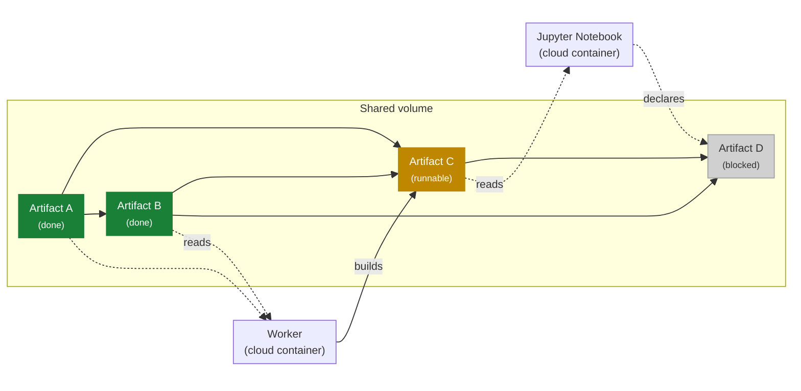

# launchpad

Launchpad turns a training pipeline into a dependency graph of artifacts and
runs it on worker containers in the cloud, each with the resources it needs.
Every result traces back to exactly what produced it, and a step that fails
mid-training restarts from its latest checkpoint. Any model you can express in
[PyTorch](https://pytorch.org) can be built this way.

## The idea in one minute

Suppose we want artifact D, any item in a training pipeline: a dataset, a
tokenizer, a trained model. D is built from other artifacts, which must exist
first. Each artifact names its parameters and the artifacts it is built from,
so declaring D in a notebook is enough: launchpad resolves the graph beneath
it, keeps every artifact on a shared volume, and builds the missing ones on
cloud containers.

```python
import lab

a = ArtifactA(size=10)
b = ArtifactB(scale=2.0, a=a)
c = ArtifactC(steps=100, a=a, b=b)
d = ArtifactD(threshold=0.5, b=b, c=c)

report = lab.declare(d, commit=True)  # A and B are done, C already declared, D new
```



*Four artifacts on the shared volume, each arrow running from an artifact to
one that depends on it. A and B are done, so C, which needs both, is runnable,
and a worker container reads them to build it. D waits on C, so it is blocked. The
notebook declared D and reads C back from the volume.*

- An **artifact** is a pipeline item we want to exist: a text source, a
  tokenizer, a tokenized dataset, a pre-training stage, or any other post-training stage such as instruction fine tuning, reinforcement learning or evaluations.
- An artifact is fully specified by its parameters and its **dependencies**,
  which are other artifacts. A pre-training stage names a dataset, the dataset
  names a tokenizer, the tokenizer names its sources.
- You describe a whole pipeline as artifacts in a **[Jupyter notebook](https://jupyter.org)**.
  Launchpad runs distributed workers on the cloud that build every artifact in
  dependency order, never repeating work, with provenance and reproducibility
  kept ([Lab](docs/lab.md)).
- Finished artifacts live on the **volume**, so any item in the pipeline can be
  loaded into memory and inspected: weights, activations, attention maps,
  generations from a checkpoint. You can compare runs side by side and
  aggregate results across them.

## Docs

Everything about how it works is in the docs, under `docs/`:

```bash
uv sync
mkdocs serve        # http://127.0.0.1:8000
```

A deployed app (`mkdocs build --strict && modal deploy main.py`) also serves them at `/guide/`. Start
with [docs/framework.md](docs/framework.md), then [docs/getting-started.md](docs/getting-started.md).
