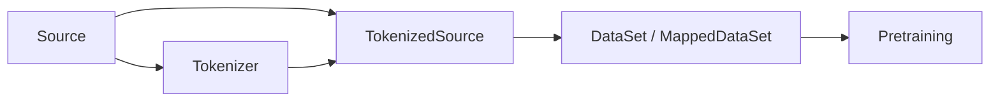

# Artifact Repository

These are the worked examples of the framework: each family is a real use case that shows what an artifact, a job and a dependency chain can express. Every artifact family defined under `artifacts/`, one page each, except
`artifacts/core`, which is the machinery they share ([Artifacts](artifacts.md),
[Training a Model](training.md)). A family is a folder holding the artifact
class in `__init__.py` and, beside it, the job that produces it in `jobs.py`.

| Family | Artifact | Folder on the volume | Produces |
| --- | --- | --- | --- |
| [Sources](artifact-repository/sources.md) | `Source`, `SourceURL` | `sources/<name>/` | Raw text. |
| [Tokenizers](artifact-repository/tokenizers.md) | `Tokenizer` (BPE, template) | `tokenizers/<uid>/` | A trained `tokenizer.json`. |
| [Tokenized](artifact-repository/tokenized.md) | `TokenizedSource` | `tokenized/<tokenizer>/<source>/` | One source's token ids. |
| [Dataset](artifact-repository/dataset.md) | `DataSet` | `datasets/<uid>/` | Concatenated train and valid token files. |
| [Mapped dataset](artifact-repository/mappeddataset.md) | `MappedDataSet` | `mappeddatasets/<uid>/` | Nothing; a view over tokenized sources. |
| [Stages](artifact-repository/stages.md) | `Pretraining` | `runs/<run_id>/pretraining/...` | A training leg and its checkpoints. |

The chain runs left to right: a source is tokenized, tokenized sources make a
dataset, a dataset feeds a training leg.

Families never import functions or constants from one another; the only thing
one takes from another is an artifact class to name as a dependency type
([Artifacts](artifacts.md#defining-a-family)). A new family also means a page
under `docs/artifact-repository/`, a row above, and a nav entry.
