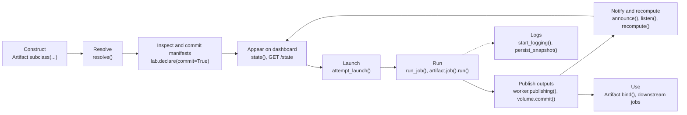
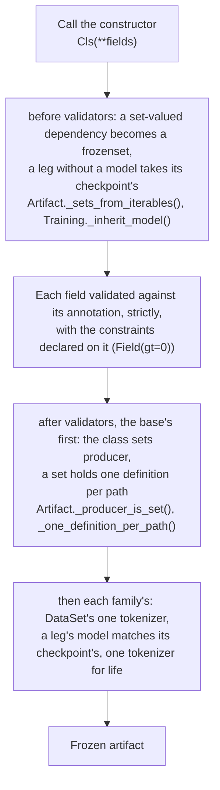
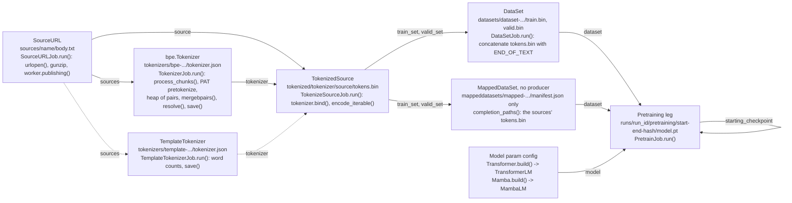

# Artifacts

An artifact is an immutable definition of something that should exist: a
class and its typed fields. Some of those fields are other artifacts, the ones
it is built from; the rest are its parameters. Every artifact owns a folder on
the volume, derived from its definition, and a `manifest.json` in it that
rebuilds it ([Manifests](manifests.md)). `Artifact` is the abstract base, a
pydantic model; calling a concrete subclass constructs one:

```python
source = SourceURL(name="odyssey", url="https://example.org/odyssey.txt")
tokenizer = Tokenizer(          # artifacts.tokenizers.bpe.Tokenizer
    vocab_size=1000,
    special_tokens=("<pad>",),
    sources=(source,),
)
tokens = TokenizedSource(tokenizer=tokenizer, source=source)
```

Defining an artifact reads no storage and does not require it to exist.

## Lifecycle

The whole path of one artifact, from a notebook cell to a bound object:



## Defining a family

Each concrete type belongs to a family: a package under `artifacts/` holding
the artifact class and, in a sibling `jobs.py`, the job that produces it.
Families never import functions or constants from one another; the only thing
one family takes from another is an artifact class to name as a dependency
type. A concrete type defines:

| Member | Contract |
| --- | --- |
| Fields | Every declared input that determines the result: parameters, and the artifacts it is built from. |
| `uid` | A type-specific label derived from the fields. |
| `artifact_path` | The unique path relative to storage, derived from the fields, usually through `uid`. |
| `files` | A mapping from output names to the filenames this artifact owns. |
| `producer` | A class-level dotted path to its `Job`, or `None` for an artifact that writes no outputs. |
| `declaring_commit` | The commit that declared its manifest, stamped by `lab.declare` and `None` until then; excluded from identity ([Manifests](manifests.md#recorded-fields)). |
| `allocated_resources` | Recorded execution allocation, excluded from identity. `None` on a dependency decoded from a parent's manifest, which records it at its own path. |
| `tags` | Labels to find the artifact by, a dict of `str` to `list[str]` such as `{"experiment": ["lr_study"], "project": ["language_modeling"]}`; `{}` by default. Excluded from identity, and `None` on a dependency decoded from a parent's manifest. The dashboard filters on them ([Dashboard](dashboard.md#filtering)). |

Paths, files, producers and dependency lists are derived; they are not
constructor arguments or separately persisted state. Artifact modules stay
free of torch and numpy; resolving a producer imports its job only when it
runs.

A parameter that is itself structured, such as a leg's training parameters or
its model, is a **param config**: a `ParamConfig` subclass, validated and
frozen like an artifact and part of its identity, but with no folder, manifest
or job of its own ([Models](models.md), [Training a Model](training.md)).

## Construction

Every artifact and param config shares one pydantic config, `STRICT`: frozen,
unknown fields refused, NaN and infinity refused, and strict about types.
Constructors take keywords only. Constructing an artifact runs, in order:



What strict validation does with a value:

- An `int` in a `float` field is stored as that float, so `max_norm=1` and
  `max_norm=1.0` are one artifact with one path. An int too large for a float
  to hold exactly is rounded, as `float()` would.
- Everything else that would need converting is refused with a
  `ValidationError` naming the field: `True` in an `int` field, `"0.5"` in a
  `float` field, a `list` where a `tuple` is declared.
- `-0.0` is kept as given; its manifest writes `0.0`, so it lands at the same
  path as `0.0` ([Manifests](manifests.md#canonical-text)).

An instance passed into a field is kept as given, never validated again: it
was validated when it was built and cannot have changed since. That is why a
definition is never changed by a call that skips validation:
`model_construct`, `model_copy(update=...)` (which also keeps cached
properties, so a copied leg would keep its old `lineage_hash` and path) or
`object.__setattr__`. A changed definition is a new construction:
`type(a)(**dict(a) | changes)`. `model_copy` is used for exactly one thing,
replacing a recorded field.

## Dependencies and parameters

A field is a dependency when its annotation is one of four shapes with only
artifact types inside: `A`, `A | B | None`, `tuple[A, ...]` or
`frozenset[A]`. Every other field is a parameter. The rules, each with the
failure it prevents:

1. **An artifact type anywhere else is refused.** Only these shapes are
   followed by `resolve`, the codec and `lab.declare`. An artifact inside a
   param config would be written as plain fields, get no manifest or folder of
   its own, and leave its parent's manifest undecodable.
2. **An unordered collection of dependencies is a `frozenset`.** Fields compare
   in order, so as tuples `sources=(a, b)` and `sources=(b, a)` would be
   unequal, and redeclaring a tokenizer with its sources listed the other way
   would be a conflict at its own path. As a set they are one definition, one
   manifest, written in one order.
3. **An ordered collection is a `tuple`, never a `list`.** `DataSet`
   concatenates its sources in order, so order is part of what it is. A list is
   unhashable, and mutable under a frozen artifact.
4. **A field is classified by its annotation, never its value.** An empty
   `sources=frozenset()` and `starting_checkpoint=None` are still dependencies,
   written as `[]` and `null`, so a class always writes manifests of one shape.
5. **Any iterable becomes a `frozenset` before validation.** Strict mode alone
   would refuse `sources=(valid,)`, which declarations pass.
6. **A set may not hold two members at one path.** Two `SourceURL`s named
   `odyssey` with different URLs are unequal, so a set keeps both, yet both
   own `sources/odyssey`. The set is refused at the line that built it.
   Members differing only in `declaring_commit` are equal and collapse to one,
   the first passed.

What a parameter may hold is checked when a class is first used, by
`Artifact.dependencies()`: scalars, `Literal`s, tuples and param configs, and
inside a param config the same, field by field. `list`, `dict`, `set`,
`frozenset`, `Any` and `object` are refused with a `TypeError`, because
decoding turns every JSON array into a tuple, and hashing needs every value
hashable. The check runs at first use rather than at class creation because a
field annotated with a class defined later in its module is only resolved
then.

## Identity and agreement

Keep three questions distinct:

1. **Same identity:** two artifacts compute the same `artifact_path`. Identity
   is always written as `artifact.artifact_path`, never as `==`. It is what
   deduplication, lease keys, manifest locations, and every map of artifacts
   key on.
2. **Same definition:** concrete type, parameters, and dependency definitions
   agree recursively. `declaring_commit`, `allocated_resources`, `tags` and bound
   state are excluded at every node. **This is what `==` and `hash()` mean**: `Artifact`
   overrides both to compare its fields except the recorded ones, so an
   artifact rebuilt from an older manifest is still the same artifact. Binding
   does not change equality.
3. **Same provenance or allocation:** the recorded fields agree.

Equal artifacts have equal paths and equal definitions in their manifests, but
their complete manifests may differ in the recorded fields. Declaration and
resolution therefore check agreement with `==`, never by comparing manifest
text, and always between two artifacts already known to share a path: a
manifest read from that path, or a second route reaching it during traversal.
Sharing a path is never evidence of agreement: two sources named `odyssey`
with different URLs land on one path, compare unequal, and must conflict.

Anything rendering a set as a sequence (a digest, a JSON array, a traversal, a
job's input stream) picks an order at that point. Those orders are renderings,
never comparisons.

## Location and ownership

`artifact_path` is a nonempty, normalized relative path, and `load` refuses
one that is absolute or climbs out of its root. Owned filenames are unique
bare filenames, excluding `manifest.json` and the temporary names publication
derives from them. This keeps nested artifacts independent:

```text
root/
  sources/odyssey/
    manifest.json
    body.txt
  tokenizers/<tokenizer-uid>/
    manifest.json
    tokenizer.json
  tokenized/<tokenizer-uid>/odyssey/
    manifest.json
    tokens.bin
```

`TokenizedSource.artifact_path` is `tokenized/<tokenizer-uid>/<source-uid>`:
its own root, grouped by tokenizer, never inside the tokenizer's folder. Leases
use exact artifact paths; owning a directory does not grant ownership of
artifacts beneath it.

Path encodings are a storage compatibility contract: changing them requires an
explicit migration. Readable names and short hashes may collide; consistency
checks detect conflicting definitions at a shared path rather than assuming
the encoding is collision-free.

A virtual artifact owns no files and has no job (`producer = None`). It is
complete when the dependency files it reads exist (`completion_paths`), and it
is never launched.

## Resolution

`resolve(artifact)` returns every artifact a request is built from and then
itself, dependencies before dependents, each path once. It walks `deps()`
depth-first: dependency fields by name, set members by artifact path, so the
order never depends on set iteration.

- A path revisited on the active traversal stack is a cycle and raises.
- A repeated path must hold an `==` definition before it is deduplicated, so a
  shared path cannot hide a conflicting leaf.
- Of agreeing duplicates, the first object reached is kept, recorded fields
  included.

Resolution reads no storage and makes no launch decisions. An artifact shared
by several requests or runs is one path, declared once and built once.

```python
for artifact in resolve(tokens):
    print(artifact.artifact_path)
# sources/odyssey
# tokenizers/<tokenizer-uid>
# tokenized/<tokenizer-uid>/odyssey
```

## Families

What each artifact is built from and the job that fills it. An arrow is a
dependency field; the label is the field name.



`DataSet.from_sources(tokenizer, train_sources, valid_sources)` and
`MappedDataSet.from_sources(...)` build the middle of that graph from raw
sources: one `TokenizedSource` per source, then the dataset over them.

## Why

**`==` is definition equality, not a separate method.** `resolve`, `bind` and
`lab.declare` all ask whether two artifacts are the same definition. A second
method beside `==` would leave each of them to remember to call it, and the
one that forgot would turn a declaring commit difference into a conflict. Set-valued
dependencies need a `hash` that agrees with it, so both are overridden
together.

**One strict config, on two bases.** A pydantic config does not reach the
models nested in a field, so each base, `Artifact` and `ParamConfig`, sets
`STRICT` itself and every subclass inherits it: a new family or architecture
cannot end up with pydantic's lax defaults by forgetting a line. `Artifact`
does not subclass `ParamConfig`, since an artifact is not a parameter.

## Reference

::: artifacts.core.artifact

::: artifacts.core.resolve
