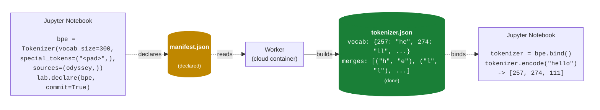

# How it fits together

Three things describe every step of a pipeline, and each answers one question:

| | What it is | Answers | Page |
| --- | --- | --- | --- |
| **Artifact** | A frozen Python object: a class and its typed fields, some of them other artifacts. | What should exist? | [Artifacts](artifacts.md) |
| **Manifest** | That definition as JSON, in the artifact's own folder on the volume. | What was asked for? | [Manifests](manifests.md) |
| **Job** | The code that writes the artifact's files. | How is it made? | [Jobs](jobs.md) |

Whether an artifact exists is none of the three: it exists when its completion files are in
its folder.

## One artifact, start to finish

*One tokenizer's two files, both in its folder on the shared volume,
`tokenizers/bpe-300-88cd7fb37c/`. The notebook defines `bpe` and declares it, writing its
manifest. A worker the launcher starts reads the manifest, rebuilds the tokenizer and trains it,
writing `tokenizer.json`. Binding loads that file's vocabulary and merges, and `encode` returns
the ids they give: `"he"` is 257, `"ll"` is 274, `"o"` is 111.*

1. **Construct.** Building an artifact reads no storage. Its fields fix its folder,
   `artifact_path`, so equal definitions name one folder, whoever asks for them.
2. **Declare.** `lab.declare` resolves the graph beneath it, dependencies first, and writes the
   manifest of each artifact not yet declared ([Lab](lab.md#declaration)). A manifest is
   written once: declaring the same definition again only adds tags, and a different definition
   at that path is refused.
3. **Launch.** Launching is by hand, per artifact, from the dashboard. The launcher reads
   manifests, never a notebook's objects, and refuses an artifact that has no job, is complete,
   or has a dependency that is not ([Launcher](launcher.md#launching)). The worker rebuilds the
   artifact from its manifest and imports its job only then, from the artifact's `producer`.
4. **Run.** The job is given the artifact and nothing else: its inputs are the artifact's
   dependencies. It writes only inside the artifact's folder, and publishes each completion file
   whole, under the call's lease.
5. **Bind.** `bind()` reads the manifest back, checks it holds the same definition, checks every
   completion file is there, and loads the files onto a fresh copy.

The three artifacts the reference pages use, and the folders they own. One nests under another's
prefix and is still its own:

| Artifact | Folder | Files |
| --- | --- | --- |
| `odyssey = SourceURL(name="odyssey", url=...)` | `sources/odyssey/` | `manifest.json`, `body.txt` |
| `bpe = Tokenizer(vocab_size=1000, sources=(odyssey,), ...)` | `tokenizers/bpe-1000-d44bf6191c/` | `manifest.json`, `tokenizer.json` |
| `tokens = TokenizedSource(tokenizer=bpe, source=odyssey)` | `tokenized/bpe-1000-d44bf6191c/odyssey/` | `manifest.json`, `tokens.bin` |

## What each never does

- An **artifact** never reads storage to be built or compared, and its module never imports
  torch, numpy or its job.
- A **manifest** never selects code. A job runs whatever is deployed, so a code change takes
  effect after `modal deploy`; `declaring_commit` records the declaration, not what ran.
- A **job** never creates its folder or manifest, never writes outside them, and never replaces a
  file it published.

## Failure and recovery

- A failed or cancelled call leaves every published file in place, and the artifact stays
  launchable. A failed attempt is never reported as success, and nothing retries on its own: you
  relaunch.
- A relaunch of a partial artifact keeps what is consistent with the definition and publishes the
  rest. A training leg resumes from its newest checkpoint
  ([Training a Model](training.md#interrupting-and-resuming)).
- Deleting outputs is an explicit operation outside jobs, and invalidates nothing downstream.

## Why

| Choice | Why |
| --- | --- |
| A folder that is a pure function of the definition | Equal requests share one folder, so nothing is built twice; two different definitions at one path are caught by `==`, not overwritten. |
| One job per artifact class, named by a dotted string | Declaring, resolving and drawing a graph never import torch, numpy or a family's jobs; only the worker about to run one does. |
| A job's inputs are its artifact's dependencies | They are declared once, so what a job reads cannot drift from what its artifact names. |
| Dependency definitions embedded in a manifest | A manifest decodes and compares on its own, without reading other folders. Long chains make large manifests, which a decoding memo keeps cheap. |
| Recorded fields at a manifest's root only | An embedded definition is exactly a definition, so two equal dependencies embed as the same bytes in any parent, and each commit is the one its own artifact was declared at. |
| A param config's class written only where a subclass stands | Without it a subclass would be written as its base, silently; with it everywhere, renaming any param config would break every manifest. |
| The codec and the manifest files in separate modules | The codec stays a pure function of dicts, tested with no folder; one module owns the file layout, the path checks and their errors. |
