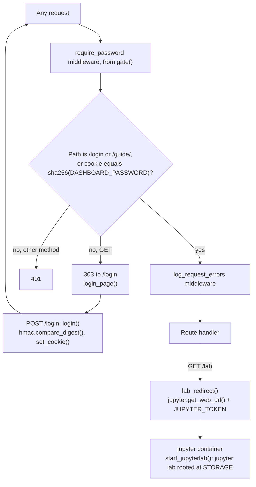
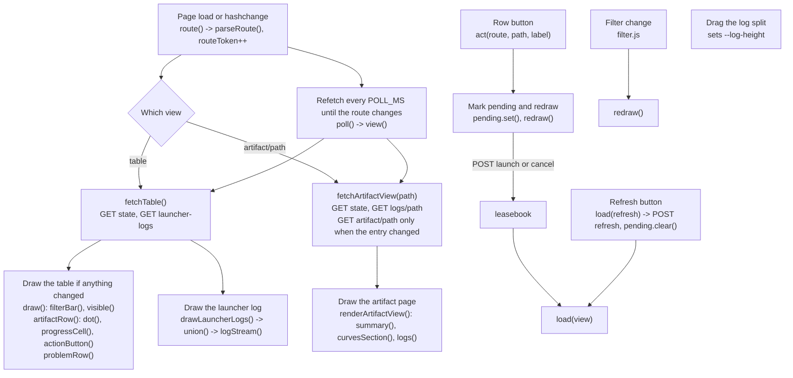

# Dashboard

The dashboard is one page served by the launcher (`leasebook`): a table with
one row per artifact on the volume, a live launcher log under it, and a page per
artifact. No build step, no bundler, no framework.

## Access

The dashboard and the lab are public URLs, so both sit behind one Modal secret,
`launchpad-lab` ([Getting started](getting-started.md#setup)), which both
containers mount and neither starts without.

- Every dashboard route but `/login` and `/guide/` wants a cookie. Without one,
  a navigation lands on the login page (one field, `web/login.html`), which
  takes `DASHBOARD_PASSWORD`, yours to pick since it is the one a person types,
  and leaves a cookie holding its digest; neither the password nor a session
  list is stored anywhere. A request other than a navigation gets a 401.
- JupyterLab takes `JUPYTER_TOKEN` instead, which nobody types: the header's
  `/lab` link carries it, and since it travels in a URL it stays a random
  string.
- `/guide/` is these docs, built by MkDocs from `docs/` and `mkdocs.yml` into
  `web_image` on every deploy and linked from the header. The build is given
  the source of every module a page renders with `:::` (`main.DOCS_SOURCE`),
  which mkdocstrings reads without importing; a page that renders a module
  missing from that list fails `test/test_guide.py`.

## Files

`web/index.html` loads `web/app.js` as an ES module; everything else is
imported from there. The page is served as static files by the same ASGI app
that answers the API, so its fetches are same-origin relative paths, with no
URL to configure and no CORS.

- **`app.js`**: the only file that touches the network: routing, fetching,
  launching, log polling, pending buttons and the launcher log's filter
  choices. Rendering modules receive data and give back DOM.
- **`render.js`**: the artifact row and its cells.
- **`artifactview.js`**: one artifact's page: its type, parameters and
  dependency links, its training curves when its job keeps a step log, and
  every call's log.
- **`filter.js`**: the filter bar over the table and which rows pass it.
- **`logview.js`**: shared timestamp formatting, level filters and safe log
  rows, for artifact streams and the launcher panel alike.
- **`el.js`**: the one DOM-building primitive everything else uses,
  `el(tag, props, ...children)`, so text always goes through `textContent`,
  never `innerHTML`.

Routing is hash-based and client-side, two shapes (`parseRoute`): `""`, the
table, and `#/artifact/<path>`, one artifact's page. `route()` runs on every
`hashchange` and once at load: it switches the page, points `view` at it,
fetches it once and starts its poll.

## The table

One row per artifact on the volume, by path, from one endpoint, `/state`
([Launcher](launcher.md#the-state-map)). There is no grouping by run, source or
dataset; a manifest the state map could not read lands in the collapsed
"unreadable manifests" table under it.

Four columns: the artifact (its status dot and type), its path, its progress,
and the button. Which call holds it and when that call last beat are the hover
of the artifact's label, not columns: both are long, and neither is what the
table is read for at a glance. Progress takes whatever width the others leave;
what still overruns it truncates, with the whole of it on hover.

The page is two frames: the table above and the launcher's log below, with a
boundary between them that drags. The log takes a fifth of the window until
someone drags it; each frame scrolls on its own, and a drag lasts as long as
the page. An artifact's page carries its own calls' stream, so the bottom frame
is not shown there.

Launcher log lines are one each: time, call, source, level, message, newest
first, with the logger name on the message's hover. The panel is the whole
account of what the launcher container did, so it holds what it did to the
calls it manages too: each line names its call (a short id, or `launcher` for
the container's own) and its source. Level checkboxes work like the artifact
page's: DEBUG starts off, and selections survive polls and navigation. The
noise around the launcher (uvicorn, grpc) is its `ambient` source, under an
**ambient** box, on by default.

### Filtering

Above the table, the filter bar walks an artifact's manifest one level of its
JSON at a time, read off the `/state` map with no request of its own. The top
level is the artifact's class, "every artifact" to begin with. Picking one
keeps only its rows, all the same shape from there down, and shows two
filterable keys, both closed:

- **parameters**: the manifest's `parameters` as they nest (`training_parameters`,
  `model`, `model.d_model`, down to `batch_size`).
- **dependencies**: every dependency's path across the rows, which is how a leg
  is filtered by the dataset it trains on.

Every key is a level, closed until clicked. One holding an object opens onto its
keys; any other is a leaf, shown with the number of distinct values it holds
(more than one is a tuned parameter), and opens onto those values: a min/max
range when all are numbers, blank for an open end, and a checkbox per value
otherwise. Only an open level filters: closing one closes every level under it
and drops their choices. Within a leaf any checked value matches; across leaves
every leaf has to; a row without the leaf never does. The choices live in the
page's memory and survive polls, and the bar is rebuilt only when the class,
the open levels or the manifests under them change. There is no filter by
status. Unreadable manifests ignore the filters.

## Fetching

**The page mirrors the server and decides nothing.** It refetches the current
view every `POLL_MS` (2 seconds) and redraws what changed, so a row walks
`runnable`, `starting`, `running`, `done` on its own, a tick behind the server.

- The table fetches `/state` and `/launcher-logs` each tick. Rows are rebuilt
  only when the map or the page's pending marks differ from what is on screen,
  so an idle table never rebuilds under the reader, while a row with a job
  running does, since `/state` reads that call's beat per request.
- An artifact's page fetches `/state` and `/logs/<path>` each tick, and
  `/artifact/<path>`, the one route that reads a file on the server's mount,
  only when that artifact's entry has changed.
- A tick that fails keeps the last screen up, shows the error and tries again.
  `routeToken`, bumped on every navigation, is checked by both the fetch and
  the polling loop, so an answer for a view the reader has left is dropped and
  the old loop stops itself. Coming back from an artifact's page redraws at once
  from the last payload, then fetches.

The header's refresh button is the manual reload, for what nothing announces: a
manifest declared from the lab. It POSTs `/refresh` and refetches; it shows
green after a good answer, and the error in red after a bad one.

## Row buttons

One button per row, offering the one thing worth doing (`actionButton`), asked
in this order:

| The artifact | Button | Route |
| --- | --- | --- |
| is done | *run*, frozen | |
| has a call running | **stop** | `POST /cancel/<path>` |
| has verdict `starting` | *starting*, blue and disabled | |
| is ready | **run** | `POST /launch/<path>` |
| is blocked | *run*, frozen | |

`done` is asked first because it is the one answer that cannot be undone;
everything after it is a claim about now, and a claim can lag. The button
reflects server state directly. The one piece of local state, `pending`,
covers the round trip only: a clicked button turns blue and disabled and reads
`starting` (or `stopping`) until the server answers, and the server recomputes
before answering, so the next fetch already knows what was asked for.

A cancelled row goes back to **run** at once, since the lease is what `/cancel`
removes; the container can still be finishing for seconds afterwards, and a run
clicked in that gap grants a second call ([Launcher](launcher.md#cancelling)). A
call granted but not yet beating reads `starting`, with a blue dot, for
`STARTUP_GRACE_SECONDS` (60); after that, with still no beat, it reads
`failed`, red, and offers run again if the artifact is ready. For a call the map
found under way, `/state` reads its grant and beat on each request, so an
expired grace or a container killed hard reaches the row on the next poll.

## The artifact page

`#/artifact/<path>` shows the artifact's manifest as the server's mount holds
it: its type, then a row each for its declaring commit, its allocated resources and its
own parameters, and one link per direct dependency. Dependencies are named, not
inlined: clicking one navigates to its page. A path with no entry is a message,
not an error.

When its job keeps a step log, the page draws it: one uPlot chart per metric,
training and validation loss sharing one with validation dashed, one line per
metric per attempt, every row of `train.jsonl` as last read off the volume.
Drag to zoom, click a legend entry to hide a line.

Below that, what every call that ever worked on the artifact said, as one
stream newest first, each line tagged with its call (a short id, the full one on
hover) and its level, timestamps in the reader's zone with the full instant on
hover. A call's last heartbeat is a line too. DEBUG starts off; an **ambient**
box, on by default, hides what the container logged around the call. Each call
arrives with its log in both storages and the page counts each row once
([Logging](logging.md)).

## Known inefficiencies

- A recompute snapshots every historical beat record. Nothing prunes old ones
  from the Dict, so `state()`'s cost grows with the deployment's total call
  history, not its current active calls.
