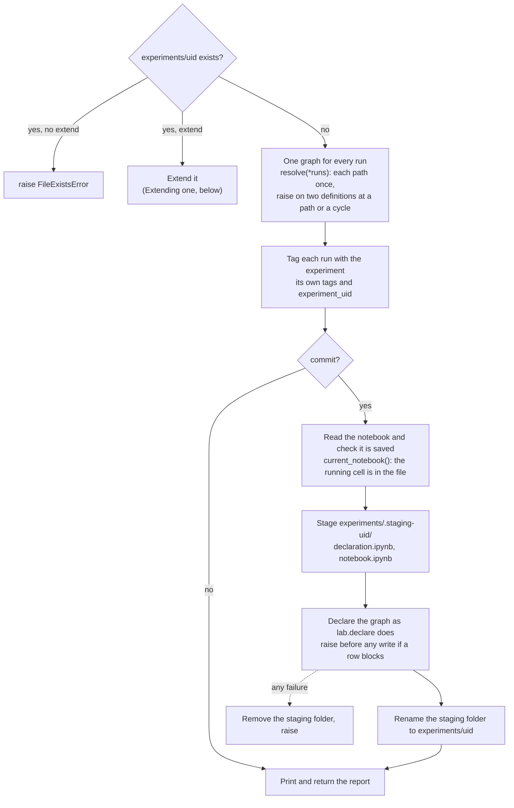
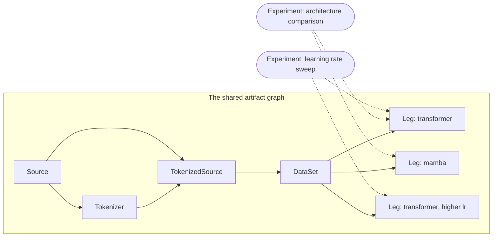

# Experiments

An **experiment** is a group of artifacts that belong together because they
answer one question: does this architecture beat that one, what does a larger
tokenizer buy, how does the batch size change the loss. Its members are the
artifacts tagged with its name, `tags={"experiment": [experiment_uid]}`, and
its folder, `experiments/<experiment_uid>/`, holds the notebook that created
it and one that lists its members. An experiment is not an artifact: it has no manifest, no identity and no
place in any artifact's graph.

## Creating one

The dashboard's **new experiment** link opens a copy of
`declarations/experiment_template.ipynb` in the lab's temporary workspace
([Lab](lab.md#starting-from-a-template)). Nothing reaches the volume until the
notebook calls `lab.create_experiment`:

```python
runs = [Pretraining(run_id=f"{experiment_uid}-bs{batch_size}", ...) for batch_size in (32, 64, 128)]
report = lab.create_experiment(experiment_uid, runs, commit=True)
```

Over a grid, `lab.sweep(build, grid)` returns the runs: `build` declares one
point's whole chain from a namespace of its values, and every point that
fails validation anywhere in that chain is printed and left out, as the
template does.



1. **The name.** `experiment_uid` is one folder name of letters, digits, `.`,
   `_` and `-`. A taken one raises before anything else, preview included,
   unless `extend` says how to add to it ([Extending one](#extending-one)).
2. **One graph.** Every run and everything it is built from resolve together,
   so a tokenizer or dataset the runs share is one node, declared once. Two
   definitions at one path, across runs as within one, raise before anything
   is written, as does a cycle.
3. **Membership.** Each run asked for is tagged with the experiment on top of
   its own tags. A run already on the volume is reused: a commit adds the
   experiment to its stored tags and changes nothing else
   ([Lab](lab.md#declaration)). What the runs are built from is not tagged.
4. **The notebook.** A commit keeps the notebook it runs from as last saved,
   refusing one whose saved file lacks the running cell: save it first. Outside
   a notebook, a commit raises unless the caller passes its bytes as `notebook`.
5. **Declaration.** The graph is declared as `lab.declare` declares one, each
   path once: missing manifests are written, existing ones only gain tags, and
   each run this commit creates gets its own `declaring.ipynb`.
6. **The folder.** `experiments/<experiment_uid>/` holds two notebooks, each
   under a heading naming the folder: `declaration.ipynb`, the one that
   created the experiment, and `notebook.ipynb`, whose one cell is
   `lab.load_experiment(experiment_uid)`. Both are written into a staging folder first,
   which is renamed into place last.

## Extending one

An experiment can take more artifacts after it is created: call
`create_experiment` again with its name, the artifacts to add, and `extend`:

```python
report = lab.create_experiment("batch-size-study", more_runs, commit=True, extend="add")
```

The new artifacts resolve, are tagged and are declared exactly as a new
experiment's are, so `notebook.ipynb`, which lists whatever is tagged, already
lists them. What `extend` chooses is where the notebook declaring them goes:

- **`"add"`** keeps it beside the first, as the next free `declaration<n>.ipynb`
  from 2: `declaration2.ipynb`, then `declaration3.ipynb`. `declaration.ipynb`
  is never touched, so the dashboard's **declaration ↗** link keeps opening the
  notebook that created the experiment.
- **`"overwrite"`** replaces `declaration.ipynb` with it, and the dashboard
  opens that one from then on.

Either way the notebook is written only after everything it declares, whole,
and renamed into place, so a failed extension leaves the folder as it was and
running it again completes it. A preview writes nothing, and `extend` on an
experiment that does not exist yet creates it as a first call would. The
launcher is told once, `experiment extended`, naming the paths the extension
asked for.

## Reading one back

`lab.load_experiment(experiment_uid)` returns every artifact whose manifest is
tagged with the experiment, sorted by artifact path and unbound. It reads the
manifests on each call, reloading the mounted volume first, so a run tagged
after the experiment was created is listed too, and it works for an
experiment that was only ever a tag.

```python
runs = lab.load_experiment("batch-size-study")
finished = [run.bind() for run in runs if all(run.status().completion.values())]
```

## Why

**A label over the graph, not a structure.** The artifact graph is shared by
design. Two experiments that use the same tokenizer and dataset build them
once, and that sharing is the point of identifying artifacts by their
parameters. So an experiment cannot be a subtree, because the same artifact
belongs to several experiments. Membership is a tag, which sits beside the
definition the way `declaring_commit` and `allocated_resources` do: recorded at
the root of the artifact's manifest and excluded from identity
([Artifacts](artifacts.md#artifacts.core.artifact.Artifact.RECORDED)), so joining an experiment never
moves an artifact.



The transformer leg is in both experiments and is trained once.

**Tags are only added.** A redeclaration can add a tag and never remove one,
so creating an experiment over a reused run cannot take that run out of the
experiments it was already in.

**Staged, then renamed.** The folder is what says an experiment exists, so it
appears only once everything it promises is on the volume. Manifests written
before a failure stay: each is a whole declaration on its own, and running the
notebook again finds them declared and completes the experiment.
