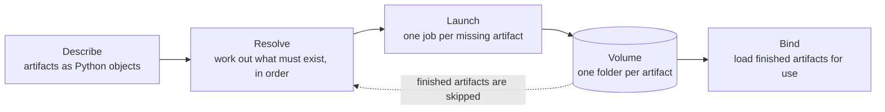
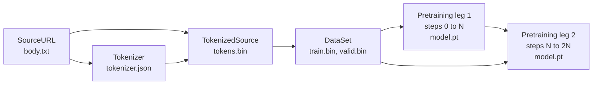
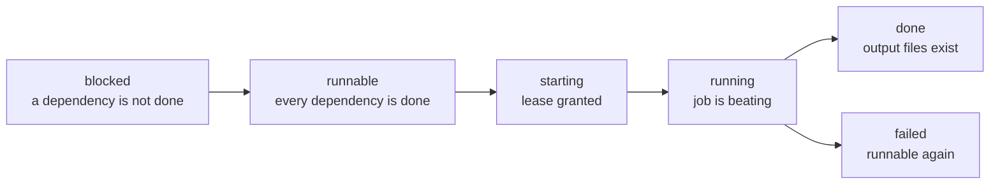
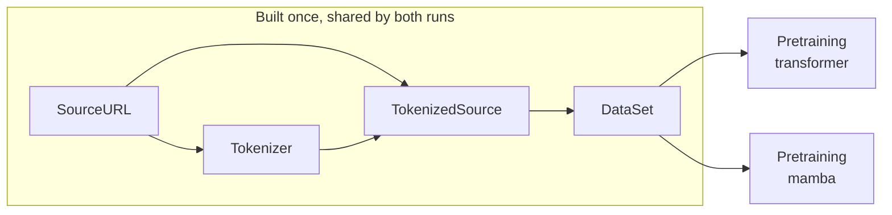
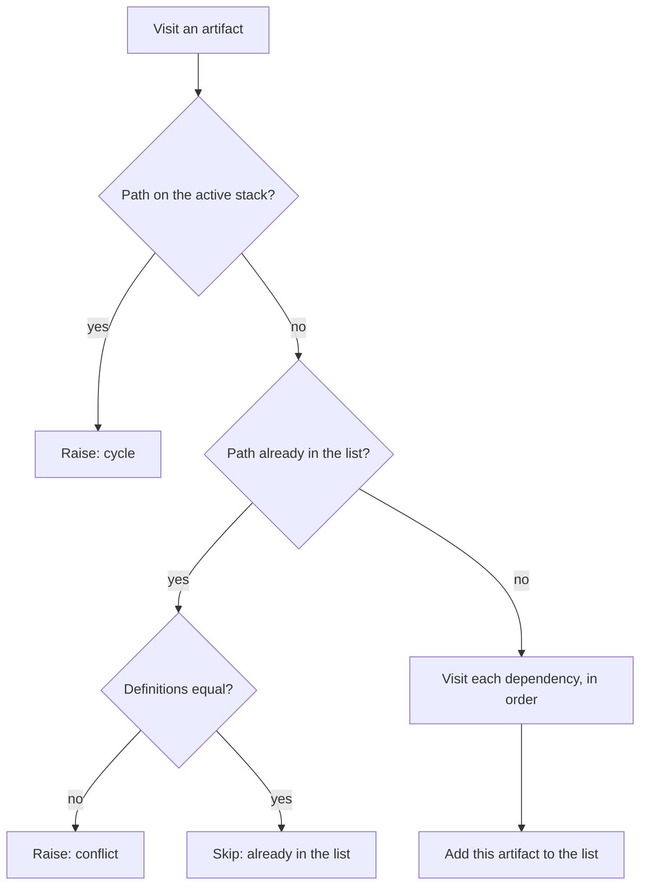
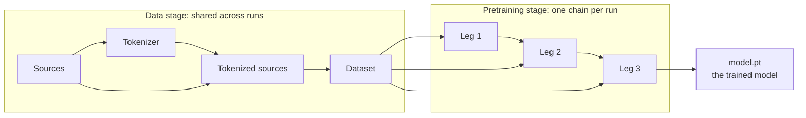

# Framework

Launchpad turns a training pipeline into a graph of immutable, described
things, and runs the graph on Modal. This page explains the idea: what the
repo is for, how a training run maps onto it, why dependencies are resolved,
and how to think about stages.

## The goal

A training run is a chain of expensive steps: fetch text, train a tokenizer,
tokenize, assemble a dataset, train a model, train it further. Done by hand,
each step is a script with its own paths, and nothing records which output
came from which input. Two experiments that share a tokenizer rebuild it, or
worse, quietly use the wrong one.

Launchpad's answer is to describe each step as an **artifact**: a frozen
Python object whose parameters fully define what it is. Identical parameters
give an identical folder on a shared Modal Volume, so the same description is
built once, whoever asks for it. An artifact defines what should exist; its
manifest records the declared definition; the presence of its completion files
says whether it exists yet. You declare definitions, jobs produce their
outputs, and you bind finished artifacts to use them, all on Modal, against one
mounted volume.



What this buys:

- **No rebuilds.** An artifact whose output files exist is done, and is never
  produced again.
- **Reproducibility.** The manifest next to the outputs records exactly what
  was asked for, down to every upstream artifact.
- **Conflicts are caught.** Two different definitions that map to the same
  folder are an error, not a silent overwrite.
- **Resumable work.** Each step is its own job and its own folder, so a
  failure costs one step, not the pipeline.

## How a training run maps onto artifacts

Each step of the training process is an artifact family. An artifact names the
artifacts it is built from as constructor parameters, and those names are the
edges of the graph.

| Training step | Artifact | Output | Built from |
| --- | --- | --- | --- |
| Raw text | `SourceURL` | `body.txt` | nothing |
| Tokenizer training | `Tokenizer` (BPE, template) | `tokenizer.json` | sources |
| Tokenization | `TokenizedSource` | `tokens.bin` | a tokenizer and a source |
| Dataset assembly | `DataSet` or `MappedDataSet` | `train.bin`, `valid.bin` (`MappedDataSet` owns no bytes) | tokenized sources |
| Training | `Pretraining` (one leg) | `model.pt` | a dataset, and optionally the previous leg |

The model architecture is not an artifact. It is a parameter of the training
leg, an instance of a `Model` class from `models/`, so one `Pretraining` class
trains every architecture.



Arrows point from an artifact to what is built from it. A leg continues the
previous one by naming it as its `starting_checkpoint`, so a leg's
dependencies include every leg before it.

## Why dependencies are resolved

Describing the last artifact in the chain is enough, because its parameters
already name everything it needs. Resolution turns that nested description
into a work list.

```python
import lab

lab.declare(leg2)  # reports every artifact leg2 needs, dependencies first
```

Resolution does three jobs that nothing else can.

**Order.** `resolve(artifact)` returns the artifact and everything beneath it,
dependencies before dependents. The launcher only runs an artifact when all
its direct dependencies are done, so every artifact reports one of `blocked`,
`runnable`, `starting`, `running`, `failed` or `done`.



**Sharing.** Two runs rarely differ everywhere. Resolution keys on
`artifact_path`, so the source, tokenizer and dataset that two experiments
have in common appear once and are built once.



**Safety.** A path reached twice must carry the same definition, or the graph
is rejected. A path that reaches itself is a cycle and is rejected.



Resolution reads no storage and launches nothing. Whether an artifact is
already done is a separate question, answered by looking at its folder.

## Stages

A **stage** is a family of artifacts that consumes the outputs of earlier
artifacts and produces outputs for later ones. It is a way of reading the
graph, not a type in the code.

- **Data stage.** Sources, tokenizers, tokenized sources and datasets. These
  are shared across experiments, which is why they are identified by their
  parameters alone and carry no run name.
- **Pretraining stage.** `Pretraining` legs. A leg trains for a fixed number
  of steps and is complete when its `model.pt` exists. A long run is a chain
  of legs rather than one long job, so each leg is resumable, inspectable and
  a valid starting point for another run. Within a leg, periodic failsafe
  checkpoints let an interrupted job pick up where it stopped. They are not
  artifacts, and nothing may depend on them.



Only pretraining exists today. The pattern for another stage is the same: a
new artifact family whose parameters name the artifacts it consumes, with a
job that writes its output files. Resolution, launching and the dashboard
need no changes, because they only ever see artifacts and their dependencies.

## Invariants

- Every artifact has one path, and one definition at that path.
- Dependencies are acyclic.
- A manifest's definition and declaring commit never change once written.
- Completed outputs are never modified in place.
- An artifact is `done` only when every completion file exists at its final
  path.
- A job is launched only when every direct dependency is `done`.
- At most one execution publishes to a path, and a failed execution never
  corrupts completed outputs.
- Declaring or launching an already complete artifact does no work.
- Definitions, jobs, the launcher and storage stay separately understandable:
  resolution reads no storage, status reads no ownership, and binding launches
  nothing.

What these guarantee in practice:

| Case | Result |
| --- | --- |
| Shared dependency reached twice | One resolved entry; conflicting definitions raise before any write. |
| Tokenizer sources supplied in reverse order | One definition, equal and equally hashed: the same path, manifest and training input order. |
| Two sources named alike with different URLs in one set | Refused at construction, not deduplicated. |
| Manifest round trip | The same definition and field types, and the root's recorded fields; the same manifest text; the result unbound. |
| Equal definitions written differently (`1` and `1.0` in a float field) | One artifact, one path, one manifest. |
| Preview against empty storage | A report only; no folders or files created. |
| Redeclare from a later commit, with different resources or more tags | The existing manifest kept; drift on every node declared at an older commit, blocking only in strict mode; resources never rewritten; missing tags added on commit, none removed. |
| Redeclaring an already-published path | The existing manifest is read, not overwritten; a different definition is a conflict. |
| Interrupted declaration | A retry completes the missing manifests without rewriting existing ones. |
| Interrupted output write | Temporary files do not make an artifact complete; partial outputs are reused only after the job validates them. |
| Mapped dataset with unfinished inputs | No owned outputs and no job; completion follows its dependencies' files. |
| Bind a completed tokenizer | A distinct usable object; the original stays unbound. |
| Bind an incomplete or conflicting definition | A descriptive error before any object is returned. |
| Standalone tokenizer or corrupt manifest | The state map finds it; corruption affects its row and the work that depends on it, not unrelated rows. |
| Two launch requests or a stale heartbeat | At most one worker publishes for that path. |
| Two different definitions rendering to one path | They compare unequal; declaration reports a conflict and writes nothing. |
| The whole flow run against an explicit `root`, with no mount present | Declaring, status, binding and a job's own dependency reads all stay under that root; nothing falls back to `STORAGE`. |
| Commit with open files on a Modal mount | The volume-reload error propagates; declaration does not proceed from stale state. |

## Extending

- **A new artifact family** is a package under `artifacts/` with its artifact
  class (fields, path, owned files, optionally a `_load` for what binding reads)
  and its job. The core does not change, and families depend on one another
  only by naming each other's classes as dependency types
  ([Artifacts](artifacts.md#defining-a-family)).
- **A new architecture** is a new `Model` subclass under `models/`; one
  training artifact type trains every architecture ([Models](models.md)).
- **A parameter** may only have a type whose values survive storage exactly,
  which is checked when the type is first used.
- **Code changes** take effect after `modal deploy`, since jobs run the
  deployed code.

## Deliberate limits

- **Identity** is parameters and dependency definitions only. Commit and
  resources are recorded, never identity. External content is not identity
  either: a source behind a URL may change without changing its path, and the
  first completed download is treated as fixed until it is explicitly deleted.
- **Outputs are immutable.** There are no mutable or versioned artifacts.
  Deleting outputs is an explicit operation outside jobs, and invalidates
  nothing downstream: rebuilding one can change its bytes without invalidating
  what was built from it.
- **One producer** per artifact type, or none for a virtual artifact.
- **Nothing is guaranteed to run.** At most one execution publishes to a path,
  and launching and relaunching are by hand.
- **Validation is file presence.** Content is not checked, and the same
  identity does not promise the same bytes: GPU training is not bit
  reproducible, and recorded commits do not make execution reproducible.
- **Graphs are static**: fully declared before anything runs. A job cannot add
  dependencies.
- **One platform, one store**, with no pluggable execution or storage backends.

Not built, each needing its own design when a pipeline needs it: automatic
scheduling, retry policies, content verification, automatic invalidation,
executing historical code, graph-wide transactions, mutable annotations,
garbage collection, and cleanup of the temporary files a hard-killed execution
leaves behind. A change to what is stored is applied to the whole volume at
once, by hand.

## Where to go next

- [Artifacts](artifacts.md): how an artifact is defined and identified.
- [Manifests](manifests.md): how a definition is written to disk and read back.
- [Jobs](jobs.md): the code that builds one artifact.
- [Launcher](launcher.md): how the graph is launched and watched.
- [Artifact Repository](repository.md): what lives where.
