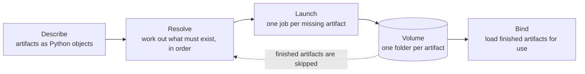
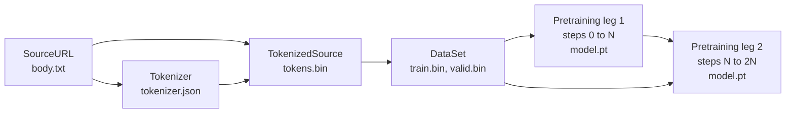
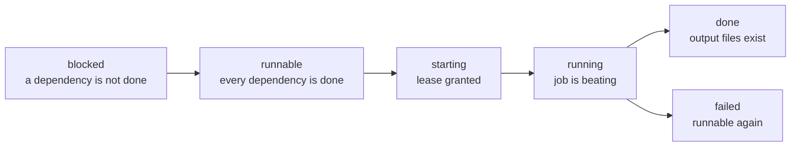
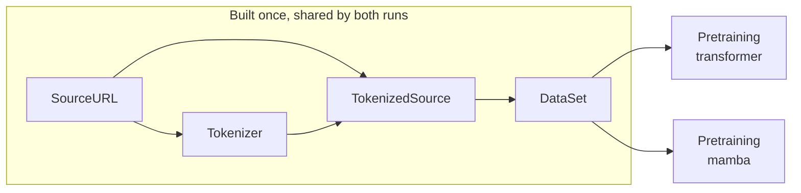
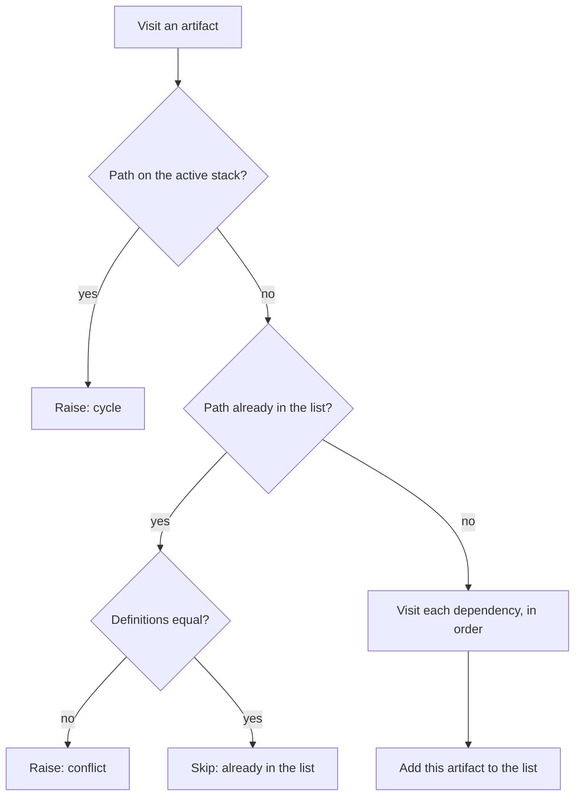
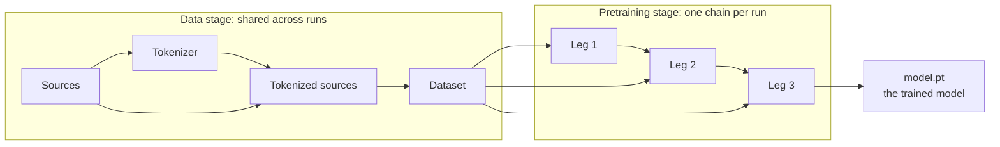

# Framework

Launchpad turns a training pipeline into a graph of immutable, described
things, and runs the graph on Modal. This page explains the idea: what the
repo is for, how a training run maps onto it, why dependencies are resolved,
and how to think about stages.

## The goal

A training run is a chain of expensive steps: fetch text, train a tokenizer,
tokenize, assemble a dataset, train a model, train it further. Done by hand,
each step is a script with its own paths, and nothing records which output
came from which input. Two experiments that share a tokenizer rebuild it, or
worse, quietly use the wrong one.

Launchpad's answer is to describe each step as an **artifact**: a frozen
Python object whose parameters fully define what it is. Identical parameters
give an identical folder on a shared Modal Volume, so the same description is
built once, whoever asks for it.



What this buys:

- **No rebuilds.** An artifact whose output files exist is done, and is never
  produced again.
- **Reproducibility.** The manifest next to the outputs records exactly what
  was asked for, down to every upstream artifact.
- **Conflicts are caught.** Two different definitions that map to the same
  folder are an error, not a silent overwrite.
- **Resumable work.** Each step is its own job and its own folder, so a
  failure costs one step, not the pipeline.

## How a training run maps onto artifacts

Each step of the training process is an artifact family. An artifact names the
artifacts it is built from as constructor parameters, and those names are the
edges of the graph.

| Training step | Artifact | Output | Built from |
| --- | --- | --- | --- |
| Raw text | `SourceURL` | `body.txt` | nothing |
| Tokenizer training | `Tokenizer` (BPE, template) | `tokenizer.json` | sources |
| Tokenization | `TokenizedSource` | `tokens.bin` | a tokenizer and a source |
| Dataset assembly | `DataSet` or `MappedDataSet` | `train.bin`, `valid.bin` (`MappedDataSet` owns no bytes) | tokenized sources |
| Training | `Pretraining` (one leg) | `model.pt` | a dataset, and optionally the previous leg |

The model architecture is not an artifact. It is a parameter of the training
leg, an instance of a `Model` class from `models/`, so one `Pretraining` class
trains every architecture.



Arrows point from an artifact to what is built from it. A leg continues the
previous one by naming it as its `starting_checkpoint`, so a leg's
dependencies include every leg before it.

## Why dependencies are resolved

Describing the last artifact in the chain is enough, because its parameters
already name everything it needs. Resolution turns that nested description
into a work list.

```python
import lab

lab.declare(leg2)  # reports every artifact leg2 needs, dependencies first
```

Resolution does three jobs that nothing else can.

**Order.** `resolve(artifact)` returns the artifact and everything beneath it,
dependencies before dependents. The launcher only runs an artifact when all
its direct dependencies are done, so every artifact reports one of `blocked`,
`runnable`, `starting`, `running`, `failed` or `done`.



**Sharing.** Two runs rarely differ everywhere. Resolution keys on
`artifact_path`, so the source, tokenizer and dataset that two experiments
have in common appear once and are built once.



**Safety.** A path reached twice must carry the same definition, or the graph
is rejected. A path that reaches itself is a cycle and is rejected.



Resolution reads no storage and launches nothing. Whether an artifact is
already done is a separate question, answered by looking at its folder.

## Stages

A **stage** is a family of artifacts that consumes the outputs of earlier
artifacts and produces outputs for later ones. It is a way of reading the
graph, not a type in the code.

- **Data stage.** Sources, tokenizers, tokenized sources and datasets. These
  are shared across experiments, which is why they are identified by their
  parameters alone and carry no run name.
- **Pretraining stage.** `Pretraining` legs. A leg trains for a fixed number
  of steps and is complete when its `model.pt` exists. A long run is a chain
  of legs rather than one long job, so each leg is resumable, inspectable and
  a valid starting point for another run. Within a leg, periodic failsafe
  checkpoints let an interrupted job pick up where it stopped. They are not
  artifacts, and nothing may depend on them.



Only pretraining exists today. The pattern for another stage is the same: a
new artifact family whose parameters name the artifacts it consumes, with a
job that writes its output files. Resolution, launching and the dashboard
need no changes, because they only ever see artifacts and their dependencies.

## Where to go next

- [Artifacts](artifacts.md): how an artifact is defined and identified.
- [Manifests](manifests.md): how a definition is written to disk and read back.
- [Jobs](jobs.md): the code that builds one artifact.
- [Launcher](launcher.md): how the graph is launched and watched.
