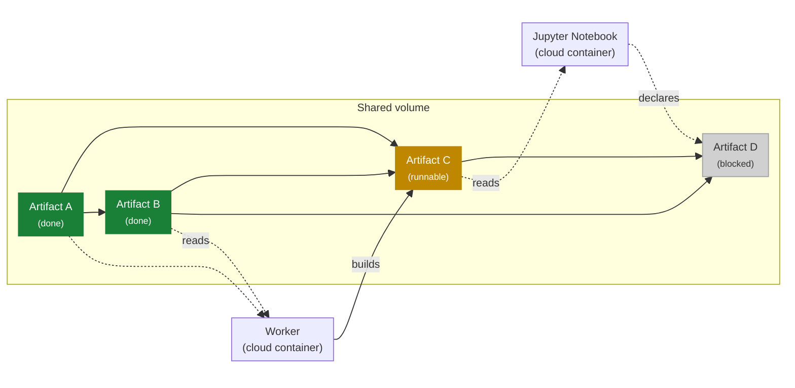
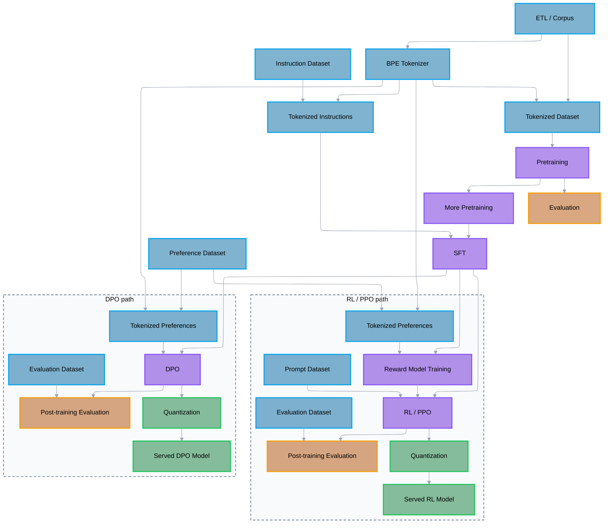
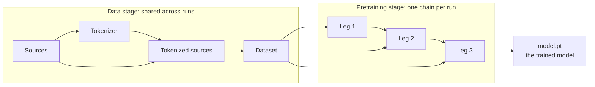
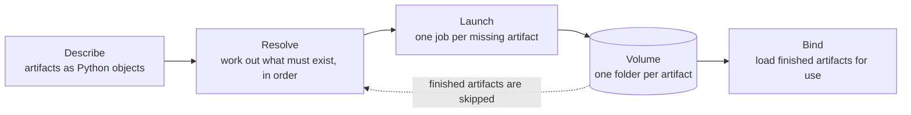

# Framework

Launchpad turns a training pipeline into a dependency graph of artifacts and
runs it on worker containers in the cloud, each with the resources it needs.
Every result traces back to exactly what produced it, and a step that fails
mid-training restarts from its latest checkpoint. Any model you can express in
[PyTorch](https://pytorch.org) can be built this way.

## The idea in one minute

Suppose we want artifact D, any item in a training pipeline: a dataset, a
tokenizer, a trained model. D is built from other artifacts, which must exist
first. Each artifact names its parameters and the artifacts it is built from,
so declaring D in a notebook is enough: launchpad resolves the graph beneath
it, keeps every artifact on a shared volume, and builds the missing ones on
cloud containers.

```python
import lab

a = ArtifactA(size=10)
b = ArtifactB(scale=2.0, a=a)
c = ArtifactC(steps=100, a=a, b=b)
d = ArtifactD(threshold=0.5, b=b, c=c)

report = lab.declare(d, commit=True)  # A and B are done, C already declared, D new
```



*Four artifacts on the shared volume, each arrow running from an artifact to
one that depends on it. A and B are done, so C, which needs both, is runnable,
and a worker container reads them to build it. D waits on C, so it is blocked. The
notebook declared D and reads C back from the volume.*

- An **artifact** is a pipeline item we want to exist: a text source, a
  tokenizer, a tokenized dataset, a pre-training stage, or any other post-training stage such as instruction fine tuning, reinforcement learning or evaluations.
- An artifact is fully specified by its parameters and its **dependencies**,
  which are other artifacts. A pre-training stage names a dataset, the dataset
  names a tokenizer, the tokenizer names its sources.
- You describe a whole pipeline as artifacts in a **[Jupyter notebook](https://jupyter.org)**.
  Launchpad runs distributed workers on the cloud that build every artifact in
  dependency order, never repeating work, with provenance and reproducibility
  kept ([Lab](lab.md)).
- Finished artifacts live on the **volume**, so any item in the pipeline can be
  loaded into memory and inspected: weights, activations, attention maps,
  generations from a checkpoint. You can compare runs side by side and
  aggregate results across them.

Launchpad resolves the pipeline as a dependency graph, you can tune,
fork or compare any item without redoing the rest: change one artifact and
only it and what depends on it are rebuilt, and everything upstream is reused.
The diagram below shows the complexity launchpad is able to address in the context of modern natural language modeling. Every box is an artifact,from raw corpus to served model, with pre-training and SFT as a shared base.
DPO and RL are alternative post-training paths: both fork from the same SFT
artifact, you pick one or build both, and each reuses everything upstream.




## Supported workflows

some examples, not a complete list:

- **Sweeps and ablations.** Change one parameter, such as the learning rate or
  batch size, and every upstream artifact is reused. Only the changed stage and
  what depends on it are built ([Experiments](experiments.md)).
- **Loss and metric curves.** An artifact's page on the dashboard charts its
  step log: training and validation loss, and every other numeric metric the
  job records, with one line per attempt ([Dashboard](dashboard.md)).
- **Extending and branching training.** A training leg continues another by
  naming it as its starting checkpoint, and any finished leg can start a new
  run ([Training a Model](training.md)).
- **Inspecting any finished artifact.** Read a tokenizer's vocabulary, sample a
  dataset, or load a trained model and look inside it
  ([Lab](lab.md#inspecting-a-trained-model)).
- **Profiling and monitoring.** Every training leg reports its MFU and peak GPU
  memory as step metrics while it computes, and a separate profiler breaks a
  run down by operation, memory and timeline. You can quickly iterate on
  resource allocation, and when writing custom kernels the profiling interface
  makes it easy to see where the time goes, so you can check that GPUs are well
  used and tune again ([Profiling](profiling.md)).
- **Tracing provenance.** A manifest records the exact definition of an
  artifact, every upstream artifact it was built from, and the commit that
  declared it ([Manifests](manifests.md)).


## From artifacts to a graph

Let's focus on the first few steps of training a language model. Each step is
an artifact, and an artifact names the artifacts it is built from as
constructor parameters. Those names are the edges of the dependency graph.

| Training step | Artifact | Output | Built from |
| --- | --- | --- | --- |
| Raw text | `SourceURL` | `body.txt` | nothing |
| Tokenizer training | `Tokenizer` (BPE, template) | `tokenizer.json` | sources |
| Tokenization | `TokenizedSource` | `tokens.bin` | a tokenizer and a source |
| Dataset assembly | `DataSet` or `MappedDataSet` | `train.bin`, `valid.bin` (`MappedDataSet` owns no bytes) | tokenized sources |
| Training | `Pretraining` (one leg) | `model.pt` | a dataset, and optionally the previous leg |

The model architecture is not an artifact. It is a parameter of the training
leg, an instance of a `Model` class from `models/`, so one `Pretraining` class
trains every architecture.



Arrows point from an artifact to what is built from it. The boxes are
artifacts, training legs included, and the trained model is the last leg's
output. A leg trains for a fixed number of steps and
is done when its `model.pt` exists. A long run is a chain of legs rather than
one long job, so each leg is resumable, inspectable and a valid starting point
for another run. A leg continues the previous one by naming it as its
`starting_checkpoint`, so its dependencies include every leg before it, and all
of them depend on the dataset. The data artifacts carry no run name, only
parameters, so they are shared across experiments. Within a leg, periodic
failsafe checkpoints let an interrupted job pick up where it stopped. They are
not artifacts, and nothing may depend on them.

Only pretraining exists today. Another stage follows the same pattern: a new
artifact family whose parameters name the artifacts it consumes, with a job that
writes its output files. Resolution, launching and the dashboard need no
changes, because they only ever see artifacts and their dependencies.

## The goal

A training run is a chain of expensive steps: fetch text, train a tokenizer,
tokenize, assemble a dataset, train a model, train it further. Done by hand,
each step is a script with its own paths, and nothing records which output
came from which input. Two experiments that share a tokenizer rebuild it, or
worse, quietly use the wrong one.

Launchpad's answer is to describe each step as an **artifact**: a frozen
Python object whose parameters fully define what it is. Identical parameters
give an identical folder on a shared Modal Volume, so the same description is
built once, whoever asks for it. An artifact defines what should exist; its
manifest records the declared definition; the presence of its completion files
says whether it exists yet. You declare definitions, jobs produce their
outputs, and you bind finished artifacts to use them, all on Modal, against one
mounted volume.



What this buys:

- **No rebuilds.** An artifact whose output files exist is done, and is never
  produced again.
- **Reproducibility.** The manifest next to the outputs records exactly what
  was asked for, down to every upstream artifact.
- **Conflicts are caught.** Two different definitions that map to the same
  folder are an error, not a silent overwrite.
- **Resumable work.** Each step is its own job and its own folder, so a
  failure costs one step, not the pipeline.
