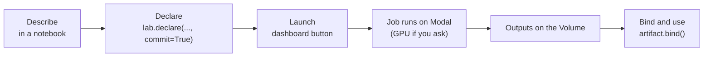

# Getting started

Launchpad runs ML pipelines on [Modal](https://modal.com). You describe what
should exist (a dataset, a tokenizer, a trained model), Launchpad works out
what has to be built first, runs each piece as its own job, and shows progress
on a dashboard. This page is for using it; [Framework](framework.md) explains
the idea, and the other pages how each part works.

## The idea in one minute

- An **artifact** is a thing that should exist: a text source, a tokenizer, a
  tokenized dataset, a training run. You describe it with a small Python
  object, and its fields fully define it.
- An artifact can name other artifacts as **dependencies**. A training run
  names a dataset, the dataset names a tokenizer, the tokenizer names its
  sources.
- Each artifact lives in a folder on a shared Modal Volume. The folder holds a
  `manifest.json` (what it is) and its output files (what it produced). An
  artifact is **done** when its output files exist.
- A **job** is the code that builds one artifact. One job per artifact.
- You **declare** artifacts (write their manifests), then **launch** them from
  the dashboard, dependencies first.



Because identity comes from the fields, the same description always lands in
the same folder. Declare something twice and nothing is rebuilt. Share a
tokenizer between ten runs and it is built once.

## Setup

Requirements: Python 3.12+, [uv](https://docs.astral.sh/uv/), a Modal account.

```bash
uv sync                      # install dependencies
modal setup                  # log in to Modal (once)

# One secret per Modal workspace: the dashboard password and the JupyterLab token
modal secret create launchpad-lab \
  DASHBOARD_PASSWORD='pick-one' \
  JUPYTER_TOKEN=$(openssl rand -hex 24)

modal deploy main.py         # deploys the dashboard, launcher, workers and lab
```

Use `modal deploy`, not `modal serve`: the scheduled log writer only runs on a
deployed app. Re-run `modal deploy main.py` after code changes, since workers
run the deployed code. `--force` on `modal secret create` replaces an existing
secret, which is how the password is changed; both containers pick it up on the
next deploy.

`modal deploy` prints the dashboard URL. Open it and log in with
`DASHBOARD_PASSWORD`. The header has a `/lab` link to JupyterLab, already
mounted on the volume.

## Your first workflow

All of this runs in a notebook, in the lab or on your laptop.

### 1. Describe a pipeline

```python
from artifacts.sources import SourceURL
from artifacts.tokenizers.bpe import Tokenizer
from artifacts.tokenized import TokenizedSource

source = SourceURL(name="odyssey", url="https://example.org/odyssey.txt")
tokenizer = Tokenizer(vocab_size=1000, special_tokens=("<pad>",), sources=(source,))
tokens = TokenizedSource(tokenizer=tokenizer, source=source)
```

Nothing has run. These are only definitions, validated as they are built: a
wrong type or an out-of-range value raises at that line.

### 2. See the plan

```python
from artifacts.core.resolve import resolve

for artifact in resolve(tokens):
    print(type(artifact).__name__, artifact.artifact_path)
```

You get every artifact that has to exist, in the order it has to be built:
source, tokenizer, tokenized source. Since one job builds one artifact, this
list is the work.

### 3. Preview, then declare

```python
import lab

lab.declare(tokens)                  # preview: compares with the volume, writes nothing
lab.declare(tokens, commit=True)     # writes the missing manifests
```

The report has one row per artifact, with a state ([Lab](lab.md#declaration)
has the full table): `new` artifacts are written on commit, while `conflict`
and `undeclared` block it. A commit with a blocker raises `DeclarationError`
and writes nothing.

From a laptop, use `local.declare_on_volume(tokens, commit=True)`. It is the
same call, run inside a container that has the volume.

### 4. Launch from the dashboard

The new artifacts appear in the table. Each row walks
`blocked` (a dependency is not done) -> `runnable` -> `starting` -> `running`
-> `done`. A `failed` row can be launched again.

Press the button on a `runnable` row to start its job. Build dependencies
first: the sources, then the tokenizer, and so on. The row's page shows
parameters, dependencies, live logs and, for training, loss curves. Press stop
to cancel a job. [Dashboard](dashboard.md) has the details.

### 5. Use the result

```python
tokenizer = tokenizer.bind()    # loads the built files onto a copy
tokenizer.encode("hello")
```

`Artifact.load("tokenizers/<uid>")` reads a declared artifact back from the
volume without building anything. `.bind()` additionally requires that it is
done and loads its files.

## Example: train a model end to end

`declarations/tinystories.ipynb` declares a full pretraining run: two text
sources, a BPE tokenizer, a mapped dataset, and a transformer.

```python
pretraining = Pretraining(
    run_id="TINYSTORIES",
    dataset=dataset,
    model=Transformer(vocab_size=tokenizer.vocab_size, d_model=512, d_ff=1344,
                      sequence_length=256, num_layers=4, num_heads=16,
                      rope_theta=10000, device="cuda"),
    training_parameters=TrainingParameters(
        total_steps=20000, batch_size=64, ...
    ),
    loop_config=LoopConfig(checkpoint_every=5000, val_every=200, ...),
)

declare_on_volume(pretraining, commit=True)
```

Then launch the sources, tokenizer and tokenized sources, and the run, from
the dashboard, and watch the loss curves and logs on the run's page.

Things worth knowing about training ([Training a Model](training.md) has all
of it):

- **GPUs.** Ask for one on the artifact:
  `allocated_resources=Resources(gpu_type="A100")`. With none, the job runs on
  the default CPU pool. Resources are not part of identity, so changing them
  does not create a new artifact.
- **Architectures.** `Transformer` and `Mamba` ship in `models/`, and one
  `Pretraining` class trains either ([Models](models.md)).
- **Checkpoints and resume.** A job writes failsafe checkpoints every
  `checkpoint_every` steps. If it is cancelled or dies, launching it again
  resumes from the newest one.
- **Legs.** A long run can be split into legs. A leg names the previous one as
  `starting_checkpoint` and continues from its `model.pt`.
- **Check a result.** [Lab](lab.md#inspecting-a-trained-model) shows how to
  rebuild a trained model from its leg in a notebook.

## Common questions

**Declaring did nothing visible.** Declaring only writes manifests. Launch from
the dashboard to run jobs. If a manifest you wrote from the lab is not in the
table, press the dashboard's refresh button.

**A row is `blocked`.** A dependency is not done. The row's page lists which.

**I changed a parameter and got a new row.** Parameters define identity, so a
changed parameter is a new artifact. That is intended: the old one stays.

**`conflict` on declare.** Two different definitions map to the same path, for
example two sources named `odyssey` with different URLs. Rename one.

**Can I work without Modal?** Declaring and resolving work against any local
folder: pass `root=`. Launching and the dashboard need the deployment.

**Run the tests.** `uv run pytest`.

**Preview these docs.** `mkdocs serve`; a deploy publishes them at `/guide/`.
