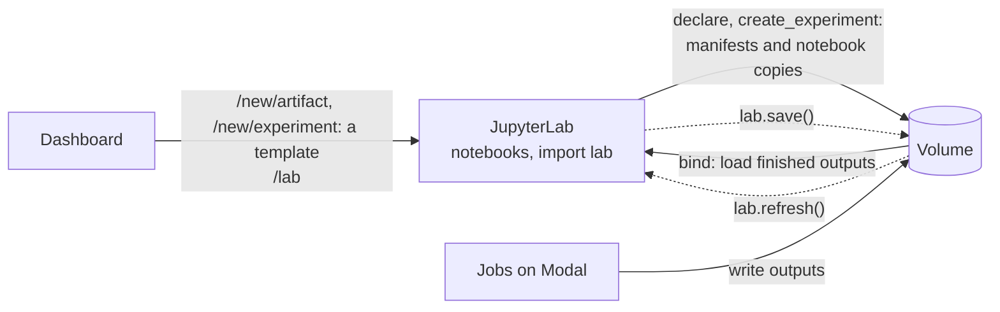
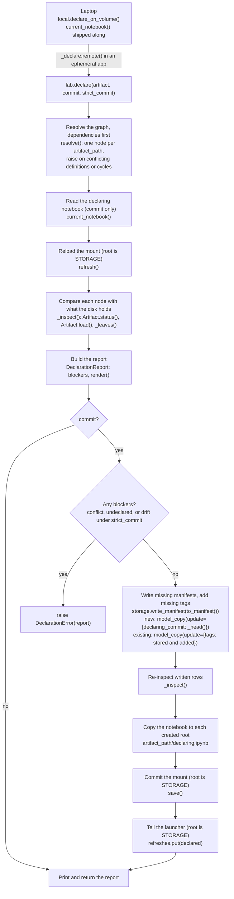

# Lab

The lab is a JupyterLab server running in its own Modal container, with the
volume linked into its file browser. It is where you declare artifacts,
and where you load finished ones to inspect them and do research: read a
tokenizer's vocabulary, sample a dataset, load a trained model and look at what
it does.

## How it fits



The `jupyter` function serves JupyterLab in its own container, with its own
image and idle scale-down, separate from the dashboard's. The dashboard's
header links to `/lab`, which redirects there with the token attached.
`lab_image` carries every dependency `pyproject.toml` declares, not only what
the workers need, so a notebook there can import and run anything in the repo,
`torch` included.

The server is rooted at `LAB_WORKSPACE`, a folder on the container's own disk
that holds the notebooks `/new/<kind>` starts and a `storage` link to the volume. The
file browser shows the artifact folders under `storage/` (`storage/sources/`,
`storage/runs/`), and a path found there, less that prefix, can be passed
straight to `Artifact.load`. Notebooks are protected by the same secret as the
dashboard ([Dashboard](dashboard.md#access)).

## Starting from a template

The dashboard header's **new experiment** and **new artifact** links are how
anything gets declared. `/new/<kind>` writes a copy of
`declarations/<kind>_template.ipynb` into the workspace through Jupyter's
contents API, named `new-<kind>-<timestamp>-<suffix>.ipynb`, and opens it;
nothing is written to the volume.

- **`experiment_template.ipynb`** sweeps batch sizes: one `experiment_uid`,
  shared sources, tokenizer, dataset and model, a `Pretraining` per batch size
  with `run_id=f"{experiment_uid}-bs{batch_size}"`, and one
  `lab.create_experiment` call ([Experiments](experiments.md)).
- **`artifact_template.ipynb`** defines one pretraining run, previews and
  commits its declaration, and benchmarks its model on the GPU it asks for,
  with kernel tables to read the result.

The workspace is temporary: it goes when the lab scales down. A notebook that
never declares anything leaves nothing behind, and one that commits keeps
itself: the last saved version is copied to `<artifact_path>/declaring.ipynb`
beside each manifest it was asked for and wrote, under a heading naming that
path. The heading replaces a first cell of markdown, the template's note that
the notebook is temporary, and goes above one of code. Save before
committing, since the copy is the file on disk, not the cells in the browser.

There is nothing to initialize and no environment detection. The mount exists
only inside a container, so a laptop works against a folder of its own by
passing `root=`, the same mechanism a test uses with a `tmp_path`, and reaches
the volume through `local.py`. Nothing in the lab forces a `volume.commit()`:
every mount commits in the background, and JupyterLab's autosave does the rest.

## The notebook API

`import lab` gives the notebook its two entry points, declaration of one
artifact and of an experiment's, the experiment's artifacts read back, and the
volume verbs. Construction, loading and binding stay on the artifact classes
and instances (`Tokenizer(...)`, `Artifact.load(path)`, `tokenizer.bind()`).

| Call | What it does |
| --- | --- |
| `lab.declare(artifact)` | Previews the declaration and writes nothing. With `commit=True` it writes the missing manifests. |
| `lab.create_experiment(experiment_uid, artifacts)` | The same for an experiment's runs, resolved together; with `commit=True` it also creates `experiments/<experiment_uid>/` ([Experiments](experiments.md)). |
| `lab.load_experiment(experiment_uid)` | Every artifact tagged with the experiment, by artifact path, unbound. |
| `lab.refresh()` | Reloads the mount so files written elsewhere appear, such as a job's outputs. |
| `lab.save()` | Commits the mount so a notebook saved in JupyterLab outlives the container. |
| `lab.worker` | A stand-in execution context for running one job from a cell with `job.run(root, lab.worker)`: no lease, no heartbeat, logs to the console. |
| `local.declare_on_volume(artifact, commit=...)` | From a laptop: the same declaration, run in an ephemeral container that mounts the volume. |

## Declaration

```python
lab.declare(
    artifact,
    *,
    root=STORAGE,
    commit=False,
    strict_commit=False,
    verbose=False,
    notebook=None,
) -> DeclarationReport
```

`verbose` controls only how the result is printed. `root` is for tests and
scripts; a notebook gets `STORAGE`. `notebook` is the declaring notebook's
bytes, for a caller with no kernel: `local.declare_on_volume` reads them where
the kernel is and ships them. Without it, a commit reads the kernel's own
notebook file, `current_notebook()`.

1. Resolve the requested artifact into its graph ([Artifacts](artifacts.md#resolution)).
2. Inspect each path once and compare an existing manifest with the request
   using `==`, definition agreement.
3. Record drift, resource differences and tags to add per node. A node drifts when the
   declaring commit at the root of the manifest at its own path is not the
   commit declaring now, `lab._head()`, so declaring a new artifact over
   dependencies declared at an older commit reports drift on each of their
   rows. Drift blocks only with `strict_commit=True`; resource differences
   and tags never block. A node carrying `allocated_resources=None` or `tags=None`, a
   dependency of a loaded artifact, requests neither: its row reports the
   stored ones, and nothing is compared or added for them.
4. Collect one row per path with its state, drift and differences. A preview
   returns these in a report and writes nothing, not even a folder.
5. With `commit=True`, refuse before writing if any row blocks. Otherwise write
   the manifests of `new` artifacts in dependency order, each stamped with
   `lab._head()` as its `declaring_commit` (and `Resources()` when it requests
   none, `{}` for tags). An existing matching manifest changes in one way
   only: it gains every requested tag value it lacks, appended to its key.
   Its definition, declaring commit and resources are never rewritten, and
   no tag is ever removed. Against the mounted volume, reload before
   inspecting and commit after writing.
6. Return a report recording created and updated manifests and the resulting
   states, reusing the resolved graph.

Each row's state:

| Observation | State | Blocks a commit? |
| --- | --- | --- |
| No manifest and no owned outputs | `new` | No |
| No manifest and at least one owned output | `undeclared` | Yes |
| Manifest cannot be decoded, or its definition disagrees | `conflict` | Yes |
| Matching manifest; required files absent | `already declared` | No |
| Matching manifest; some required files present | `partial` | No |
| Matching manifest; all required files present | `done` | No |

A manifest this commit wrote reads `declared` rather than `already declared`:
the state says what the volume holds, and `already` says it held it before
this call. For zero required files, a matching manifest means `done`. A virtual artifact
can be `new` even when all its dependency files exist: undeclared-output
detection checks owned outputs, not borrowed completion files. Commit drift is
an additional observation, not a state.



Example: `sources/odyssey` and `tokenizers/bpe-1000-feeeeefa90` were declared
at commit `a1b2c3d` and built; the `TokenizedSource` built from them is not
yet declared, and the notebook now runs at `e4f5a6b`.

```python
>>> report = lab.declare(tokens)   # preview
sources/odyssey                                done   (drift: a1b2c3d -> e4f5a6b)
tokenizers/bpe-1000-feeeeefa90                 done   (drift: a1b2c3d -> e4f5a6b)
tokenized/bpe-1000-feeeeefa90/odyssey          new

2 done, 1 new
ok -- 1 to declare

>>> lab.declare(tokens, commit=True)   # the new one gets written at e4f5a6b
sources/odyssey                                done      (drift: a1b2c3d -> e4f5a6b)
tokenizers/bpe-1000-feeeeefa90                 done      (drift: a1b2c3d -> e4f5a6b)
tokenized/bpe-1000-feeeeefa90/odyssey          declared

1 declared, 2 done
1 manifest written: tokenized/bpe-1000-feeeeefa90/odyssey

declared on artifact path:
tokenized/bpe-1000-feeeeefa90/odyssey
```

`DeclarationReport` is data: its `rows` hold the path, state, drift,
differences, the stored declaring commit beside the one declaring now
(`declaring_commit`), the stored and requested resources as a pair, the
stored tags beside what a commit leaves, and whether a manifest was created
or updated; its `roots` are the paths asked for. Counts and the verdict are
derived from them. A blocked commit raises `DeclarationError` with the report
attached. A graph that is structurally invalid raises before any report
exists. A committed declaration that creates the declared artifact ends its
report with `declared on artifact path:` and that path, and copies the
declaring notebook to `<artifact_path>/declaring.ipynb` under a heading
naming the path; a preview, a redeclaration and the
artifact's dependencies write no copy.

**Publication.** One writer at a time per root, assumed rather than enforced;
once a manifest reaches disk it is the truth. Each manifest is written
directly, with no temporary file: it is small, written in one call, and written
before any job runs, so there is no half-written manifest to mistake for a
complete one. An existing manifest is never overwritten with another
definition, only, on commit, with tags added. Declaration across a graph is
not a transaction: an interrupted one is completed by repeating it, and what
was already written is left alone. Declaration runs no jobs, produces no
outputs, and does not bind what it was given.

## Loading and binding

An artifact in the lab goes through two steps.

1. **Load.** `Artifact.load(path)` reads the manifest at that path and returns
   the artifact, unbound: its definition is known and its outputs are not
   touched, whether or not it is built.
2. **Bind.** `.bind()` checks that the stored manifest agrees with it and that
   it is complete, then loads what its type needs from the outputs. It returns
   a separate, usable copy, or raises. It never returns a half-loaded artifact,
   and the original stays unbound.

```python
import lab
from artifacts.core.artifact import Artifact

declared = Artifact.load("tokenizers/<uid>")  # unbound
tokenizer = declared.bind()
tokenizer.encode("hello")                      # declared.encode would raise
assert tokenizer == declared and tokenizer is not declared
```

What binding loads depends on the type. A tokenizer loads its vocabulary and
merges. A dataset opens its token files as memory maps, and exposes the same
batch functions the training loop uses:

```python
dataset = Artifact.load("datasets/<uid>").bind()
get_batch = dataset.train_batches(batch_size=4, sequence_length=256, seed=0)
inputs, targets = get_batch(1)  # the batch training step 1 would see
```

Binding loads only what the artifact and its direct dependencies name; it
never resolves a whole pipeline.

## Inspecting a trained model

A leg's `model.pt` holds the model state, and the leg's `model` parameter
describes the architecture, so the network can be rebuilt in a notebook. A
notebook may have no GPU, so the example builds it on the CPU.

```python
import torch

from config import STORAGE

leg = Artifact.load("runs/<run_id>/pretraining/<uid>")
state = torch.load(leg.paths(STORAGE)["model"], map_location="cpu")

network = leg.model.build(torch.device("cpu"))
network.load_state_dict(state["model"])
```

## Rules worth knowing

- **Refresh before binding.** A job runs in another container. Call
  `lab.refresh()` to see what it wrote.
- **Bind only finished artifacts.** Binding an artifact that is not complete
  raises. The dashboard shows which are done.
- **The default root is the volume.** Every load and bind reads from `STORAGE`
  unless given another absolute `Path`, so the same code runs against a test
  folder ([Artifact Repository](repository.md#roots)).

## Reference

::: lab
    options:
      members: [declare, create_experiment, load_experiment, DeclarationReport, DeclarationError, refresh, save, current_notebook]
