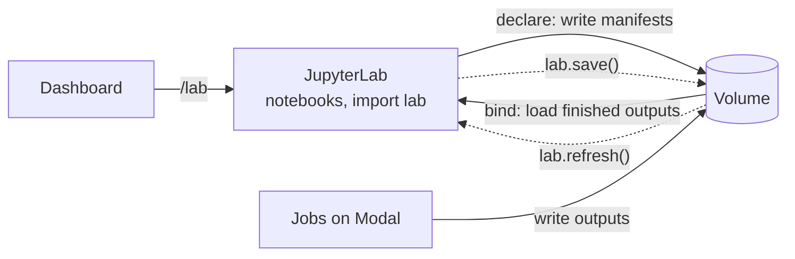

# Lab

The lab is a JupyterLab server running in its own Modal container, with the
volume mounted as its file browser root. It is where you declare artifacts,
and where you load finished ones to inspect them and do research: read a
tokenizer's vocabulary, sample a dataset, load a trained model and look at what
it does.

## How it fits



The server starts rooted at the volume itself rather than a notebooks folder,
so the file browser shows the artifact folders (`sources/`, `tokenizers/`,
`runs/`) and a path found there can be passed straight to `Artifact.load`.
Notebooks are protected by the same password as the dashboard.

## Loading and binding

An artifact in the lab goes through two steps.

1. **Load.** `Artifact.load(path)` reads the manifest at that path and returns
   the artifact. It is unbound: its definition is known and its outputs are not
   touched.
2. **Bind.** `.bind()` checks that the artifact is complete, then loads what
   its type needs from the outputs. It returns a separate, usable copy, or
   raises. It never returns a half-loaded artifact.

```python
import lab
from artifacts.core.artifact import Artifact

declared = Artifact.load("tokenizers/<uid>")  # unbound
tokenizer = declared.bind()
tokenizer.encode("hello")                      # declared.encode would raise
```

What binding loads depends on the type. A tokenizer loads its vocabulary and
merges. A dataset opens its token files as memory maps, and exposes the same
batch functions the training loop uses:

```python
dataset = Artifact.load("datasets/<uid>").bind()
get_batch = dataset.train_batches(batch_size=4, sequence_length=256, seed=0)
inputs, targets = get_batch(1)  # the batch training step 1 would see
```

## Inspecting a trained model

A leg's `model.pt` holds the model state, and the leg's `model` parameter
describes the architecture, so the network can be rebuilt in a notebook. A
notebook may have no GPU, so the example moves the model to the CPU.

```python
import torch

from config import STORAGE

leg = Artifact.load("runs/<run_id>/pretraining/<uid>")
state = torch.load(leg.paths(STORAGE)["model"], map_location="cpu")

# a new model, built and validated again, with only the device changed
network = type(leg.model)(**dict(leg.model) | {"device": "cpu"}).build()
network.load_state_dict(state["model"])
```

## The notebook API

`import lab` gives the notebook its volume verbs.

| Call | What it does |
| --- | --- |
| `lab.declare(artifact)` | Previews the declaration and writes nothing. With `commit=True` it writes the missing manifests. |
| `lab.refresh()` | Reloads the mount so files written elsewhere appear, such as a job's outputs. |
| `lab.save()` | Commits the mount so a notebook saved in JupyterLab outlives the container. |
| `lab.worker` | A stand-in execution context for running one job from a cell with `job.run(root, lab.worker)`: no lease, no heartbeat, logs to the console. |

Committing the declaration of a run also copies the notebook it ran from to
`runs/<run_id>/declare-<uid>.ipynb`, so the volume keeps what declared it.

## Rules worth knowing

- **Refresh before binding.** A job runs in another container. Call
  `lab.refresh()` to see what it wrote.
- **Bind only finished artifacts.** Binding an artifact that is not complete
  raises. The dashboard shows which are done.
- **The default root is the volume.** Every load and bind reads from
  `STORAGE` unless given another absolute `Path`, so the same code runs
  against a test folder.
