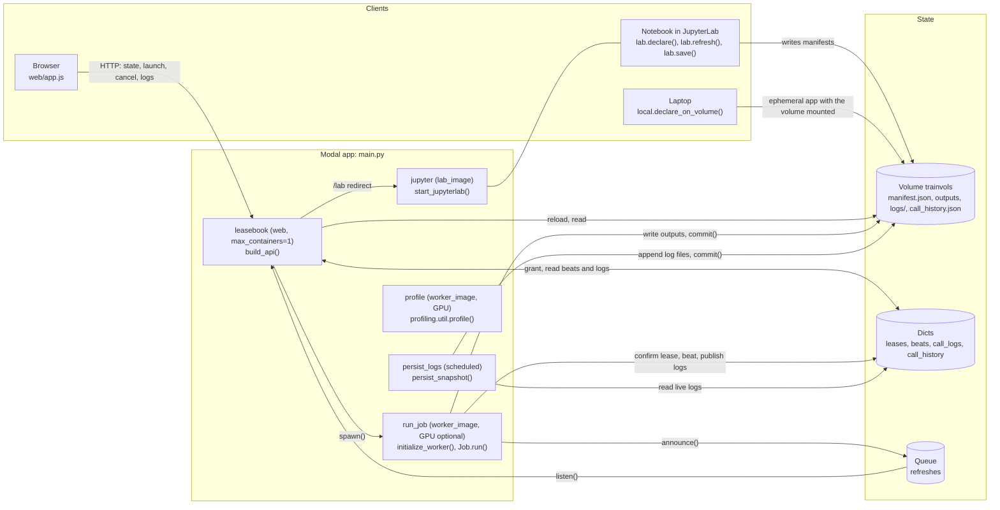
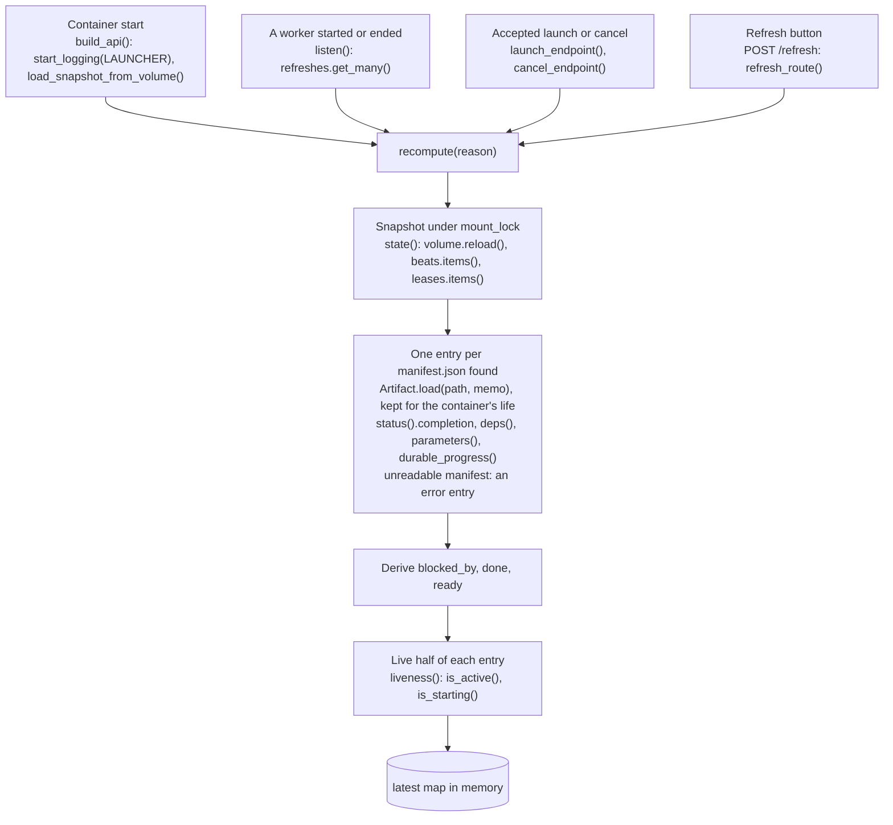
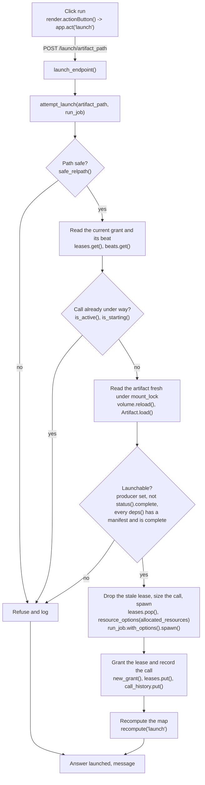
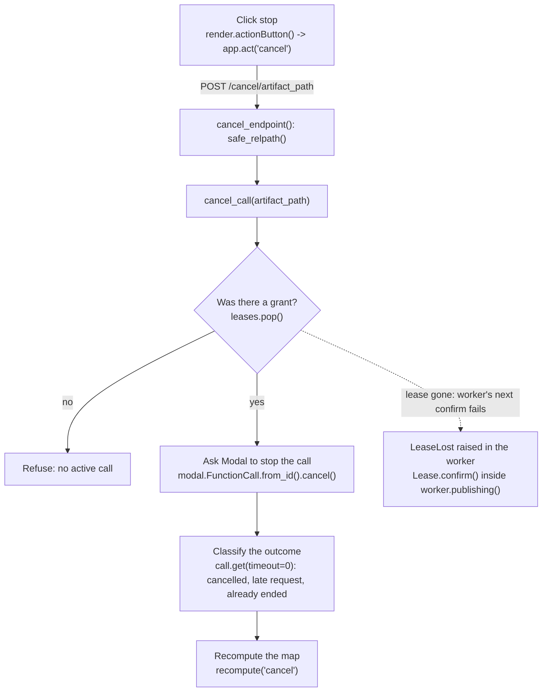

# Launcher

The launcher is the `leasebook` web app: one container, pinned with
`max_containers=1`, that is both the dashboard's API and the only thing that
launches or cancels a job. It keeps one state map of every artifact on the
volume, grants leases, spawns workers, and answers the page.

## Who talks to what

The other containers, each with its own mount of the volume:

- **`run_job`** writes locally and publishes with `volume.commit()` on its way
  out ([Workers](workers.md)).
- **`persist_logs`** is a scheduled function (every `PERSIST_LOGS_EVERY`
  seconds), the only writer of log files and `call_history.json`
  ([Logging](logging.md)). Schedules fire only on a deployed app, not under
  `modal serve`.
- **`jupyter`** serves the lab ([Lab](lab.md)); `lab.py` runs inside it, so its
  functions touch `STORAGE` directly. `local.py` is how a laptop gets there:
  one ephemeral app that mounts the volume.
- **`profile`** runs a profiled training loop on a GPU and returns its
  measurements; it is not a launched job ([Profiling](profiling.md)).

The volume is always the source of truth. Every reader, mounted or not, works
from a snapshot of it: a local mount refreshed on `reload()`, or a remote call
into a container that just took one. Neither container's disk is the other's
cache.

## The state map

`launcher.state.state(root)` maps every declared path under `root` to its
entry, over one `volume.reload()`, one snapshot of the `leases` and `beats`
Dicts, and one glob of `manifest.json` files: each manifest loaded once, its
footprint read, its direct dependency paths listed. There is no resolution and
no graph walk; a dependency is a path in `depends_on`, and whatever else is true
of it lives on its own entry, so no entry goes stale when another changes.
`parameters` is the artifact's own fields only, never a dependency's manifest.
A definition at a path never changes once declared, so each path is decoded
once and kept for the container's life. The `state` docstring owns the
entry's fields.

An entry has two halves. The **durable half** (type, parameters, status,
`done`, `ready`, `blocked_by`, `durable_progress`) changes only when the volume
does, so only a recompute changes it. The **live half** (`call_id`, `active`,
`last_heartbeat`, `live_progress`, `verdict`) is `launcher.state.liveness` over
a grant and a beat, Dict reads with no mount, so `/state` reads it again on
every request for the calls the map found under way. That is how a running
job's progress and heartbeat move on the page between recomputes.

`verdict` is the one word a row shows, first match wins:

| Verdict | Meaning |
| --- | --- |
| `done` | Every completion file exists |
| `running` | The leased call is beating |
| `starting` | A lease has no heartbeat yet and is within its startup grace (`STARTUP_GRACE_SECONDS`) |
| `failed` | The manifest would not load, or the leased call stopped beating or never started within its grace |
| `runnable` | Ready: produced by something, not done, every direct dependency done |
| `blocked` | Otherwise; `blocked_by` lists the direct dependencies not done, missing manifests included |

An artifact failed by its lease stays ready, so it can be run again. A virtual
artifact is never ready. A scan has no requested artifact to compare against,
so it has no drift, never reports `new` or `undeclared`, and reports a manifest
it cannot decode as an error entry at its own path, which leaves every other
entry intact. A state map is an observation over a scan, not a transactional
snapshot: it is rebuilt whole and published at once.

## When the map is recomputed

Only when something changed what it would say, never on a clock:

A manifest declared from the lab is announced by no call, which is what the
refresh button is for. Between recomputes the map is the authority on the
volume, lagged by one message but complete, since an artifact's files never
leave the volume once they land; a row walks `runnable`, `starting`, `running`,
`done` on its own.

**Everything in this container that reloads the mount or holds a file on it
open takes `mount_lock` first**: `state()`, a launch's readiness read, and
`/artifact`. A reload replaces the mount's view of the volume and refuses to
run while the process has a file under it open, so the listener thread's
refresh and a request reading a manifest take turns. The lock is never held
across the listener's blocking queue read, and the routes that take it are sync
`def`, so blocking on it never stalls the event loop (LESSONS.md, "A background
thread makes the mount's reload race its readers"). The launcher container
writes nothing to the volume; at startup it reads the log files back once, so
the Dicts and the files agree after any gap. It runs in `REGION`, next to
Modal's Dicts, so a Dict read is a short round trip.

## Routes

| Route | What it does |
| --- | --- |
| `GET /state` | The map, from memory, plus two Dict reads (grant and beat) for each call under way. Polled by the page every two seconds; polling costs the volume nothing. |
| `GET /artifact/{path}` | The artifact as this container's mount holds it, as of the last recompute: its `manifest.json` without the nested dependency manifests, and its `train.jsonl`, read under `mount_lock`. Fetched only when the artifact's entry changed. It reads leniently, showing whatever is on disk. |
| `GET /logs/{path}` | Every call ever granted for the artifact (`call_history`), each with its log in both storages from the `call_logs` Dict. Dict reads only. |
| `GET /launcher-logs` | The same, for the launcher's own call id. |
| `POST /refresh` | Recompute now. |
| `POST /launch/{path}` | Launch, below. |
| `POST /cancel/{path}` | Cancel, below. |

## Launching

Launching is per artifact and by hand: nothing launches a dependency
automatically, and the user launches dependencies first.

A launch is refused unless the artifact has a job, is not complete, every
direct dependency is declared and complete, and no call is running or starting
on its path. An accepted launch spawns one call with the resources in the
artifact's own manifest (an unspecified one takes Modal's default), records the
grant naming that call, recomputes the map, and returns without waiting for
the job. The launcher records the call itself, in `call_history` and its own
log, at grant time, so a call is listed by the thing that made it, not by
whether it ever ran. Launch decisions are serialized; different paths run
concurrently, a path nested under another's folder included.

## Cancelling

Cancelling releases the lease first, then asks Modal to stop the call: the
lease is the stop that lands at once. The call's next lease check finds no
grant and raises, and every job takes one inside `worker.publishing` between
writing a file and renaming it, so the artifact cannot complete even though
Modal delivers its own cancellation on the container's heartbeat, seconds
later, with no bound worth relying on (LESSONS.md, "A cancel is a request, and
it arrives late"). Until then, a launch made in the meantime is granted, and
two calls write the same artifact: each through its own temporary file, and
only the lease holder renames. What a call's output says once the request is
sent is what the row logged under it says, so a request that arrived after the
job finished does not read as one that stopped it.

## Ownership and liveness

- Each artifact path has at most one owner, the call currently granted it.
  Ownership is per exact path; owning a folder grants nothing beneath it.
- Ownership prevents two calls from publishing to one path, not from running
  at once ([Workers](workers.md#what-reaches-the-volume-and-when)).
- Liveness comes from heartbeats. A call with no heartbeat past its startup
  grace, or whose heartbeat goes stale (older than `FLATLINE` heartbeats), is
  `failed`, and its path can be launched again. Every verdict comes from one
  snapshot of leases and beats and one view of the volume, with no call-status
  request to Modal.

## Scheduling, deferred

There is no queue of work. Launching is per artifact and by hand: `/launch`
starts one job, `/cancel` stops one. A scheduler that took a whole plan and
worked through it was built, run against real containers, and taken back out:
the launcher underneath it wants simplifying first.
