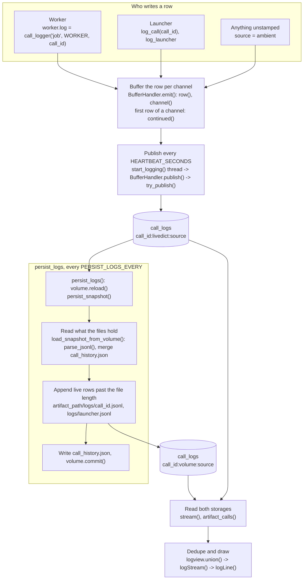

# Logging

Every log row any container files has one shape, is published live to a Modal
Dict, and is persisted beside its artifact on the volume. `system/logs.py` is
the only module that writes a row.

## One shape

```json
{"ts": 1757260800.1, "call_id": "fc-01JQ8W", "source": "worker",
 "level": "INFO", "logger": "job", "msg": "..."}
```

A traceback is folded into `msg`. The `call_logs` key a row lives under is
built from two of its own fields plus where it is kept:

    {call_id}:{storage}:{source}

- **`storage`** is `livedict` for what a container has published to the Dict,
  and `volume` for the rows its file holds: the same rows, one trailing the
  other by a persist pass. A reader unions them and counts a row once.
- **`source`** is who wrote it: `worker` (the call's own account of itself),
  `launcher` (what the launcher did to that call), or `ambient` (what the
  container logged around it that no logger of ours stamped, such as a
  library's warning).
- **`call_id`** is the call the row is about. The launcher's own rows use the
  call id `launcher`, so its log is a call's log in every other way, with no
  `worker` source, no grant and no heartbeat, and its file is
  `logs/launcher.jsonl` at the volume root rather than in an artifact's folder.

## One way in

Two names, and nothing else writes a row:

- **`start_logging(call_id)`**, once per container: points logging at stdout
  (what `modal app logs` reads back), attaches the `BufferHandler` that keeps
  every record in the channel its stamp names, and starts the thread that
  publishes each channel whole every `HEARTBEAT_SECONDS`. `call_id` is whose the
  container's unstamped records are (`launcher` for the launcher, its own call
  id for a worker); those are its `ambient` source.
- **`call_logger(name, source, call_id)`**, which stamps the rest. A job gets
  one as `worker.log` (source `worker`); the launcher binds the two it needs at
  the top of `launcher/leasebook.py`: `log_launcher` for its own doings and
  `log_call(call_id)` for a call it manages.

Which channel a row lands in is the logger it was written with. What the
launcher does to a call (the grant, the cancel, a stale lease dropped, a
refusal naming the call under way, a worker's start and end messages) is
stamped with that call's id, and the handler files it under the container's
own call id as well, so it reads on the artifact's page and in the dashboard's
panel alike. What the container does for itself (starting, the startup sync,
every recompute and what prompted it, a request that raised) is stamped
`launcher` and reads in the panel only. A worker stamps no call but its own, so
the fan-out is the launcher's alone.

The stamp rides on the record, so any thread a call or a container starts files
under the right call without inheriting anything (LESSONS.md, "Ask the record
which call it is, never the thread").



## The two storages

`{call_id}:livedict:{source}` is what a container has published: the whole
list, republished on each pass, so a page polling the Dict sees a call's log
grow while it runs. A container starting a channel continues the longer of what
the Dict holds and what the file's rows say, so a launcher that restarts
mid-call extends the list rather than truncating it.

`{call_id}:volume:{source}` is the file's rows: `{artifact_path}/logs/{call_id}.jsonl`,
or `logs/launcher.jsonl` for the launcher. **`persist_snapshot` is the only thing
that writes one**, on the schedule `persist_logs` runs it (`PERSIST_LOGS_EVERY`
seconds, in its own container). Each pass is stateless:
`load_snapshot_from_volume` walks `**/logs/*.jsonl`, publishes each file's rows
as that call's `volume` channels, and merges `call_history.json` into the
`call_history` Dict (a union per artifact, so a wiped Dict comes back from the
file; a log file no grant names gets a grant with no `granted_ts`). Then the
pass appends every live row past its file's count to that file and to the
`volume` channel, writes `call_history.json` and commits. The launcher runs the
same `load_snapshot_from_volume` once at startup, so a dashboard that comes back
after any gap agrees with the files.

**Which calls belong to an artifact is the `call_history` Dict's to say.**
`attempt_launch` appends the grant right after it spawns, and `artifact_calls`
joins that list with `beats` on every request for an artifact's page. Nothing is
inferred from a beat or a filename.

`/logs/<path>` hands back, per call, `livedict` and `volume` straight from the
Dict, and `/launcher-logs` the same two for the call id `launcher`; neither
reloads the volume or recomputes the map ([Dashboard](dashboard.md)).

## The step log

A leg's `train.jsonl`, one row per training step tagged with the attempt that
took it, is the worker's own file, written by `artifacts/core/SGD/steplog.py`
([Training a Model](training.md#what-you-can-watch)). It reaches the volume when
the worker commits under its lease, and `/artifact/<path>` reads it off the
launcher's mount as the last reload left it; no attempt's rows are streamed
before that commit.

## Levels

- **DEBUG**: protocol chatter only useful when debugging: lease confirms and
  retries, per-step or per-batch detail, cache hits, anything high-frequency.
  What was asked of a call (the spawn request and its resources, a cancel
  request) is DEBUG too; what became of it is INFO, and the page hides DEBUG
  until a reader turns it on, so a call reads as its outcomes first. For
  example, `Lease.confirm` logs every successful confirm and every
  indeterminate retry at DEBUG.
- **INFO**: one line per meaningful lifecycle event, not per iteration: job
  started, its milestones, checkpoint progress, job completed. `runtime.py`
  logs `"done"` once a call's writes are committed, and a line naming the
  ending it is about to announce.
- **WARNING**: a recoverable problem that loses no work: a failed heartbeat
  write, a lease read retried before it succeeds. `try_publish` logs a failed
  `beats.put` or `call_logs.put` at WARNING and keeps going.
- **ERROR**: the call's work is lost or it crashed. `runtime.py` logs a
  `LeaseLost` at ERROR in one line without a traceback (a cancel arrives this
  way too), and any other exception with its traceback before re-raising.
- **CRITICAL**: reserved for failures that abort more than one call. Unused.

There is no separate "training" or "system" logger: a call has one (`job`), the
launcher one (`leasebook`), and every line from anything they do lands in that
channel. A category split, if ever worth having, is another
`call_logger("job.lease", ...)`, whose rows carry their own `logger` name and
land in the same channel.

## Not captured

- Output that bypasses `logging` (a bare `print`, tqdm on stderr) reaches only
  Modal's own capture and expires there.
- A library that gives itself a handler and sets `propagate = False` never
  reaches ours, so its lines are Modal's only (LESSONS.md, "A library that keeps
  its own handler never reaches ours").
- The lab's output reaches only `modal app logs`.
- A live channel is the whole of its file plus what came after, republished every
  `HEARTBEAT_SECONDS`; nothing trims it.
- A container killed hard (out of memory, evicted) or one that never starts
  (image build failure, no GPU available) is listed with what it published up to
  its last beat, beside the launcher's own rows about it; Modal's line saying
  why stays in Modal.

## Reference

::: system.logs
