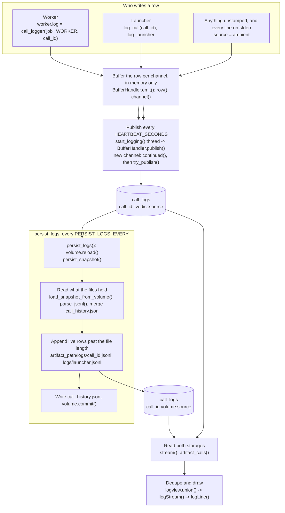

# Logging

Every log row any container files has one shape, is published live to a Modal
Dict, and is persisted to a file on the volume by one scheduled pass.
`system/logs.py` is the only module that writes a row.

## The row

```json
{"ts": 1757260800.1, "call_id": "fc-01JQ8W", "source": "worker",
 "level": "INFO", "logger": "job", "msg": "..."}
```

A traceback is folded into `msg`. Rows are kept in lists, one per **channel**,
and a channel is one key of the `call_logs` Dict:

    {call_id}:{storage}:{source}

- **`call_id`** is the call the row is about. The launcher's own rows use the
  call id `launcher`, so its log is a call's log in every other way, with no
  `worker` source, no grant and no heartbeat.
- **`storage`** is `livedict` for what a container has published, and `volume`
  for what its file holds: the same rows, the second trailing the first by a
  persist pass.
- **`source`** is who wrote it: `worker` (the call's account of itself),
  `launcher` (what the launcher did to that call), or `ambient` (a record no
  logger of ours stamped, such as a library's warning, or a line written to
  stderr).

## How a row travels



1. **Stamp.** Code logs through `call_logger(name, source, call_id)`, which
   puts `source` and `call_id` on the record itself. A job's is `worker.log`
   (`job`, `worker`); the launcher's are `log_launcher` for its own doings and
   `log_call(call_id)` for a call it manages (`leasebook`, `launcher`).
2. **Buffer.** `start_logging(call_id)`, once per container, attaches a
   `BufferHandler` to the root logger. `emit` turns each record into a row and
   appends it to the live channel its stamp names; an unstamped record is
   filed under the container's own `call_id` as `ambient`. A row the launcher
   stamps with another call's id is appended to the launcher's own channel as
   well, so a grant or a cancel reads on the artifact's page and in the
   dashboard's panel alike. `emit` never leaves memory: it runs on whatever
   thread logged, Modal's own event loop included, where a blocking Modal
   call raises. `start_logging` also puts a tee in place of `sys.stderr`
   (`_StderrLines`): every write goes through to the real stream, and every
   complete line reaches the buffer as an unstamped INFO record from the
   logger `stderr`. That is how a library that logs through a handler of its
   own, torch's compile warnings and Inductor's `AUTOTUNE` tables among them,
   and Python's warnings reach a call's log. A carriage return restarts the
   line, so a progress bar files as its last state.
3. **Publish.** A thread `start_logging` starts puts every channel the
   container holds, whole, every `HEARTBEAT_SECONDS`. A channel new since the
   last pass is first started from `continued()`: the longer of the Dict's
   live and volume lists, so a container that restarts mid-call extends a
   channel rather than truncating it. One whose read fails is held back to the
   next pass rather than put without its start. Stopping publishes once more,
   so the rows logged on the way out land.
4. **Persist.** `persist_logs` runs `persist_snapshot` every
   `PERSIST_LOGS_EVERY` seconds in its own container. It reloads the volume,
   runs `load_snapshot_from_volume` (every `**/logs/*.jsonl` read and put as
   that call's `volume` channels, `call_history.json` merged into the
   `call_history` Dict), appends each call's live rows past its file's row
   count to the file and to its `volume` channel, writes `call_history.json`
   and commits. The calls it visits are those `call_history` names, plus
   `launcher`. Reading the files first is also what brings a wiped Dict back,
   within one pass.
5. **Read.** `/logs/<path>` returns, for every call `call_history` lists under
   the artifact, both storages from the Dict (`artifact_calls`);
   `/launcher-logs` returns both for the call id `launcher` (`stream`). Neither
   touches the volume.
6. **Draw.** The page unions the two storages, counting a row once by `ts`,
   `level`, `logger` and `msg`, sorts newest first and draws every line. DEBUG
   is hidden until the reader turns it on.

**Which calls belong to an artifact is the `call_history` Dict's to say.**
`attempt_launch` appends the grant right after it spawns, before the call has
said anything; nothing is inferred from a beat or a filename. A log file no
grant names gets a grant with no `granted_ts` when the files are read, so
nothing on the volume goes unlisted.

## Where it lives

### The `call_logs` Dict

`launchpad-call-logs`, served from us-east, holds every channel. A `livedict`
channel is written by the container that logged its rows, through its
`BufferHandler`, and read by both log routes, by `continued()` when a container
starts the channel again, and by `persist_snapshot` for the rows to file. A `volume` channel is a copy
of the file's rows, written by `load_snapshot_from_volume` and
`persist_snapshot`, and read by both log routes and `continued()`.

### The `call_history` Dict

`launchpad-call-history` holds every grant, keyed by artifact path. It is
written by `attempt_launch` at grant time and by `load_snapshot_from_volume`'s
merge of `call_history.json`, and read by `artifact_calls` to list an
artifact's calls and by `persist_snapshot` to find each call's file.

### The volume

`{artifact_path}/logs/{call_id}.jsonl` for a call, `logs/launcher.jsonl` at the
root for the launcher, and `call_history.json` at the root are the durable
record. `persist_snapshot` is the only thing that writes them;
`load_snapshot_from_volume` reads them back.

### stdout

`log_to_stdout`, the first thing `start_logging` does, points `basicConfig` at
stdout, so every record is also a formatted line in `modal app logs`. A
`run_profile` call runs `log_to_stdout` alone: its rows are only in Modal's
capture, which `run_profile` prints as the call runs. Our loggers log at DEBUG, libraries at
INFO, and `modal`, `grpc`, `urllib3` and `uvicorn.access` at WARNING, so the
publisher's own requests stay out of the log.

### Regions

The launcher and `persist_logs` run in `REGION`, beside the Dicts, so each Dict
read is a short round trip; a worker and the lab run in any region, wherever Modal has room
for them.

## Why

- **Live rows go to a Dict, not a file.** A file a worker writes reaches the
  volume on a background commit, at no moment anyone can wait on, and the
  launcher sees it only after its next reload. A Dict put is visible to every
  reader at once, so a page polling it watches a call's log grow while it runs.
- **One scheduled pass writes the files, not each container.** The launcher
  writes nothing to the volume, and no container has to commit its own log: the
  pass files whatever the Dict holds, whoever published it, a container killed
  hard included. It is stateless: the count it appends from is the file's own,
  so a pass that never ran costs lag and nothing else.
- **A channel is put whole.** A Dict has no append. Every key has one writer
  (a container for its live channels, the file readers for `volume` ones), so a
  whole put needs no read back and loses no update.
- **Two storages under separate keys.** Keeping the file's rows apart from the
  container's keeps each key to one writer, and lets a wiped Dict come back
  from the files. The reader pays for it by unioning two lists.
- **The stamp rides on the record.** Any thread a call or a container starts
  files under the right call without inheriting anything (LESSONS.md, "Ask the
  record which call it is, never the thread").
- **The launcher is a call id.** Its log takes the same routes, the same file
  layout and the same renderer as any call's.
- **A grant is recorded at grant time.** A call whose container never ran is
  still listed under its artifact, with the launcher's rows about it (LESSONS.md,
  "A call the container never spoke for was invisible").
- **stderr is teed in Python, once, and never put back.** A library's handler
  keeps the `sys.stderr` it found when it was made, and torch makes its own at
  import, so the tee goes in with the first `start_logging`, before any job
  imports torch, and stays for the container's life; each call only points it
  at its own buffer. Swapping file descriptor 2 for a pipe would also catch
  native code and subprocesses, but every write to stderr would then wait on a
  reader thread, and a reader that stalled would stall the job.

## What it costs

Each of these grows with history, and nothing trims it:

- **Publishing.** Every `HEARTBEAT_SECONDS`, a container puts every channel it
  holds, changed or not. The launcher's own channel holds every row it has ever
  logged, continued from the file, and the launcher also holds a channel for
  every call it has logged about since it started.
- **Reading.** `/launcher-logs` returns the launcher's whole log twice, once
  per storage, on every poll of the dashboard, and the page dedupes and redraws
  all of it.
- **Persisting.** Each pass reads every log file back and puts each as its
  `volume` channel, one at a time, gets and puts `call_history` per artifact,
  and gets every listed call's live channels. It runs in its own container, so
  the launcher never waits on it.

## The step log

A leg's `train.jsonl`, one row per training step tagged with the attempt that
took it, is the worker's own file, written by `artifacts/core/SGD/steplog.py`
([Training a Model](training.md#what-you-can-watch)). It reaches the volume when
the worker commits under its lease, and `/artifact/<path>` reads it off the
launcher's mount as the last reload left it; no attempt's rows are streamed
before that commit.

## Levels

- **DEBUG**: protocol chatter: lease confirms and retries, per-step detail,
  every recompute. What was asked of a call (the spawn request and its
  resources, a cancel request) is DEBUG too; what became of it is INFO, so a
  call reads as its outcomes first.
- **INFO**: one line per lifecycle event, not per iteration: job started, its
  milestones, checkpoint progress, `"done"` once a call's writes are committed.
- **WARNING**: a recoverable problem that loses no work: a failed heartbeat or
  log put (`try_publish`), a lease read retried before it succeeds.
- **ERROR**: the call's work is lost or it crashed. A `LeaseLost` (a cancel
  arrives this way too) is one line without a traceback; any other exception
  is logged with its traceback before it is re-raised.
- **CRITICAL**: reserved for failures that abort more than one call. Unused.

There is one logger per role, `job`, `leasebook` and `profile`, not one per
category. A split, if ever worth having, is another `call_logger("job.lease",
...)`, whose rows carry their own `logger` name and land in the same channel.

## Not captured

- A bare `print`, or anything else on stdout that bypasses `logging`, reaches
  only Modal's own capture and expires there. stderr is captured, but only
  what Python writes to `sys.stderr`: native code or a subprocess writing to
  file descriptor 2 reaches only Modal's capture.
- A library that gives itself a handler and sets `propagate = False` reaches
  ours only as lines on stderr: `ambient` rows from the logger `stderr`, at
  INFO whatever their own level, and only from a handler made after the
  container's first `start_logging` (LESSONS.md, "A library that keeps its own
  handler never reaches ours").
- The lab's output reaches only `modal app logs`.
- A `run_profile` call's rows are only in Modal's capture: `run_profile` prints
  them as the call runs, and nothing puts them in `call_logs` or on the volume.
  A declared profile runs as a job, so its rows, torch's included, are in its
  call's log.
- Under `modal serve` no schedule fires, so nothing is persisted; the Dict is
  the only copy.
- A container killed hard (out of memory, evicted) or one that never starts
  (image build failure, no GPU available) is listed with what it published up
  to its last beat, beside the launcher's rows about it; Modal's line saying
  why stays in Modal.

## Reference

::: system.logs
