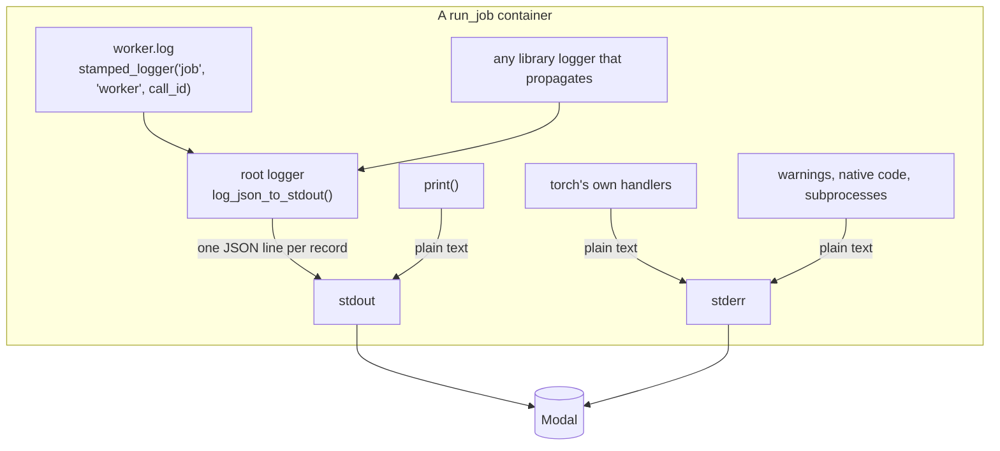
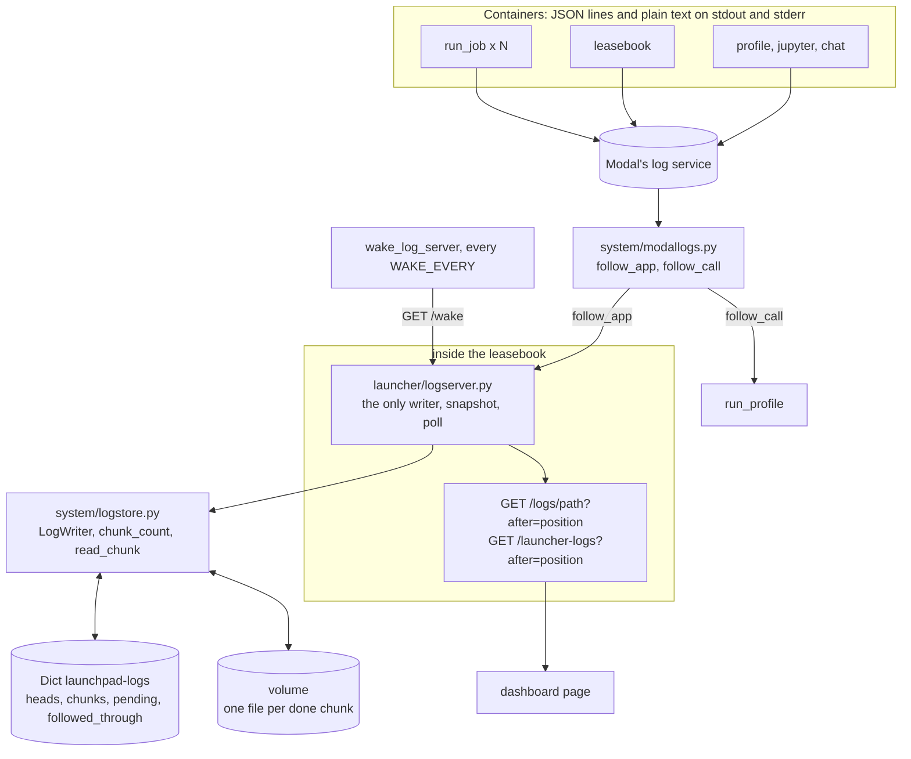

# Logging through Modal's capture

**Proposed** replacement for the pipeline in [Logging](../logging.md), which keeps its own copy
of every log row in a Modal Dict, republished whole every second. Part 1 is the shape. Part 2 is
the specification, ending with the plan.

## Part 1: The shape

Modal already keeps everything each container writes to stdout and stderr, labeled with the
container and the call that wrote it. So:

- every container writes each log record as one JSON line to stdout, and nothing more;
- Modal keeps it;
- a log server in the launcher's container copies every row into a Dict within seconds, so it
  outlives every container and Modal's own retention;
- the log server persists the Dict's rows to the volume in chunks, and serves an artifact's or
  the launcher's log from both as one view.

### 1. Writing

The containers are the workers (`run_job`), the launcher (`leasebook`), and `profile`,
`wake_log_server`, `jupyter` and `chat`. Each calls `log_json_to_stdout()` once, which points
Python's logging at stdout, one JSON line per record. Our own code logs through
`stamped_logger(name, source, call_id)`, which puts the call and the writer on every record; a
job's `worker.log` is one. Both are in `system/loglines.py`.



Output that bypasses our loggers is plain text, captured the same way.

### 2. What Modal keeps

Every chunk a container writes to stdout or stderr, with a timestamp, the container's id and,
while the container runs a call, the call's id. It adds lines of its own about containers: out
of memory, preemption, waiting for a GPU. It keeps all of it for the account's retention period.
Modal's own API reads it back: `.logs.fetch()` for a time range and `.logs.stream()` for what
arrives next, on an `App`, a `Function` or a `FunctionCall`.

### 3. Rows

A line read back is a row:

```json
{"id": "ta-01JQ8WZ4:7:812", "ts": 1793534400.123, "call_id": "fc-01JQ8W",
 "source": "worker", "level": "INFO", "logger": "job", "msg": "step 120: loss 2.31"}
```

`id` is unique to the row, so a row read twice is kept once. `source` is who wrote it: `worker`,
`launcher`, `ambient` (no stamped logger) or `modal` (Modal's own lines). `call_id` is the call it
is about:

| The line | `call_id` | `source` |
|---|---|---|
| a stamped logger in a worker | its stamp | `worker` |
| anything else in a worker or `profile` | the call Modal labeled it with | `ambient` |
| a Modal line about a worker's container | the call that container last ran | `modal` |
| the launcher, about itself | `launcher` | `launcher` |
| the launcher, about call X | `X` | `launcher` |
| anything else in the leasebook | `launcher` | `ambient` |
| anything in `wake_log_server`, `jupyter` or `chat` | the function's name | `ambient` |

The launcher stamps every row because Modal labels the leasebook's lines with a web request, not
with the call a row is about. `row_from_line` sits in `system/loglines.py` beside the writer, so
the line format lives in one file.

### 4. Reading from Modal: `system/modallogs.py`

Launchpad's module over Modal's log API, and the only one that calls it. Its two functions are
launchpad's: each calls Modal's `.logs.fetch()` or `.logs.stream()` and turns the chunks that
come back into rows.

| Launchpad function | What it does | Returns | Modal API underneath |
|---|---|---|---|
| `follow_app(since)` | Reads every row any container of the app wrote from `since` until now, then keeps watching and hands over each new row as soon as Modal has it. After a dropped connection it reconnects by itself, without repeating a row. | `Iterator[Row]` that never ends | `App.logs.fetch`, then `App.logs.stream` |
| `follow_call(call_id)` | Watches one call and hands over each of its rows as soon as Modal has it, starting with Modal's "waiting for a GPU" lines while the call waits for a container. | `Iterator[Row]` that ends when the call ends | `FunctionCall.logs.stream`, and `Function.logs.fetch` on `profile` until the call starts |

`follow_call` is for `run_profile`, which runs a profile from a notebook and prints its log.

### 5. Where rows are kept: `system/logstore.py`

Two kinds of log are kept, each named by its call id: every call the launcher granted (the ones
the `call_history` Dict lists, by artifact), and `launcher`. Every other call id stays in Modal
only.

- **A log is a run of chunks.** Each chunk holds up to `CHUNK_ROWS` rows. Rows are appended to
  the last chunk, the open one.
- **A chunk is done** when it is full, or when its log has been quiet for `SEAL_IDLE_SECONDS`.
  It is then persisted to the volume as a file of its own and marked done in the Dict. A done
  chunk never changes, and the log's next rows open a new chunk.
- **The Dict holds every chunk,** in a new Dict, `launchpad-logs`, beside a head per log saying
  how many chunks it has. An entry nobody reads or writes for 7 days expires.
- **The volume holds every done chunk:** `{artifact_path}/logs/{call_id}/{chunk}.jsonl`, or
  `logs/launcher/{chunk}.jsonl`.
- **The Dict also records `followed_through`,** the time before which every row is in it.

`LogWriter` files rows into chunks, flushes them to the Dict and persists the done ones. Readers
consume both: `read_chunk` returns a chunk from the Dict while it is there, and from the volume
image once it has expired. A done chunk is the same rows in both, so it does not matter which one
a reader got.

### 6. The log server: `launcher/logserver.py`

The log server runs inside the leasebook, and it is the only writer of logs. It follows Modal
with `follow_app(followed_through)`, buffers the rows in memory, and writes them to their chunks
in the Dict every `FLUSH_SECONDS` (2 seconds). Every `PERSIST_LOGS_EVERY` (a minute) it persists
the chunks that are done. The volume image may come later and slowly: readers have the rows from
the Dict meanwhile, and a chunk is safe there until it goes 7 days without a read or write.

`wake_log_server`, which Modal runs every `WAKE_EVERY` (10 minutes), only sends a request to the
leasebook's `/wake`. A leasebook that was down starts for it, and its log server catches up from
`followed_through` and persists. So logs reach the Dict and the volume with no page open, and
there is still one writer.

Its API takes a list of call ids:

- `snapshot(call_ids)` returns the latest rows of those logs, merged into one list by time, and a
  position: each log's last chunk and how many of its rows were read.
- `poll(call_ids, position)` returns the rows past that position, merged by time, and the new
  position. Polling again and again is the live stream.

A done chunk never changes and an open one only grows, so a position stays valid across restarts
of the leasebook.

### 7. The page

`/logs/<path>` serves an artifact's calls and `/launcher-logs` the launcher's: a snapshot without
`after`, a poll with `after=<position>`. The page draws the snapshot, then polls every 2 seconds
and adds what comes back, newest first. It keeps rows by id, so when a chunk it read from the
Dict is read again from the volume image, the rows it already shows stay as they are.

### 8. All together



One row's trip:

1. A job logs "step 120": one JSON line on stdout.
2. Modal keeps it, labeled with the call and the container.
3. `follow_app` yields it as a row, and the log server files it as row 44 of chunk 3 of
   `fc-01JQ8W`, the open one.
4. Within `FLUSH_SECONDS`, it is in the Dict.
5. The page's next poll, at position `fc-01JQ8W:3.44`, gets it.
6. Once chunk 3 is full, or the call has been quiet for `SEAL_IDLE_SECONDS`, the next persist
   writes it to the volume and marks it done.
7. Once chunk 3 has gone 7 days without a read or write, it expires from the Dict, and reads
   come from its file.

Boundaries:

- **`loglines`** is the line format, both ways, on the standard library alone. It is the only
  logging module a container's write path imports, so writing a log never touches the network.
- **`modallogs`** is the only module that calls Modal's log API. Replacing Modal's logs means
  rewriting this file.
- **`logstore`** is the only module that reads or writes log rows, in the Dict or on the volume.
- **`logserver`** is the only writer, in the leasebook, and serves `snapshot` and `poll`.
- **The page** sees rows and positions, over HTTP.

### Why

| Where live rows go | Cost per record in the container | Captures `print`, native output, Modal's lines | Moving parts |
|---|---|---|---|
| A Dict, every row republished each second (today) | the whole log, every second | no | buffer, publisher thread, a wrapper around stderr, two copies merged on the page |
| A Dict, written by each worker in chunks | the new rows | no | a publisher thread in every container |
| A Queue, one partition per call | the new rows | no | publisher thread; reads remove rows, so one reader only |
| **Modal's capture, copied to a Dict by one writer** | **a line on a pipe** | **yes** | **a formatter, a parser, a writer** |
| An external service (Loki, OpenTelemetry) | an exporter | with an agent | a service and its credentials |

- **A Dict between Modal and the volume.** Rows outlive every container and Modal's retention
  seconds after they are written, and a position points into chunks no restart rewrites.
- **One follow for the whole app.** One connection carries every call's rows, the launcher's, and
  Modal's lines that name no call, and one fetch from `followed_through` fills any gap.
- **One writer.** Only the log server writes chunks, and the scheduled job wakes it rather than
  writing itself, so no chunk is ever written by two and no lease is needed.
- **A done chunk persisted whole.** Writing its file twice writes the same file, so persisting
  needs no record of how far it got: a crash before the mark only makes the next pass repeat it.
- **Woken on a schedule.** A log persisted only when someone reads it could expire from the Dict
  first.
- **Polled, not pushed.** A pushed stream would hold one of the leasebook's
  concurrent requests open for as long as a page is.

## Part 2: Specification

### 1. Writing: `system/loglines.py`

```python
WORKER, LAUNCHER, AMBIENT, MODAL = "worker", "launcher", "ambient", "modal"  # LAUNCHER is also a call_id

def log_json_to_stdout() -> None
def stamped_logger(name: str, source: str, call_id: str) -> logging.LoggerAdapter
def launcher_logger(call_id: str = LAUNCHER) -> logging.LoggerAdapter
```

- `log_json_to_stdout` gives the root logger one handler on stdout. Our loggers log at DEBUG,
  libraries at INFO, `modal`, `grpc`, `urllib3` and `uvicorn.access` at WARNING. It uses
  `basicConfig(force=True)`, so calling it again changes nothing.
- `stamped_logger` is a `LoggerAdapter` putting `call_id` and `source` on every record, from any
  thread. `launcher_logger(call_id)` is `stamped_logger("leasebook", LAUNCHER, call_id)`.

A line is one JSON object:

| Key | Value |
|---|---|
| `v` | `1`; a line without it is not ours |
| `ts` | `record.created`, Unix seconds |
| `pid` | `os.getpid()`; a forked DataLoader worker shares the parent's `seq` |
| `seq` | a per-process count from 0 |
| `call_id`, `source` | the record's stamp, or `null` |
| `level`, `logger` | `record.levelname`, `record.name` |
| `msg` | the message, then the traceback after a newline; cut to `MAX_LINE_BYTES = 16384`, ending `[cut: N bytes]` |

```json
{"v": 1, "ts": 1793534400.123, "pid": 7, "seq": 812, "call_id": "fc-01JQ8W", "source": "worker", "level": "INFO", "logger": "job", "msg": "step 120: loss 2.31"}
```

`json.dumps` escapes every newline, so a traceback stays one line.

### 2. Modal's log API: version 1.5.4

From here on, a name with a Modal object in front (`FunctionCall.logs.stream`) is Modal's; a bare
name is launchpad's.

- Logs are read through `.logs` on three Modal objects: `modal.App.lookup(APP_NAME)`,
  `modal.Function.from_name(APP_NAME, name)` and `modal.FunctionCall.from_id(call_id)`.
- `.logs.fetch(since, until, source)` returns a time range, filtered by stream. It makes a count
  request, up to three refining counts and up to ten fetches; a range is at most 35 days.
- `.logs.stream()` is one long-lived request, with no resume point. `App.logs.stream` never
  ends; `FunctionCall.logs.stream` ends with the call.
- Both yield `modal.types.LogEntry(message, timestamp, source, object_id, context_ids)`, `source`
  one of `stdout`, `stderr`, `system`.
- `context_ids` holds the ids the entry was written under: function `fu-`, call `fc-`, input
  `in-`, container `ta-`. Empty ones are dropped, so each is recognized by its prefix.
- `message` is a chunk of one container's stream: several lines, or part of one. Entries are
  ordered within one container's stream only.

The Dict API used in section 5: `Dict.get(key)` and `Dict.update(mapping)`, which writes several
keys in one request.

### 3. Rows: `system/loglines.py`

```python
class Row(TypedDict):
    id: str
    ts: float
    call_id: str
    source: str  # worker | launcher | ambient | modal
    level: str
    logger: str
    msg: str

class Origin(NamedTuple):  # what Modal says about a line
    ts: float
    stream: str      # stdout | stderr | modal
    call_id: str     # the call Modal files the line under
    container: str
    index: int       # the line's position among those its entry completed

def row_from_line(line: str, origin: Origin) -> Row
```

`row_from_line` takes the text after the line's last `\r`, so a progress bar keeps its last
state, then:

- **a JSON object with `"v": 1`**: `id` is `{container}:{pid}:{seq}`; `ts`, `level`, `logger`,
  `msg` are the line's; `call_id` is the line's or else `origin.call_id`; `source` is the line's
  or else `ambient`.
- **any other line**: `id` is `{container}:{origin.ts}:{index}`, `ts` is `origin.ts`, `call_id`
  is `origin.call_id`, `source` is `modal` for a Modal line and `ambient` otherwise, `level` is
  `INFO`, `logger` is the stream's name.

A fetch and a stream read the same entry into rows with the same ids, so a reader drops repeats
by id.

### 4. Reading from Modal: `system/modallogs.py`

```python
def follow_app(since: float) -> Iterator[Row]
def follow_call(call_id: str) -> Iterator[Row]
```

Below, `run_job` and `profile` are `modal.Function.from_name(APP_NAME, name)`, looked up on first
use, never at import.

**Lines.** One buffer per container and stream holds a line not yet ended. A complete line goes
to `row_from_line`; a blank one yields nothing. A buffer waiting `PARTIAL_LINE_SECONDS = 5` is
flushed as a line.

**Origin.** `stream` is the entry's `source`, with `system` renamed `modal`; `container` is its
`ta-` id; `call_id` depends on the function its `fu-` id names:

| Function | `origin.call_id` |
|---|---|
| `leasebook` | `launcher` |
| `run_job`, `profile` | the entry's `fc-` id, or, for an entry with none, the call its container last ran |
| any other | the function's name |

**`follow_app(since)`** reads `App.logs.fetch(since, now)`, then `App.logs.stream`. When the
stream fails, it waits `HEARTBEAT_SECONDS` (one second, the workers' heartbeat interval), reads
`App.logs.fetch` from `RECONNECT_OVERLAP_SECONDS = 5` before its last row, skips the ids it
already yielded in that window, and opens a new stream.

**`follow_call(call_id)`** reads `FunctionCall.from_id(call_id).logs.stream` until the call
ends. Modal's line saying a call waits for a GPU carries no call id, so until the call's first
line it also reads `profile.logs.fetch(source="system")` every `HEARTBEAT_SECONDS`.

### 5. Where rows are kept: `system/logstore.py`

```python
log_dict = modal.Dict.from_name(f"{APP_NAME}-logs", create_if_missing=True)

class LogWriter:
    followed_through: float  # read when the writer is made

    def add(self, row: Row) -> None
    def flush(self) -> None
    def persist(self, root: Path, volume: modal.Volume) -> None

def chunk_count(root: Path, log: str) -> int
def read_chunk(root: Path, log: str, chunk: int) -> list[Row]
```

**Keys in `log_dict`:**

| Key | Value |
|---|---|
| `{log}:head` | `{"chunks": n}`: chunks 0 to `n - 1` exist |
| `{log}:{chunk}` | `{"rows": [...], "done": bool}`, at most `CHUNK_ROWS = 256` rows |
| `pending` | the chunks not yet done, as `"{log}:{chunk}"` |
| `followed_through` | a time: every row older is in the Dict |

A chunk is at most `CHUNK_ROWS * MAX_LINE_BYTES`, 4 MiB.

**Files.** A done chunk of a call is `{artifact_path}/logs/{call_id}/{chunk:06d}.jsonl`, the
artifact path read from `call_history`, which maps each artifact path to its grants (`call_id`,
`granted_ts`, `artifact_type`); the map from call id to artifact path is read from
`call_history.items()`, and read again when a call id is missing from it. A done chunk of
`launcher` is `logs/launcher/{chunk:06d}.jsonl`. One row per line.

**`LogWriter()`** reads `followed_through`, or takes now when there is none, and merges
`call_history.json` into `call_history`, so a wiped Dict comes back.

**`add(row)`** files a row of a granted call or of `launcher` into its log's open chunk, in
memory until the next `flush`, and drops any other. A `launcher`
row about another call is filed in both logs. The first row of a log loads its head and its last
chunk, which, if not done, this writer continues: a new writer picks up where the last one
stopped. A full chunk stays pending and the next row opens a new chunk. A row whose id the writer
holds is skipped; it holds the ids of rows newer than `followed_through` less
`RECONNECT_OVERLAP_SECONDS`, starting with those in the chunks it loads.

**`flush`** writes every changed chunk, its head and `pending` in one `log_dict.update`, then
`followed_through`: the newest `ts` flushed, less `FOLLOW_LAG_SECONDS = 30`. A crash before
`followed_through` only makes the next writer repeat rows, and it skips them by id.

**`persist(root, volume)`**:

1. Every pending chunk that is full, or whose log's newest row is older than
   `SEAL_IDLE_SECONDS = 300`, is written to its file (to `{file}.tmp`, then renamed).
2. `call_history.json` is written, then `volume.commit()`.
3. One `log_dict.update` marks those chunks done and takes them out of `pending`.

A crash between 2 and 3 leaves them pending, and the next persist writes their files again: the
same rows, or more for a chunk that grew in between.

**`chunk_count(root, log)`** is the head's `chunks`, or the number of the log's files once the
head has expired.

**`read_chunk(root, log, chunk)`** returns the chunk's rows from the Dict, or from its file once
the Dict's entry has expired. A call from before this design has neither head nor files: its one
chunk is today's `{artifact_path}/logs/{call_id}.jsonl`, each row's missing `id` given as
`{call_id}:{line number}`.

| How a log is kept | A flush costs | Persisting it twice | |
|---|---|---|---|
| one list per log in the Dict | the whole log, and a size ceiling | | no |
| chunks appended to one file per log | the new rows | repeats lines, unless a byte count says where to cut | no |
| **chunks, each persisted as its own file once done** | **the new rows' chunk** | **writes the same file** | **this** |

### 6. The log server: `launcher/logserver.py`

```python
class Batch(TypedDict):
    rows: list[Row]  # oldest first
    position: str    # "{log}:{chunk}.{rows read},{log}:{chunk}.{rows read}"

def start_log_server(root: Path, volume: modal.Volume) -> Callable[[], None]
def snapshot(call_ids: list[str]) -> Batch
def poll(call_ids: list[str], position: str) -> Batch
```

**`start_log_server`**, called by the leasebook's `build_api`, makes a `LogWriter`, then starts:

1. a thread calling `add` for every row of `follow_app(writer.followed_through)`;
2. a thread calling `flush` every `FLUSH_SECONDS = 2`, and `persist` every
   `PERSIST_LOGS_EVERY = 60` under `launcher.state.mount_lock`, which every read of the
   leasebook's mount holds.

Anything that escapes either thread is logged at ERROR and the thread starts again; the follow
starts again from its last row's `ts`. Neither logs per row: the leasebook's own output is in
what it follows. The function it returns flushes and persists, so a leasebook scaling down
leaves its done chunks on the volume.

**`snapshot(call_ids)`** reads each log's chunks from the last backwards until it has
`SNAPSHOT_ROWS = 5000` rows, merges them by `(ts, id)` and keeps the last `SNAPSHOT_ROWS`. Its
position is each log's last chunk and its row count.

**`poll(call_ids, position)`** reads each log from its chunk and row count in the position to
its end, through any chunks opened since, or its last `SNAPSHOT_ROWS` rows for a log the
position lacks (a call granted since). It merges by `(ts, id)` and returns the new position.

**`/wake`**, a route the leasebook's password gate lets through like the docs, answers 204 and
does nothing else: the request is what starts the container. **`wake_log_server`** in `main.py`,
scheduled every `WAKE_EVERY = 600` seconds, is one request to it,
`httpx.get(f"{leasebook.get_web_url()}/wake")`.

### 7. Routes and the page

`GET /logs/{artifact_path:path}` is `snapshot` over the calls of the artifact's grants in
`call_history`; with `?after=<position>` it is `poll`:

```json
{"artifact_path": "runs/toy/pretraining",
 "calls": [{"call_id": "fc-01JQ8W", "granted_ts": 1793534100.0, "last_heartbeat": 1793534412.5}],
 "rows": [{"id": "ta-01JQ8WZ4:7:812", "ts": 1793534400.123, "call_id": "fc-01JQ8W",
           "source": "worker", "level": "INFO", "logger": "job", "msg": "step 120: loss 2.31"}],
 "position": "fc-01JQ8W:3.45"}
```

`calls` is each grant with its last heartbeat, read off the `beats` Dict. `GET /launcher-logs`
and `GET /launcher-logs?after=<position>` do the same for `["launcher"]`, answering
`{"rows", "position"}`.

The page holds its rows in a `Map` by id, and a position, per view. A snapshot starts the map
and each poll adds to it; a row the map holds is kept once, so a chunk read again from the volume
image changes nothing on the page. It draws newest first, its source filter gains `modal`, and the artifact view's
"last heartbeat" row stays, built from `calls`.

### 8. All together

One row's trip, with what each step holds:

1. `worker.log.info("step 120: loss 2.31")` in call `fc-01JQ8W` writes the line in section 1.
2. Modal keeps `LogEntry(message="<the line>\n", source="stdout",
   context_ids=["fu-...", "fc-01JQ8W", "in-...", "ta-01JQ8WZ4"])`.
3. `follow_app` yields the row in section 3, and `add` appends it as row 44 of chunk
   `fc-01JQ8W:3`.
4. The next `flush` writes `fc-01JQ8W:3` with 45 rows, `done` false, and `fc-01JQ8W:3` is in
   `pending`.
5. `GET /logs/runs/toy/pretraining?after=fc-01JQ8W:3.44` returns it, with position
   `fc-01JQ8W:3.45`.
6. Chunk 3 fills to 256 rows. The next `persist` writes
   `runs/toy/pretraining/logs/fc-01JQ8W/000003.jsonl`, commits, and marks the chunk done.
7. Once `fc-01JQ8W:3` has expired from the Dict, `read_chunk` reads that file.

| Module | Imports | Never imports |
|---|---|---|
| `system/loglines.py` | the standard library | anything that reaches the network |
| `system/modallogs.py` | `loglines`, `config`, `modal` | `launcher.*`, the volume |
| `system/logstore.py` | `loglines`, `system.lease_protocol`, `config`, `modal` | `launcher.*`, Modal's log API |
| `launcher/logserver.py` | `loglines`, `modallogs`, `logstore`, `launcher.state` | Modal's log API |
| `launcher/leasebook.py` | `logserver`, `loglines` | `modallogs`, `logstore` |
| `system/runtime.py`, `lab.py` | `loglines` | `modallogs`, `logstore`, `logserver` |
| `profiling/util.py` | `modallogs` (`follow_call`) | Modal's log API |

A service replacing Modal's logs must, for `modallogs` alone to change:

- keep each container's stdout and stderr, in order per stream;
- label each line with a timestamp and its container, and ideally its call;
- return the whole app's lines from a given time, then stream what follows;
- keep them for longer than `WAKE_EVERY`.

### 9. Failure modes

| What fails | What happens |
|---|---|
| Modal's log service is slow or down | New rows stop reaching the Dict. Workers do not notice: a write is a line on a pipe. The log server catches up from `followed_through`. |
| The leasebook is down | The page is down with it. `wake_log_server` starts it every `WAKE_EVERY`, and its log server catches up and persists. |
| The leasebook fails to start for longer than Modal keeps logs | Rows written then are gone. |
| The leasebook crashes between flushes | The next one catches its rows up from `followed_through`, without repeats, and continues its open chunks. |
| It crashes after a persist's commit, before the marks | The next persist writes the same chunks again and marks them. |
| A chunk expires from the Dict | It is read from its file, written when it was done. |
| A row reaches the log server later than `FOLLOW_LAG_SECONDS`, and the leasebook crashes before flushing it | It is missing from the log. Modal still has it. |
| A container is killed hard | Its rows up to the kill are kept, with Modal's line saying why. |

### 10. Assumptions to check

| Assumption | If false |
|---|---|
| The leasebook never runs two containers at once, a redeploy included | Two writers could overwrite each other's open chunks; a writer lease comes back, for filing only. |
| A line from a worker's own thread carries the call's `fc-` id | It takes the call its container last ran. |
| Modal keeps a line of `MAX_LINE_BYTES` whole | Lower `MAX_LINE_BYTES`. |
| Lines from forked processes do not interleave | Cut lines to 4096 bytes, the size a pipe writes atomically. |
| `follow_app` yields a line within `FOLLOW_LAG_SECONDS` of its write | Raise `FOLLOW_LAG_SECONDS`. |
| `Dict.update` takes a 4 MiB chunk with its head in one request | Lower `CHUNK_ROWS`. |
| Context ids carry the prefixes in section 2 | Change the prefixes. |

### 11. Plan

Each stage ships alone and leaves the dashboard working.

**Stage 0: check the assumptions** with a throwaway script under `modal run`, and set the
constants they decide.

**Stage 1: JSON lines on stdout.**

- Add `system/loglines.py`. In `system/logs.py`, today's pipeline, `start_logging` calls
  `log_json_to_stdout`, and every caller of its `call_logger` and `launcher_logger` moves to
  `loglines`. Today's pipeline keeps running: it reads the same stamps.
- Tests: a record round-trips into a row; a traceback stays one line; a long message is cut;
  plain text is `ambient`; `\r` keeps the last state; two processes never share an id.
- Done when `modal app logs` shows one JSON line per record and the dashboard is unchanged.

**Stage 2: file into the Dict, and serve from it.**

- Add `system/modallogs.py` (`follow_app`), `system/logstore.py` without `persist`, and
  `launcher/logserver.py`. Both routes answer from `snapshot` and `poll`,
  `launcher.state.artifact_calls`, which lists an artifact's calls for `/logs`, returns grants
  and heartbeats only, and the page keeps rows and a position. A call from before this stage is
  read from the file today's pipeline wrote. Deployed with no call running, so no call has rows
  from both pipelines. The `/debug/call_logs` route, a dump of today's Dict, still shows what
  that pipeline holds.
- Tests: chunks into lines; origin per function; `follow_app` yielding nothing twice across a
  reconnect; rows filed into chunks and heads; a full chunk followed by a new one; a new writer
  continuing an open chunk and skipping rows already in it; a `launcher` row about a call in both
  logs; a row of an ungranted call dropped; `followed_through` written after the rows;
  `snapshot` merging logs and keeping the last `SNAPSHOT_ROWS`; `poll` across a chunk boundary,
  and the last `SNAPSHOT_ROWS` for a new call; a call from before read from today's file; both
  routes.
- Done when every row `/debug/call_logs` holds for a real call is in its `/logs`, and a redeploy
  of the leasebook during a call leaves its log without a gap or a repeat.

**Stage 3: persist done chunks, and wake the log server.**

- Add `persist`, `/wake` and `wake_log_server`, which replaces today's scheduled `persist_logs`
  in `main.py`. Today's pass no longer runs; its files stay, read for the calls they hold.
- Tests: a full chunk persisted and marked done; a quiet chunk persisted after
  `SEAL_IDLE_SECONDS`; a done chunk never written again, its log's next rows in a new chunk;
  marks written only after the commit; a persist repeated after a crash writing the same files;
  `read_chunk` reading a file once the Dict's entry is gone; `call_history.json` written and
  merged back; `/wake` answering without the password.
- Done when a real call's files match its chunks, and with no page open, its last chunk reaches
  the volume within `WAKE_EVERY` plus `SEAL_IDLE_SECONDS` of its last row.

**Stage 4: delete.**

- `run_profile` uses `follow_call`.
- Delete `system/logs.py`, after moving what outlives it: `try_publish` to
  `system/lease_protocol.py`, `current_call_id` inlined into `initialize_worker`, and
  `open_json`, `open_jsonl` and `parse_jsonl` into `launcher/leasebook.py`.
- Delete today's `call_logs` Dict and its comment in `system/lease_protocol.py`, the `/debug`
  route, the page's merge of two copies (`union()` in `web/logview.js`), and the `stop_logging`
  calls in `initialize_worker` and `build_api`.
- This page replaces [Logging](../logging.md). [Workers](../workers.md),
  [Launcher](../launcher.md) (which now writes to the volume), [Dashboard](../dashboard.md) and
  [Profiling](../profiling.md) follow, and so does the LESSONS.md entry "A library that keeps its
  own handler never reaches ours". `mkdocs build --strict` passes.
- Done when `git grep -E "system\.logs|call_logs"` finds nothing. The `launchpad-call-logs` Dict
  is then deleted from Modal by hand.
