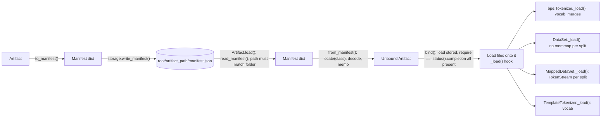

# Manifests

Every declared artifact owns `root / artifact_path / "manifest.json"`: a
self-contained definition with its dependencies' manifests embedded
recursively. Embedding is what lets one manifest be decoded and compared on its
own, since definition equality recurses through dependencies; an artifact's
whole graph rebuilds from its one manifest, without loading any outputs. A
tokenizer trained on one source:

```json
{
  "artifact": "artifacts.tokenizers.bpe.Tokenizer",
  "commit": "<defining-revision>",
  "allocated_resources": {"cpu": null, "gpu_count": null, "gpu_type": null},
  "parameters": {"special_tokens": ["<pad>"], "vocab_size": 1000},
  "dependencies": {
    "sources": [
      {
        "artifact": "artifacts.sources.SourceURL",
        "commit": "<defining-revision>",
        "allocated_resources": {"cpu": null, "gpu_count": null, "gpu_type": null},
        "parameters": {"name": "odyssey", "url": "https://example.org/odyssey.txt"},
        "dependencies": {}
      }
    ]
  }
}
```

`"artifact"` is the concrete class's dotted path. `parameters` and
`dependencies` partition that class's fields by annotation
([Artifacts](artifacts.md#dependencies-and-parameters)), so `sources=(source,)`
becomes an array of manifests while `special_tokens`, also an array, stays a
parameter. A dependency's value is a manifest, an array of manifests, or
`null`. Declaration also writes the source's manifest at its own
`sources/odyssey/manifest.json`.

## Three modules

| Module | Owns |
| --- | --- |
| `artifacts/core/manifest.py`, the codec | An artifact as a manifest dict and back: `to_manifest`, `from_manifest`, `parameters`, the class key, `canonical`, and `manifest_json`, the text on disk. It opens no file. |
| `artifacts/core/storage.py` | Manifest files: where one lives under a root (`MANIFEST`), `read_manifest` and `write_manifest`, and the checks on a root and a path. It decodes nothing. |
| `artifacts/core/artifact.py` | The calls a notebook makes: `artifact.to_manifest()`, `Artifact.from_manifest(data)`, `Artifact.load(path)`, `artifact.bind()`. |

`Artifact.load(path, root)` is `from_manifest(read_manifest(root, path))` plus
one check about identity: the decoded artifact's path must be the folder it was
read from. A path is a pure function of the definition, so a mismatch means the
folder was copied or renamed. A missing manifest raises `FileNotFoundError`;
anything else that keeps it from rebuilding an artifact (unreadable JSON, an
unknown class, a field that does not fit) raises `ValueError` naming the
folder, so a scan can turn one bad manifest into one bad row.

**`load` and `from_manifest` always return an unbound instance, even when
every output exists.** Call `.bind()` before using output-dependent methods.
`bind` loads the stored artifact, refuses one that is not `==` to the
request, requires every completion file, and then runs the family's `_load`
hook to attach what it reads from its files:



## Canonical text

The text is a pure function of the artifact, recorded fields included: the
five top-level keys in the order above, every nested map sorted by key, `-0.0`
written as `0.0` (it equals `0.0`, so it must encode equal), NaN and infinity
refused (no other JSON reader accepts them), `indent=2`, UTF-8 unescaped, and a
final newline. A set of dependencies is an array sorted by artifact path; a
tuple keeps its order.

Two invariants follow, and only these two:

- **Round trip:** `from_manifest(to_manifest(a)) == a`, with the same path, and
  a decoded manifest re-encodes to exactly its own text.
- **Equal artifacts have equal paths and equal definitions.** Two `==`
  artifacts can still have different manifests, differing in `commit` or
  `allocated_resources`, which `==` ignores and the manifest records. Nothing
  compares manifest text to decide whether two definitions agree.

There is no format version: one program reads and writes manifests, and a
format change is migrated explicitly, every manifest in one pass, one script
per change (`migrations/`).

## Which class a param config is

A param config is written as its fields, without its class, when its class is
exactly the one its field's annotation names: a `LoopConfig` in a field
annotated `LoopConfig` is plain data, and its class can be renamed without
migrating anything. When the value is a subclass of the annotated class, the
manifest has to say which, since JSON carries values, not types, and two
subclasses can have the same fields. Its dotted path is then written under
`"class"`, beside its fields:

```json
"model": {"class": "models.transformer.Transformer", "d_model": 128, "num_heads": 16, ...}
```

The rule applies at every depth: a top-level parameter (`Pretraining.model`),
a param config nested in another, and one inside a tuple. A field annotated
with a union of two param config classes writes the key on every value, since
no single class is meant. Decoding reads it back, builds that class, and lets
pydantic check the instance fits its field, which refuses a class that is not
the annotated one or a subclass of it. `class` is a Python keyword, so no field
collides with the key. The path is part of the stored format: moving or
renaming a class that a manifest names leaves it unreadable until a migration
rewrites it.

## Encoding and decoding

**Encoding.** `parameters()` dumps the artifact's own fields with pydantic,
with `serialize_as_any=True`, then walks the dump beside the instance, adding
the class key where it is due, and makes it canonical. `serialize_as_any`
matters: pydantic otherwise serializes a value by its field's annotation, so a
`Transformer` in a field annotated `Model` would be written with `Model`'s
fields only, silently. Dependencies are never dumped by pydantic, for the same
reason: `to_manifest` encodes each one by calling itself.

**Decoding.** `from_manifest` decodes each dependency into an instance first,
from its own `"artifact"` key, then walks `"parameters"` once, bottom-up: every
JSON array becomes a tuple, and every object carrying `"class"` becomes an
instance of that class. Then it validates the artifact from those values. All
validators run, so a manifest that breaks an invariant (a vocabulary mismatch,
say) cannot be loaded. A nested instance is not validated twice, so decoding a
long run validates each node once.

Two things it never does, and why:

- **It never hands pydantic a dependency as a dict.** Pydantic would validate
  it as the annotated class: the abstract `Tokenizer` cannot be built, and
  `DataSet | MappedDataSet` have the same fields, so pydantic would guess.
- **It never validates in JSON mode.** Under strict validation, once any
  `before` or `wrap` validator has run, pydantic continues with Python objects
  and refuses a JSON array for a `tuple` field. Artifacts have such a
  validator (the set conversion), so every tuple parameter beneath it would
  fail. Python mode with arrays turned into tuples is correct because a
  parameter's only container is a tuple.

**Memo.** An artifact is a pure function of its manifest, so decoding is
memoizable. `memo` is one dict a caller keeps across calls: each distinct node
is constructed once, so a run's legs, each embedding every leg before it,
share their subtrees as single instances. Instances are frozen, so sharing is
safe; the one thing a shared instance must not be is bound, which is why
`bind` never passes a memo.

A definition at a path never changes once declared, so a reader may decode
each path once and keep it; the launcher does, for its whole life. What a
redeclaration may change, the resources, is read fresh by launching.

**Trusted classes.** A manifest names classes by import path, and decoding
imports them. The volume is written only by `lab.declare`, from your own
notebooks, so there is no allow-list or registry: a path that is wrong for any
other reason (a typo, a moved module, a corrupted file) fails to import, and
`load` reports that manifest unreadable. Every class in the repository is
round-tripped by the tests instead.

## Recorded fields

`commit` and `allocated_resources` are recorded with every artifact and
excluded from identity and `==`.

New definitions capture the process's defining revision once per process: the
HEAD hash, with `-dirty` when the working tree has uncommitted changes, since
what ships is what is on disk; a container without git reads the revision baked
into its image. Decoding always keeps the manifest's recorded value. Mixed
revisions within a graph are allowed.

`commit` describes the definition. It neither selects execution code nor proves
which code produced the outputs: execution uses deployed code. Resources
configure that execution; an unspecified dimension is recorded as `null`, and
Modal supplies its platform default for it.

Once written, a manifest's definition and commit are immutable. A matching
redeclaration keeps both; only its resources follow the latest committed
declaration, since they configure the next execution and nothing else. The
manifest at an artifact's own path is authoritative; an embedded copy in a
parent's manifest cannot override it.

## Why

| Choice | Why |
| --- | --- |
| Fields alone for a param config of its annotated class | Its class can move or be renamed without migrating manifests, and the JSON reads as plain data. |
| A class key only where a subclass stands, at any depth | Without it a subclass would be written as its base, silently; with it everywhere, renaming any param config would break every manifest. |
| Dependency manifests embedded | A manifest decodes and compares on its own, without reading other folders. Long chains make large manifests, which `memo` keeps cheap to decode. |
| Codec and storage in separate modules | The codec stays a pure function of dicts, tested with no folder; one module owns the file layout, the path checks and their errors. |
| Producer, optimizer and dtype as dotted strings | Declaring and resolving never import torch, numpy or a family's jobs; the worker resolves them. |

## Reference

::: artifacts.core.manifest

::: artifacts.core.storage
