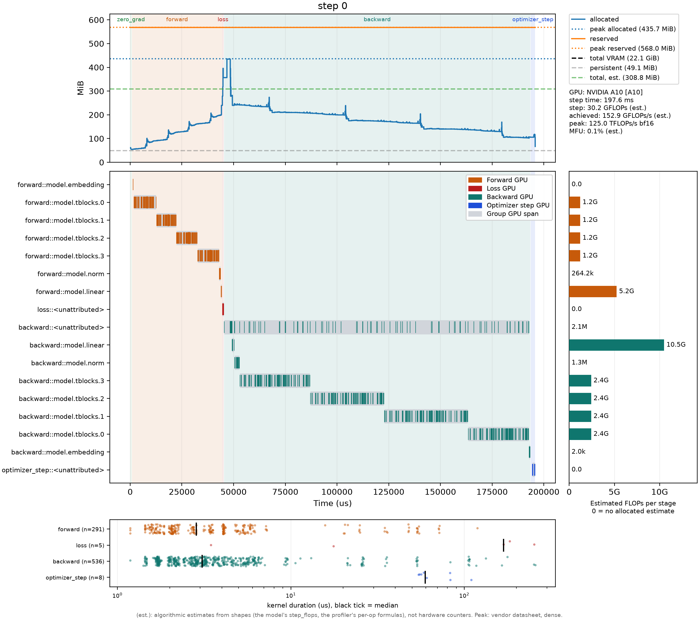

# Profiling

Profiling trains a model for a few steps on a Modal GPU and measures them: the time of every
CUDA kernel, attributed to the model's submodules, the FLOPs, the memory, and how long each phase
of the step takes. A `Profile` declares one run. `run_profile` runs it now and keeps nothing.
Declared, alone or as a series, a profile is an artifact like any other: the launcher runs it
on its own GPU, its files stay on the volume as JSON, and `bind` reads them back. Either way you
get a `Profile` whose methods hold the analysis.

## Profile a model on a GPU

In a notebook (`declarations/profiling.ipynb` is the template):

```python
from artifacts.core.artifact import Resources
from artifacts.core.SGD.optimizers import SGD
from artifacts.profiles import Profile
from models.transformer import Transformer
from profiling.util import run_profile

spec = Profile(
    run_id="scratch",
    resources=Resources(gpu_type="T4"),
    model=Transformer(
        vocab_size=10000,
        sequence_length=512,
        dtype="torch.float32",
        num_layers=4,
        d_model=128,
        d_ff=256,
        num_heads=4,
        rope_theta=10000,
    ),
    optimizer=SGD(),
    batch_size=4,
    seed=0,
    warmup_steps=5,
    profile_steps=3,
    autocast=None,
    compile="default",
    kernel_events=True,
    module_scopes=False,
    peak_memory=True,
    trace_memory=True,
)
result = run_profile(spec)
```

Modal's log of the call prints as it runs, the profiler's own `profiler_start` and `profiler_stop`
lines included:

```text
profile call fc-01M6B2GH5QK95N6Z58CPECDJ7J
2026-11-01T08:09:43.914Z INFO Transformer on NVIDIA A10, batch_size 4
2026-11-01T08:10:08.412Z INFO warmup: 5 steps
USDT:2026-11-01 08:10:08 2:2 SyncActivityProfilerHandler.cpp:52] profiler_start
USDT:2026-11-01 08:10:08 2:2 SyncActivityProfilerHandler.cpp:59] profiler_stop
2026-11-01T08:10:10.054Z INFO step 0: 20.5 ms
...
2026-11-01T08:10:10.295Z INFO step 2: 18.7 ms
2026-11-01T08:10:10.295Z INFO done
```

`result` is `spec` holding its files in memory. Plot a step:

```python
result.display_steps(steps=[0])
```



From top to bottom:

- **Memory:** allocated and reserved bytes over the step, with their peaks, the persistent
  memory (weights, gradients, optimizer state) and the VRAM. The shading marks each phase.
- **Kernels:** one row per phase and module, one tick per kernel on the GPU's clock. The bars
  on the right are each row's estimated FLOPs.
- **Kernel durations:** every kernel's duration per phase, on a log scale.

The box beside the memory panel gives the GPU, the step's time, its FLOPs and the MFU. Times are
us from the start of the step's first phase.

`result.summary()` is the same run as numbers, one row per step. Step 0 of the T4 run whose
files are shown [below](#the-files):

```text
step                                                          0
autocast                                          torch.float32
batch_size                                                    4
compile                                                 default
kernel_events                                              True
...                                                               every other field, flattened
model.class                      models.transformer.Transformer
model.d_model                                               128
optimizer.class               artifacts.core.SGD.optimizers.SGD
resources.gpu_type                                           T4
gpu                                                    Tesla T4
device_vram_bytes                                   15828320256
persistent_measured_bytes                              25732096
step_ms                                               28.512577
zero_grad_ms                                            0.29975
forward_ms                                              7.12175
loss_ms                                                 4.93425
backward_ms                                              15.271
optimizer_step_ms                                          0.39
peak_allocated_bytes                                  487872000
peak_reserved_bytes                                   580911104
persistent_estimated_bytes                             25732096
activation_estimated_bytes                            300154880
model_parameter_count                                   1936512
step_flops                                          30224154624
peak_flops_per_s                                8100000000000.0
cost_per_ms                                             1.64e-07
achieved_flops_per_s                        1060028864595.40979
mfu                                                    0.130868
flops_per_dollar                         6463590637777060.0
```

`summary("mean")` is the run as one row, each timing the mean over the steps and each peak their
max, without "step". Its rates come from the mean step_ms, so its mfu is the mean step's, not the
mean of the steps' mfu. Any pandas reduction works: `summary("median")`, `summary("min")`.

Every column is always there. A value the profile did not record (the peaks without
`peak_memory`), or that the model, the datasheet or the price table cannot give (a forward
step's memory estimates, a model with no FLOP count, a GPU missing from `gpus/peaks.py` or
`gpus/pricing.py`), is NaN, along with what is derived from it. `summary(verbose=True)` logs a
warning naming the columns that hold NaN:

```text
sweep-profile-7b6d11eaa5: no cost_per_ms, flops_per_dollar; NaN in the summary
```

Every FLOP number is an algorithmic estimate, not a hardware counter: `step_flops` is the model
declaration's analytic count of one forward and backward pass (its `forward_flops` for a forward
step), a kernel group's FLOPs are the profiler's per-op formulas from tensor shapes, and
`peak_flops_per_s` is the vendor's dense rate (`gpus/peaks.py`). `achieved_flops_per_s` is
`step_flops` over the step's wall time, and `mfu` is that over the peak, NaN for a GPU with no
unit at the precision.
`cost_per_ms` is Modal's base list price of `resources.gpu_type`, in dollars (`gpus/pricing.py`):
a region or non-preemptible execution multiplies it, and a GPU Modal upgraded, an A100 to 80 GB or an
H100 to an H200, is billed as the one requested, so `gpu` can name a GPU other than the one priced.
`flops_per_dollar` is `step_flops` over the step's cost.

## What a profile is

Every input that changes what is measured is a field of `Profile`, so a profile's path names
exactly what it measured: `profiles/<run_id>/<hash>`, the hash over every field but `run_id`.

- **`run_id`** names a series: every profile in it lives under `profiles/<run_id>/`.
- **`resources`** is the GPU it measures. `allocated_resources`, which no other artifact counts
  as identity, is set from it, and a different one is refused. It names one GPU: a `gpu_type`,
  and a `gpu_count` of None or 1.
- **`model`** and **`optimizer`** are declarations, their classes and every field: no weights,
  no optimizer state. The profiling container builds them with `model.build` and
  `optimizer.build`.
- **`step_kind`**, **`autocast`** and **`compile`** choose what a step runs, and how
  ([below](#the-step-and-compile)).
- **`batch_size`**, **`seed`**, **`warmup_steps`** and **`profile_steps`**: every step, warmup or
  measured, runs on the same `batch_size` random sequences of the model's `sequence_length`,
  drawn from `seed`, so a profile depends on no dataset.
- **The switches**, one per instrument: `kernel_events` (every CPU op and CUDA kernel, in
  `events.json`), `module_scopes` (each module's work annotated, so kernels are attributed to
  submodules), `peak_memory` (each step's peak allocated and reserved bytes) and `trace_memory`
  (each step's allocator trace, in `memory.json`). Phase times are always recorded.

Some inputs are deliberately not fields:

| Input | Why not a field |
| --- | --- |
| The tokens | Random, drawn from `seed`, shaped by the model's `vocab_size` and `sequence_length`. |
| The learning rate | It changes no kernel and no buffer. `profile` runs no lr schedule, so torch's default applies. |
| The kernel group depth | An analysis choice: the methods take `depth`. |
| The physical GPU (an `"A100"` can be a 40 or 80 GB card) | Measured: `report.json` records the device's name. |
| The code, torch and CUDA | The manifest records `declaring_commit`, but a job runs the deployed app. After a code change, `modal deploy`, then profile under a new `run_id`. |

To profile a declared leg, pass its fields: `run_id=leg.run_id`,
`resources=leg.allocated_resources`, `model=leg.model`,
`optimizer=leg.training_parameters.optimizer`, and the same for `batch_size` and `seed`.

### The step and compile

- **`step_kind`.** `"full"`, the default, is a next-token training step in five phases, each
  labelled `train::<name>` and timed: `zero_grad`, `forward`, `loss`, `backward` and
  `optimizer_step`. `"forward"` is the forward alone, under `torch.no_grad()`, in one phase,
  `forward`. Its `step_flops` is the model's `forward_flops`, so MFU counts the forward only, and
  it leaves no gradients or optimizer state, so it has no memory estimates.
- **`autocast`.** `"torch.bfloat16"` or `"torch.float16"` runs forward and loss under
  `torch.autocast`, as a leg does; None runs them in the model's `dtype`. It decides which
  kernels run, the activation memory, and the precision whose peak MFU is measured against.
- **`compile`.** None, the default, runs the model eagerly. A mode (`"default"`,
  `"reduce-overhead"`, `"max-autotune"`, `"max-autotune-no-cudagraphs"`) runs it through
  `torch.compile(network, mode=compile)`, compiled once, in the container; the loss and the
  optimizer step stay eager. The first steps compile, so give `warmup_steps` enough of them that
  no compiling lands in a measured step. The worker image has `gcc`, which Triton needs to build
  its kernel launchers.
- **Not both `compile` and `module_scopes`.** Module stages do not work under `torch.compile`,
  so a profile with both is refused, and a compiled profile's kernels group by phase only.
- **A `TransformerFA` runs in fp16 or bf16.** Its flash attention takes nothing else, so a
  profile whose `autocast` is None and whose model's `dtype` is fp32 is refused when it is
  declared, not on the GPU. In a sweep, leave those points out, or declare the model with
  `dtype="torch.bfloat16"`.

## Running a profile

`run_profile(spec)` sends the call to Modal on the GPU `spec.resources` names and prints Modal's
live log of it, the call's stdout and stderr in order: `profile`'s log rows, and whatever a
library writes past `logging`, such as Inductor's autotuning under `compile="max-autotune"`. The
rows reach nothing else: `main.profile` logs to stdout only, never to `call_logs`. Until the call
writes its first line, `run_profile` also prints Modal's own messages about `profile`, so a call
queued for a GPU says so:

```text
Function 'profile' (fu-8amyGm50LUR45l2eHnFfTq) is waiting to be scheduled on a GPU_L4 worker. We are actively working on acquiring more capacity for your workload.
```

`profile` is what runs on the GPU: a warmup loop, then the measured steps, each under the
instruments its switches turn on. It returns the JSON text of each of the profile's files.
`run_profile` hands them back on a copy of `spec`, and a `ProfileJob` publishes each one as a
file of the artifact.

::: profiling.util.run_profile
    options:
      show_root_heading: true
      heading_level: 3

::: profiling.util.profile
    options:
      show_root_heading: true
      heading_level: 3

## Keeping a series

Declared, a profile is an artifact with no dependencies. Declare a series from the lab, so
`create_experiment` declares every profile under one name and the launcher runs each on its own
GPU, as a `ProfileJob`. `declarations/profiling_experiment.ipynb` does this, one profile per
`d_model`, with the experiment's name as every profile's `run_id`:

```python
experiment_uid = "d-model-sweep"
profiles = [
    Profile(
        run_id=experiment_uid,
        resources=Resources(gpu_type="T4"),
        model=Transformer(vocab_size=10000, sequence_length=512, dtype="torch.float32", num_layers=4,
                          d_model=d_model, d_ff=256, num_heads=4, rope_theta=10000),
        optimizer=SGD(),
        batch_size=4,
        seed=0,
        warmup_steps=5,
        profile_steps=3,
        autocast=None,
        compile="default",
        kernel_events=True,
        module_scopes=False,
        peak_memory=True,
        trace_memory=True,
    )
    for d_model in (128, 256, 512)
]
lab.create_experiment(experiment_uid, profiles, commit=True)
```

Build each varied profile as a new `Profile`, as above: `model_copy(update=...)` neither
validates nor recomputes a profile's path (LESSONS.md, "pydantic is strict only where it is told
to be"). From a laptop, `local.declare_on_volume(profile, commit=True)` declares one profile at a
time.

To read a series back, bind each profile. `bind` reads `report.json` alone; `events.json` and
`memory.json` are read the first time a method needs them, so a table of a whole series reads
its reports and nothing else:

```python
profiles = [profile.bind() for profile in lab.load_experiment(experiment_uid) if profile.status().complete]
table = pd.concat([profile.summary() for profile in profiles])
table.pivot_table("mfu", index="model.d_model", columns="step")
```

From a laptop, copy the series first, into a `storage/profiles` that already exists:
`modal volume get --force nlp profiles/d-model-sweep storage/profiles`. A folder lands under the
destination by its own name, and `--force` lets a second copy, once more profiles are done,
overwrite the first. Then pass `root=Path("storage")` to `load_experiment`, `status` and `bind`.
`bind` needs every file a profile completes with, so copy its folder whole.

## The files

Every file is plain JSON: nothing in it needs torch, pickle or the machine that wrote it. Steps
are lists, the index being the step number, and every time names its clock.
`report.json` is always written; `events.json` with `kernel_events` and `memory.json` with
`trace_memory`. Together they are the profile's completion.

### report.json

The measurements that are not a time series. Nothing a field says (the model, the optimizer, the
switches) and nothing a method derives from fields and measurements (`step_flops`, the memory
estimates, the peak rate, MFU) is stored. The notebook's T4 run, step 0 (`device_vram_bytes` is
illustrative):

```json
{
  "gpu": "Tesla T4",
  "device_vram_bytes": 15828320256,
  "measured_size": {
    "model": {"parameters": 3216512, "bytes": 12866048},
    "gradients": {"parameters": 3216512, "bytes": 12866048},
    "optimizer": {"parameters": 0, "bytes": 0}
  },
  "steps": [
    {
      "step_ms": 28.51257700000076,
      "phases_unix_us": {
        "zero_grad": [1793524741460134.8, 1793524741460434.5],
        "forward": [1793524741460501.5, 1793524741467623.2],
        "loss": [1793524741467698.0, 1793524741472632.2],
        "backward": [1793524741472722.0, 1793524741487993.0],
        "optimizer_step": [1793524741488066.0, 1793524741488456.0]
      },
      "peak_allocated_bytes": 487872000,
      "peak_reserved_bytes": 580911104
    }
  ]
}
```

- `step_ms` is the step's wall time with its instruments included; the phases are what ran
  inside it.
- `measured_size` is read off the built model, its gradients and the optimizer's state after
  warmup. Their sum is the measured persistent memory.
- The two peaks are there only with `peak_memory`.

### events.json

Per step, the trace's start on the unix clock and the profiler's events as columns, one entry
per event in `prof.events()` order, so an event's row ID is its position. `event_table` keeps
every attribute of `FunctionEvent` under torch's own name, with the conversions JSON needs:

- `time_range` becomes `start_us` and `end_us`, us from the trace's start.
- `device_type` becomes its string, `"DeviceType.CPU"` or `"DeviceType.CUDA"`.
- `cpu_parent` becomes the parent's row ID, or null.
- `cpu_children` and `kernels` are left out: each is the inverse of a link the rows already hold.
- Any other value JSON cannot hold is written as its string: a symbolic size `torch.compile`
  recorded, or an infinite fill value such as the `-inf` an attention mask's `masked_fill` takes.

Four events, with illustrative values: a forward scope, an op inside it, the launch call the op
made, and the kernel that launch ran.

```json
[
  {
    "trace_start_unix_us": 1793524741456539.0,
    "events": {
      "id":                       [18435, 18440, 38512, 38512],
      "node_id":                  [-1, -1, -1, -1],
      "name":                     ["train::forward", "aten::addmm", "cudaLaunchKernel", "volta_sgemm_128x64_tn"],
      "overload_name":            ["", "", "", ""],
      "trace_name":               ["train::forward", "aten::addmm", "cudaLaunchKernel", "volta_sgemm_128x64_tn"],
      "start_us":                 [3962.5, 4101.0, 4110.25, 4140.75],
      "end_us":                   [11084.0, 4135.5, 4118.0, 4252.0],
      "thread":                   [1, 1, 1, 0],
      "fwd_thread":               [0, 0, 0, 0],
      "count":                    [1, 1, 1, 1],
      "cpu_parent":               [null, 0, 1, null],
      "input_shapes":             [[], [[384], [2048, 128], [128, 384], [], []], [], []],
      "concrete_inputs":          [[], [null, null, null, 1, 1], [], []],
      "kwinputs":                 [{}, {}, {}, {}],
      "stack":                    [[], [], [], []],
      "scope":                    [7, 0, 0, 0],
      "use_device":               [null, null, null, null],
      "cpu_memory_usage":         [0, 0, 0, 0],
      "device_memory_usage":      [0, 0, 0, 0],
      "is_async":                 [false, false, false, false],
      "is_remote":                [false, false, false, false],
      "sequence_nr":              [-1, 12, -1, -1],
      "device_type":              ["DeviceType.CPU", "DeviceType.CPU", "DeviceType.CPU", "DeviceType.CUDA"],
      "device_index":             [2, 2, 2, 0],
      "device_resource_id":       [2, 2, 2, 7],
      "is_legacy":                [false, false, false, false],
      "flops":                    [0, 201326592, 0, 0],
      "is_user_annotation":       [true, false, false, false],
      "is_python_function":       [false, false, false, false],
      "activity_type":            ["user_annotation", "cpu_op", "cuda_runtime", "kernel"],
      "self_cpu_percent":         [-1, -1, -1, -1],
      "total_cpu_percent":        [-1, -1, -1, -1],
      "total_device_percent":     [-1, -1, -1, -1],
      "_metadata_json":           ["", "", "", "\"grid\": [24, 8, 1], \"block\": [256, 1, 1], \"registers per thread\": 126"],
      "flow_id":                  [0, 0, 38512, 38512],
      "flow_type":                [0, 0, 1, 1],
      "flow_start":               [false, false, true, false],
      "external_id":              [18435, 18440, 18440, 18440],
      "linked_correlation_id":    [0, 0, 0, 18440],
      "event_metadata":           [null, null, null, null],
      "structured_input_shapes":  [[], [[384], [2048, 128], [128, 384], [], []], [], []],
      "structured_input_strides": [[], [[1], [128, 1], [1, 128], [], []], [], []],
      "input_dtypes":             [[], ["float", "float", "float", "Scalar", "Scalar"], [], []],
      "python_id":                [-1, -1, -1, -1],
      "python_parent_id":         [-1, -1, -1, -1],
      "python_module_id":         [-1, -1, -1, -1]
    }
  }
]
```

`events_to_rows` builds the linked event table from one step's columns. A step of a 4-layer
model is about 10,000 events, a few MB.

### memory.json

Per step, `torch.cuda.memory._snapshot()` as torch returns it. History is recorded with
`context=None`, so no tracebacks are taken: every `frames` list is empty, the snapshot is plain
JSON with nothing removed, and the step being timed is not slowed by stack capture. Which Python
line allocated a block is not kept; the `record_function` scope that was open is, in the
annotations. Illustrative addresses and times:

```json
[
  {
    "segments": [
      {"device": 0, "address": 139872345440256, "total_size": 20971520, "allocated_size": 12866048,
       "active_size": 12866048, "requested_size": 12865536, "stream": 0, "segment_type": "large",
       "segment_pool_id": [0, 0], "is_expandable": false, "frames": [],
       "blocks": [{"address": 139872345440256, "size": 5120512, "requested_size": 5120000,
                   "state": "active_allocated", "frames": []}]}
    ],
    "device_traces": [[
      {"action": "segment_alloc", "addr": 139872366411776, "size": 2097152, "stream": 0, "time_us": 1793524741460233, "frames": []},
      {"action": "alloc", "addr": 139872366411776, "size": 512, "stream": 0, "time_us": 1793524741460234, "frames": []},
      {"action": "free_requested", "addr": 139872366411776, "size": 512, "stream": 0, "time_us": 1793524741460241, "frames": []},
      {"action": "free_completed", "addr": 139872366411776, "size": 512, "stream": 0, "time_us": 1793524741460241, "frames": []}
    ]],
    "external_annotations": [
      {"device": 0, "name": "train::forward", "stage": "START", "time_us": 1793524741460501},
      {"device": 0, "name": "train::forward", "stage": "END", "time_us": 1793524741467623}
    ]
  }
]
```

Any other key torch returns, such as `allocator_settings`, is kept as it is. The analysis reads
each trace entry's `action`, `addr`, `size` and `time_us`, on the unix clock, each segment's
`device`, `allocated_size` and `total_size`, and the annotations.

## The analysis

A bound `Profile`, and `run_profile`'s result, carry the analysis as methods. Each runs on the
parts the profile's switches recorded, and says which switch to turn on when its part is missing.

| Method | Returns |
| --- | --- |
| `report` | `report.json` |
| `summary(agg)` | one row per step, or one reduced by `agg`: the parameters, flattened, what was measured, and the estimates, rates and cost derived from it |
| `display_steps(steps, depth)` | the timeline figure above |
| `events(step)` | `events_to_rows`' linked table of one step's events |
| `aggregate_kernels(step, depth)` | `groups, kernels, unattributed_kernels, flop_sources` of one step |
| `memory_over_time(step)` | allocated and reserved bytes after each allocator trace entry |
| `allocations_by_label(step)` | one row per allocation, labelled with the scope that made it |
| `step_flops`, `precision`, `peak_flops_per_s`, `estimated_memory` | what the declaration and the GPU's datasheet say |

`launch_chain` and `render` stay functions of the rows: `launch_chain(result.events(1), kernel_id)`.

::: artifacts.profiles.Profile
    options:
      show_root_heading: true
      heading_level: 3

## Processing events

`events_to_rows` turns a step's events into a table, `launch_chain` shows how one kernel in it
was launched, and `aggregate_kernels` groups its kernels by phase and module with the FLOPs of
each group. How each step works, from the raw events to FLOP sources, is on
[Attribution](profiling/attribution.md).

## Compile and Triton

TBD.

- Eager mode versus `torch.compile`: what Dynamo does.
- How attribution works when compile and Triton are involved.

## Why

**The GPU is identity.** A profile measures the hardware it ran on, so the same model on a T4
and an H100 are two profiles at two paths. Every other artifact keeps its resources out of its
identity, so that more memory or a faster GPU never moves it; a profile turns that around and
pins `allocated_resources` to `resources`, which is.

**A `run_id`, because a profile is a measurement.** An artifact whose files exist is never built
again. Change a kernel and the model's fields stay the same, so without a name in its identity a
new profile would land on the finished folder and measure nothing. A new `run_id` is a new
measurement; a series is one `run_id` over many parameters.

**`FunctionEvent` attributes, not a Chrome trace.** `prof.export_chrome_trace()` opens in
Perfetto, but it is Kineto's flat list of spans. It carries no `cpu_parent`, and it is written
before `prof.events()` builds its tree and drops duplicate nodes (LESSONS.md, "`prof.events()`
deletes ops"). Attribution is built and tested on the `FunctionEvent` tree, so storing that tree
keeps every analysis function as it is and adds no second way to rebuild parents. JSON rather
than pickle: a pickled `FunctionEvent` unpickles only beside a compatible torch, and JSON reads
anywhere.

**No derived number is stored.** `report.json` holds measurements; MFU, the peak rate, the FLOP
count and the memory estimates are computed on read, from the fields and `gpus/peaks.py`. A
corrected FLOP formula or datasheet figure then applies to every stored profile.

## Where things live

- **`artifacts/profiles/`**: `Profile`, its fields, files and analysis methods, and in `jobs.py`
  `ProfileJob`, which runs `profile` and publishes each file.
- **`profiling/util.py`**: `run_profile`, `profile` (the loop that runs on the GPU, and its two
  steps) and `phase`.
- **`profiling/profile_events.py`**: the capture context managers and `event_table`, the tables
  built from the events (each kernel linked to the CPU op that launched it, kernels by phase and
  module depth, allocations by scope) and `draw_timeline`.
- **`profiling/attribution_diagrams.py`**: `render`, the event-tree picture of a profiled step
  or one event in it, and the cases drawn on [Attribution](profiling/attribution.md), redrawn
  with `uv run python -m profiling.attribution_diagrams`.

`declarations/profiling.ipynb` is the minimal template: one profile, its model declared in it, one
`run_profile` call, its summary and plot, the kernel tables, a launch chain and one event drawn
with `render`. `declarations/profiling_experiment.ipynb` declares a series as an experiment, in
the lab, and reads it back into one table. `profiling/profile_model.ipynb` walks through all of
it. Two traps in reading profiler events are in LESSONS.md.
