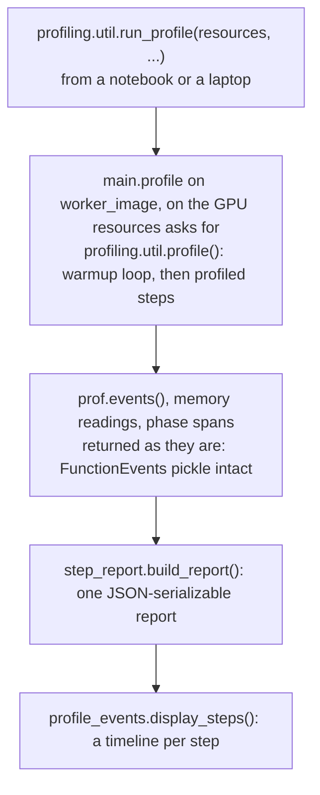

# Profiling

Two tools measure training on a GPU: a monitor inside every training leg, and a
profiler run on its own.

## The monitor inside a leg

`gpus/monitor.py`'s `GpuMonitor` reports, on CUDA, the MFU and the peak
allocated and reserved memory over each window of `loop_config.gpu_check_every`
steps, as step metrics in the leg's step log, without the loop ever waiting on
the GPU: a window's numbers arrive a few steps after it closes. MFU is the
model's analytic `step_flops()` ([Models](models.md#the-contract)) over the
measured time, against the GPU's dense peak rate for the model's `dtype`, from
`gpus/peaks.py`'s table of every GPU Modal offers.

## The profiler

`profiling/` trains a model for a few steps under `torch.profiler` and turns
what it saw into a report. It is not a launched job: no artifact, no lease,
nothing written to the volume, so the launcher never sees it.

- **`profiling/util.py`**: `run_profile` requests the GPU and prints the call's
  log rows as they are published; `profile` runs a plain warmup loop and then
  the measured steps over the same model and optimizer, each step's phases
  timed between synchronizes (`phase`).
- **`profiling/profile_events.py`**: module scopes for a profiled step, the
  capture context managers, and the tables built from the events: each kernel
  linked to the CPU op that launched it, kernels aggregated by phase and module
  depth, allocations by scope, memory over time, and the timeline drawing.
  pandas and matplotlib, which the worker image lacks, are imported where they
  are used.
- **`profiling/step_report.py`**: `build_report`, the one place the analysis
  lives: everything `display_steps` shows and what the profile ran with, as a
  versioned JSON dict. Local only.

`profiling/profile_model.ipynb` is the notebook that runs it. Two traps in
reading profiler events are in LESSONS.md: an overhead row reuses its
operator's correlation id, and `prof.events()` deletes ops whose kernels still
name them.

## Questions to investigate

- CUDA is asynchronous between CPU and GPU: what each timing measures, with and
  without a synchronize.
- Why a warmup is needed first, and how runs vary with and without it.
- The variability between different runs on a random batch of data.
- Time spent in the forward pass, and which kernels take the most time.
- What `torch.compile` does: dynamo intercepts the bytecode, traces operations
  into a graph, optimizes it and hands it to dispatch, down through `aten::` ops
  to CUDA launches.

## Reference

::: profiling.util
