# Attribution

A profiled step comes back as a flat list of profiler events: tens of thousands of CPU ops,
scopes, launch calls and GPU kernels. Attribution answers three questions about every kernel in
it: what launched it (its launch sequence), which phase and module it ran for (its owner and
group), and how many FLOPs its group did (its FLOP sources). This page follows one kernel, a
matrix multiply in a transformer block, through the steps that answer them. Each step builds
on the one before it and is one function in `profiling/profile_events.py`;
[How the steps fit together](#how-the-steps-fit-together) draws them all as one flowchart.

## 1. The events

`capture_profiler_events` records one training step with `torch.profiler`, and
`prof.events()` hands it back as a flat list of `FunctionEvent` objects, one per thing that
ran: tens of thousands even for a small model. `event_table` keeps them as JSON columns, the
profile's `events.json` ([Profiling](../profiling.md#eventsjson)), and `events_to_rows` turns one
step's columns into a DataFrame with one row per event, in the order the profiler returned them.
A profile's `events(step)` does both:

```python
rows = profile.events(2)
rows[["name", "activity_type", "device_type", "correlation_id", "linked_correlation_id", "flops"]].head(10)
```

```text
index  name                                 activity_type    device_type     correlation_id  linked_correlation_id  flops
0      train::zero_grad                     user_annotation  DeviceType.CPU  18433           0                      0
1      Activity Buffer Request              overhead         DeviceType.CPU  18433           0                      0
2      cudaDeviceSynchronize                cuda_runtime     DeviceType.CPU  38476           0                      0
3      Optimizer.zero_grad#AdamW.zero_grad  user_annotation  DeviceType.CPU  18434           0                      0
4      cudaDeviceSynchronize                cuda_runtime     DeviceType.CPU  38482           0                      0
5      train::forward                       user_annotation  DeviceType.CPU  18435           0                      0
6      cudaDeviceSynchronize                cuda_runtime     DeviceType.CPU  38489           0                      0
7      forward::model                       user_annotation  DeviceType.CPU  18436           0                      0
8      forward::model.embedding             user_annotation  DeviceType.CPU  18437           0                      0
9      aten::index                          cpu_op           DeviceType.CPU  18438           0                      0
```

The step opens with the `zero_grad` phase and the optimizer's scope inside it, then
`train::forward`, the model, its embedding stage and the embedding's first ATen op. The
`cudaDeviceSynchronize` rows are CUDA calls that wait for the GPU rather than queue work on it.
Their ids, 38476 and up, come from a different counter than the scopes' 18433 and up (step 2).

Each event has a name, an `activity_type` (what kind of thing it is, and who recorded it), a
`device_type` (where it ran), a `start_us` and `end_us`, two ids, and on some ATen ops a FLOP estimate.
Every event is one of these kinds:

| activity_type | device_type | What it is |
|---|---|---|
| `cpu_op` | CPU | An operator call: `aten::bmm`, `aten::einsum`, an autograd node's `autograd::engine::evaluate_function: ...` |
| `user_annotation` | CPU | A `record_function` scope: `train::<phase>`, a module stage `<phase>::<fqn>`, `Optimizer.step#AdamW.step` |
| `cuda_runtime`, `cuda_driver` | CPU | A CUDA call. A launch call (`cudaLaunchKernel`, `cuLaunchKernel`, `cudaMemcpyAsync`) queues work for the GPU and returns immediately; others, like `cudaDeviceSynchronize`, queue nothing |
| `kernel`, `gpu_memcpy`, `gpu_memset` | GPU | The work a launch call queued, with its time on the GPU |
| `gpu_user_annotation` | GPU | The GPU span of a scope; it launches nothing |
| `overhead` | CPU | The profiler's own work, such as `Activity Buffer Request` |

A row's index is its position in `prof.events()`, its **row ID**, and it is the only identity
used from here on: navigate with `rows.loc[row_id]`, and keep the index when filtering. A
correlation id cannot be one: rows 0 and 1 both carry 18433, because profiler overhead reuses
the id of the scope it interrupted.

The list is flat, and nothing in it says which CPU event launched a kernel. PyTorch gives
every CPU event a parent, its `cpu_parent`: the CPU event whose span encloses it on the same
thread. GPU work ran on another device, later, so it has none. Step 2 finds it.

## 2. A launch sequence

What attribution needs for every kernel is its **launch sequence**: the events from the
training phase down to the kernel, each launched by the one above it. `launch_chain` returns
it, the root first. Kernel ids change from run to run, so pick the kernel by filtering. This is
the launch sequence of the first matrix multiply in the feed-forward layer of block 0, from the
run on [Profiling](../profiling.md):

```python
groups, kernels, unattributed_kernels, flop_sources = aggregate_kernels(rows, depth=3)
ffn_gemms = kernels[(kernels.phase == "forward") & (kernels.owner_fqn == "model.tblocks.0.ffn")
                    & kernels.name.str.contains("gemm")]
display(launch_chain(rows, ffn_gemms.index[0]))
```

```text
index  name                                 activity_type    correlation_id  linked_correlation_id  flops      launcher_id
5      train::forward                       user_annotation  18435           0                      0          <NA>
7      forward::model                       user_annotation  18436           0                      0          5
16     forward::model.tblocks.0             user_annotation  18442           0                      0          7
501    forward::model.tblocks.0.ffn         user_annotation  18800           0                      0          16
502    aten::einsum                         cpu_op           18801           0                      0          501
510    aten::einsum                         cpu_op           18806           0                      0          502
529    aten::bmm                            cpu_op           18825           0                      134217728  510
531    cuLaunchKernel                       cuda_driver      39520           18825                  0          529
532    cutlass_80_tensorop_bf16_s16816gemm  kernel           39520           18825                  0          531
```

Read it top to bottom; each row's `launcher_id` is the row above it:

1. **Scopes (rows 5 to 501).** `record_function` annotations opened while the step runs: the
   training phase from `profiling.util.phase`, then the model, the block and its feed-forward
   layer from `module_scopes` ([Labelling the work while it runs](#labelling-the-work-while-it-runs)).
2. **The Python call (rows 502 and 510).** `einsum(self.W1, x, ...)` in `SwiGLU.forward`. It
   appears twice because of autocast: the outer `einsum` casts `W1` from float32 to bf16 (the
   separate kernel 509) and calls `einsum` again on the bf16 inputs.
3. **The ATen op (row 529).** `einsum` breaks down into reshapes and one `aten::bmm`, on inputs
   of shape `[1, 2048, 128]` and `[1, 128, 256]`: batch 4 × 512 tokens = 2048 rows,
   `d_model=128` going to `d_ff=256`. Its FLOPs are 2 × 2048 × 128 × 256 = 134,217,728, the
   profiler's estimate in the `flops` column.
4. **The launch call (row 531).** `cuLaunchKernel`, a CPU-side driver call that queues the
   kernel for the GPU and returns at once.
5. **The kernel (row 532).** The CUTLASS bf16 matrix multiply, 6.1 µs on the GPU, run after the
   launch call returned.

### The picture

The same nine events drawn, with their real ids. The CPU events are bars on top, each inside
the one that encloses it; the GPU work is below, with an arrow from its launcher:

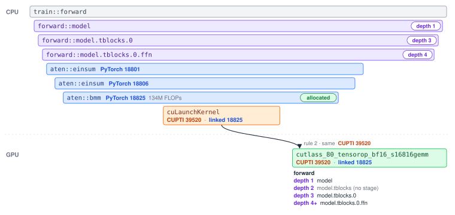

The key to every picture on this page:

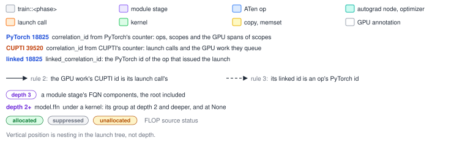

- **`PyTorch 18825`** or **`CUPTI 39520`**, under or after a name, is the event's
  `correlation_id`, named by the counter it comes from: blue for PyTorch, orange for CUPTI.
- **`linked 18825`**, on a launch call or GPU work, is its `linked_correlation_id`.
- **An arrow** is a link to GPU work from its launcher, labelled with the
  [linking rule](#the-linking-rules) that made it: solid for rule 2, dashed for rule 3.
- **A module stage's `depth N` chip**, the groups listed under each kernel and the chips on
  ATen ops come from steps 5 and 6.

Names drop `autograd::engine::` and `torch::autograd::`. Positions in the pictures on this page
show order, not duration.

### Correlation ids

The ids are the only connection the trace makes between the CPU and the GPU. In the picture,
`aten::bmm` is `PyTorch 18825`; the launch call and the kernel are both `CUPTI 39520`, and both
are `linked 18825`. `correlation_id` is `FunctionEvent.id`, which `_parse_kineto_results` fills
with `kineto_event.correlation_id()`, and two counters fill it, so the same number can come
from both:

- **PyTorch ids:** PyTorch's profiler numbers the operations Python calls, the `cpu_op` and
  `user_annotation` events, with its own counter.
- **CUPTI ids:** CUPTI, NVIDIA's profiling library, records the CUDA layer and numbers it with
  its own counter: the launch calls on the CPU (`cuda_runtime`, `cuda_driver`) and the GPU work
  they launch (`kernel`, `gpu_memcpy`, `gpu_memset`). GPU work gets the same CUPTI id as the
  call that launched it. An exported Chrome trace shows this id as `"correlation"`.

So `device_type` does not say which counter an id is from: `cuLaunchKernel` executes on the
CPU, yet its `correlation_id` is a CUPTI id. The counter follows `activity_type`. Every id a
row carries:

| Row (`activity_type`) | `correlation_id` | `linked_correlation_id` | `external_id` |
|---|---|---|---|
| Op or scope (`cpu_op`, `user_annotation`) | a PyTorch id | 0 | its `correlation_id` |
| Launch call (`cuda_runtime`, `cuda_driver`) | a CUPTI id | the PyTorch id of the op that issued the launch | its `linked_correlation_id` |
| GPU work (`kernel`, `gpu_memcpy`, `gpu_memset`) | a CUPTI id, its launch call's | the PyTorch id of the op that issued the launch | its `linked_correlation_id` |
| GPU span of a scope (`gpu_user_annotation`) | its scope's PyTorch id | 0 | its `correlation_id` |
| Profiler overhead (`overhead`) | the PyTorch id of the op it interrupted, reused | 0 | 0 |

What each is for:

- **`correlation_id`** names an event within its counter. A CUPTI id pairs GPU work with the
  launch call that queued it. A PyTorch id is what a `linked_correlation_id` points at. Two
  counters share the column, so it is not unique and never identifies a row.
- **`linked_correlation_id`** leads from the CUDA layer back to PyTorch: on a launch call or GPU
  work it holds the PyTorch id of the op that issued the launch, and 0 means none. An exported
  trace shows it as `"External id"`.
- **`external_id`** holds no value of its own: `KinetoEvent::externalId()` returns
  `linked_correlation_id` when there is one, else `correlation_id`. Nothing here uses it.
- **`node_id`** says which profiler node recorded the event. Every lookup is by
  `(node_id, id)`, so an id only matches an id from the same node; a missing `node_id` is -1.

Where the two come from. CUPTI gives every driver and runtime call a correlation ID
"identical to the correlation ID in the memcpy, memset, or kernel activity record that is
associated with this function"
([CUpti_ActivityAPI](https://docs.nvidia.com/cupti/api/structCUpti__ActivityAPI.html),
[CUpti_ActivityKernel](https://docs.nvidia.com/cupti/api/structCUpti__ActivityKernel.html)).
When an op starts, PyTorch pushes its id to CUPTI as an external correlation id (`begin_op` in
[collection.cpp](https://github.com/pytorch/pytorch/blob/main/torch/csrc/profiler/collection.cpp),
through `cuptiActivityPushExternalCorrelationId` in Kineto's
[CuptiActivityApi.cpp](https://github.com/pytorch/kineto/blob/main/libkineto/src/CuptiActivityApi.cpp)).
CUPTI reports the external id in effect for each CUDA call
([CUpti_ActivityExternalCorrelation](https://docs.nvidia.com/cupti/api/structCUpti__ActivityExternalCorrelation.html)),
Kineto maps it back to the op as the call's and its GPU work's linked activity
([CuptiActivityProfiler.cpp](https://github.com/pytorch/kineto/blob/main/libkineto/src/CuptiActivityProfiler.cpp)),
and PyTorch reports that op's id as `linked_correlation_id`
([profiler_kineto.cpp](https://github.com/pytorch/pytorch/blob/main/torch/csrc/autograd/profiler_kineto.cpp)).
`record_function` scopes are pushed under a separate kind that Kineto does not link, so a
linked id names the innermost op, never a scope: `aten::bmm` here, not `forward::model.tblocks.0.ffn`.

### The linking rules

`link_events` turns the ids into links: it gives every GPU row a `launcher_id`, the row ID of
the CPU event that launched it. The profiler records the ids, not the links, so these rules
are this repository's, and every link on the rest of this page, in a launch sequence or as an
arrow in a picture, comes from them. `_correlation_index` first builds one lookup per counter
from the CPU rows, so a PyTorch id is only ever compared with PyTorch ids and a CUPTI id with
CUPTI ids:

- **ops**: every `cpu_op` and `user_annotation` row, by its PyTorch id;
- **launches**: every `cuda_runtime` and `cuda_driver` row, by its CUPTI id.

Every other row, profiler overhead among them, is in neither, and an id of 0 is not entered.
Then each row gets its launcher from the first rule that applies to it:

1. **A CPU row keeps the launcher it came with**: its `cpu_parent`, which PyTorch decided from
   timestamps. A launch call's is normally the op that issued it; its `linked_correlation_id`
   is not read.
2. **GPU work** (`kernel`, `gpu_memcpy`, `gpu_memset`) **is matched to its launch call**: its
   `correlation_id`, a CUPTI id, is looked up in launches. A launch call runs on the CPU, but
   CUPTI records it and gives it the same CUPTI id as the work it queued, so the match pairs
   the work with exactly the call that queued it and puts that call on its path.
3. **Any GPU row still without a launcher is matched to the op that issued the launch**: its
   `linked_correlation_id`, a PyTorch id, is looked up in ops. This is how PyTorch's own
   `_parse_kineto_results` attaches kernels to ops
   ([torch/autograd/profiler.py](https://github.com/pytorch/pytorch/blob/main/torch/autograd/profiler.py)).

On the picture above:

- **Rule 1 is the nesting of the bars.** `cuLaunchKernel` sits inside `aten::bmm` because
  PyTorch recorded it there, and so on up to `train::forward`. PyTorch moves each launch call
  onto the thread of the op it is linked to, so that this nesting holds.
- **Rule 2 is the solid arrow.** The kernel is `CUPTI 39520`, and so is `cuLaunchKernel`, so the
  arrow leaves the launch call, labelled "same CUPTI 39520".
- **Rule 3 is not needed here.** The kernel's `linked 18825` names `aten::bmm`, which rule 2
  already reached through the launch call. Both rules lead to the same op; rule 2 comes first
  because it also finds the launch call, and one op can issue many.

A `gpu_user_annotation` is never compared with CUPTI ids: its `correlation_id` is its scope's
PyTorch id, and the same number can be an unrelated launch call's (in one capture
`Optimizer.step`'s GPU span and a launch call were both 1912). Its `linked_correlation_id` is
0, so it stays a root.

An id that two rows in the same lookup share matches neither of them, and a GPU row that
neither lookup matches stays a root: a GPU event's link is never guessed from timestamps, and
no ancestry is invented across threads. `_forest_order` then checks the result: every launcher
a CPU event in the table, and no cycles. LESSONS.md has the two ways this went wrong before:
profiler overhead rows reusing an op's PyTorch id, and ops `prof.events()` deletes while their
GPU work still names them.

### Linking, case by case

Rule 2 links nearly every kernel in a real step. These are the cases where it cannot.

**A launch id two calls share.** Both launch calls carry CUPTI id 77, so rule 2 matches
neither. The kernel falls back to the op that issued the launch: its `linked_correlation_id`
is 41, the first `aten::mm`'s PyTorch id (rule 3, the dashed arrow).

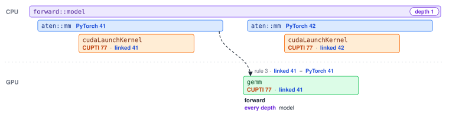

**No match by either id.** No launch call has the second kernel's CUPTI id 777, and no
op has its `linked_correlation_id` 52. It stays a root, `unscoped` and `<unattributed>`
(step 4), and is listed in `unattributed_kernels`.

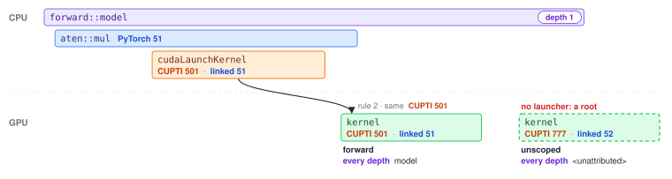

**A GPU annotation sharing a launch's id.** The `Optimizer.step` scope's PyTorch id and an
unrelated launch call's CUPTI id are both 1912, as in the capture LESSONS.md describes. The
kernel links to its launch call by CUPTI id 1912. The scope's `gpu_user_annotation` carries
the scope's PyTorch id 1912, which is never compared with CUPTI ids, and no
`linked_correlation_id`, so it stays a root.

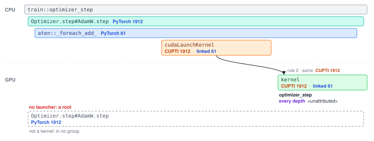

## 3. The launch forest

With every event linked, every event has at most one launcher, so the events form a forest,
the **launch forest**: CPU scopes and ops at the top, nested like a call stack, and GPU work at
the leaves. Its roots are the events nothing encloses: each `train::<phase>` scope, each
autograd node on autograd's worker thread, and GPU work no rule matched. A row's `launcher_id`
is its parent in the forest, NA for a root; on a CPU row it is the enclosing CPU event, which
need not have launched anything in the CUDA sense. A launch sequence is one path through the
forest, from a kernel up to its root.

For the steps after this one, `aggregate_kernels` builds the forest once with `_launch_forest`:
each event's fields, parent and children, every row ID in parent-first order, the CPU events
and the kernels. Steps 4 and 6a walk it down, 6b walks it up, each walk O(events).

`render` in `profiling/attribution_diagrams.py` draws the pictures. The cases on this page are
event tables of the same shape `events_to_rows` returns, so `render(rows, event_id)` draws any
event of a profiled step the same way, at the step's times: what it launched, under its launch
sequence. By default it leaves out the events that lead to no GPU work (views, reshapes,
allocations); the cases here are drawn with `gpu_work_only=False`, so every row shows.

## Labelling the work while it runs

The launch forest says which op launched a kernel, not which module of the model the op ran
for. `module_scopes` adds that while the step runs, as module scoped stages: `record_function`
annotations named `<phase>::<fqn>`, where phase is `forward` or `backward` and fqn is a
`named_modules` path under the root, `model`:

```text
forward::model                  # the root module
forward::model.tblocks.0        # a submodule
backward::model.tblocks.0       # the same submodule during backward
```

- **Forward.** A forward pre-hook opens `forward::<fqn>` on every module call and a forward
  hook closes it, so forward stages nest as the calls do.
- **Claiming autograd nodes.** A `TorchFunctionMode` sees every op's output during forward and
  claims each new autograd node for the module path active at that moment, once. Input graph
  nodes, nodes a child module already claimed, and `AccumulateGrad` (a shared parameter
  accumulates from several modules) are not claimed.
- **Backward.** Each claimed node gets a pre-hook and a post-hook that open and close the whole
  root-to-owner path, `backward::model`, ..., `backward::<owner>`, around the node's execution.
  Autograd runs nodes on a worker thread that has no `train::backward` above it, which is why
  the stage name carries its phase.
- **Shared modules** take the alias below the module calling them when there is one, else their
  first `named_modules` path.

`train::<phase>` annotations, from `profiling.util.phase`, mark whole phases; module stages mark
module work within one. Loss and optimizer work runs outside every module call and gets no
module stage. Direct `.forward()` calls bypass the hooks, and compiled graphs and checkpoint
recomputation are outside this eager scheme. On exit every hook is removed and every stage still
open is closed, even after an exception. These stages are events like any other, so they sit
on every kernel's launch sequence, and step 4 reads them from there.

## 4. Each kernel's owner

`_kernel_owners` walks the forest parent-first. Every event inherits its launcher's
**execution context**, a phase, an owner module FQN and the row ID of the owner's stage, and a
CPU event can change it for everything below it. `_execution_context` is that rule:

| CPU event | Context it passes down |
|---|---|
| `train::<phase>` annotation | that phase, no owner |
| `<phase>::<fqn>` annotation, fqn the root or under it | that phase, owner fqn, this row as the stage |
| `Optimizer.step#...` annotation outside every module | `optimizer_step`, no owner |
| `autograd::engine::evaluate_function: ...` node | `backward`, keeping the owner only if already in backward |
| anything else | what it inherited |

A root starts as `unscoped` with no owner. In the launch sequence above, kernel 532 inherits
from row 501: phase `forward`, owner `model.tblocks.0.ffn`, stage 501. A kernel no module stage
encloses has no owner and becomes `<unattributed>`: loss and optimizer work, and kernels whose
link is missing. A kernel with an owner whose chain never passes the root stage
(`forward::model`) raises `ValueError`: its module path is incomplete, so it cannot be grouped
correctly at any depth.

## 5. Each kernel's group

`_module_group` cuts the owner FQN to `depth` components, the root included, and the kernel's
group is `(phase, that prefix)`:

| depth | owner `model.tblocks.0.ffn` goes to |
|---|---|
| 1 | `model` |
| 2 | `model.tblocks` |
| 3 | `model.tblocks.0` |
| None | `model.tblocks.0.ffn` |

A prefix needs no stage of its own: `model.tblocks` is a group although no module call recorded
it. Work done directly in a shallower module stays in that module's group, so groups never
share a kernel, and repeated calls of the same module merge into one group.

Below, `aten::bmm` runs inside `model.tblocks.0.ffn` and `aten::add` directly in
`model.tblocks.0`. `model.tblocks` is a ModuleList that is never called, so the stages jump
from depth 1 to depth 3, yet depth 2 still groups both kernels under it. The `add` kernel's
owner has three components, so at depth 4 and deeper it stays in `model.tblocks.0`.

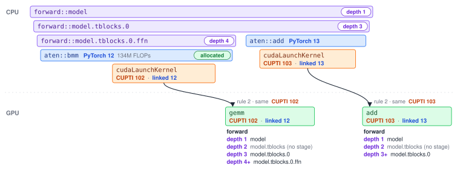

## 6. FLOP sources

The profiler reports FLOPs on some ATen ops, computed from their input shapes, never on
kernels. Two things make the obvious sum wrong: ops nest (`aten::einsum` calling `aten::einsum`
calling `aten::bmm`, any of which may report), and one op can launch many kernels. A **FLOP
source** is a reported estimate, and every one gets exactly one status.

**6a. Reported estimates, top-down.** `_reported_flops` takes every CPU `aten::` op with a
positive finite `flops`. Walking down, it carries the outermost reported op above each event:
an estimate with one above it is suppressed by it, since the outer estimate already covers its
work.

**6b. Subtree summaries, bottom-up.** `_subtree_summaries` walks up once and gives every event
three things about the subtree below it: how many kernels it holds, which group they fall
into (one group key, or mixed), and the FLOPs it carries. A subtree carries its own reported
estimate if it has one, else the sum of what its children carry, and nothing without kernels.
Siblings add, a nested estimate is replaced, and an op launching ten kernels counts once.

**6c. One status per estimate.** `_flop_sources` keeps the estimates with kernels below them
(an op that ran only on the CPU did no GPU work) and gives each a status:

| Status | When | Counts toward |
|---|---|---|
| `suppressed` | a reported ATen op encloses it | nothing; `suppressed_by` names the op |
| `unallocated` | its kernels fall into more than one group (`spans_groups`) | nothing |
| `allocated` | otherwise | its kernels' one group |

In the launch sequence above, neither `einsum` reports FLOPs, so `aten::bmm` (row 529) is the
outermost estimate and is allocated: 134,217,728 FLOPs to `(forward, model.tblocks.0)` at
depth 3. Nesting and spanning look like this:

```text
forward::model.left
└── aten::mm  100 FLOPs           allocated to (forward, model.left), kernel_count 2
    └── aten::mm  200 FLOPs       suppressed_by the outer aten::mm
        ├── kernel
        └── kernel

forward::model
└── aten::outer  300 FLOPs        unallocated at depth 2, allocated to (forward, model) at depth 1
    ├── forward::model.left   ── aten::left  100 FLOPs  ── kernel     suppressed_by aten::outer
    └── forward::model.right  ── aten::right 200 FLOPs  ── kernel     suppressed_by aten::outer
```

An estimate is never divided or duplicated, and a suppressed one is never added back. So the
allocated plus unallocated FLOPs equal what the forest's roots carry, at every depth, and
`_flop_sources` raises if they do not. Only the split between groups changes with depth.

## 7. The kernel table

`_kernel_table` takes every kernel row (not copies or memsets) with its phase and group from
step 5, its owner and owner stage from step 4, and its GPU interval: `gpu_start_us`,
`gpu_end_us` and `duration_us`, in us from the trace's start. A kernel with no finite interval
raises `ValueError`. No FLOP figure goes on a kernel: one estimate launches many kernels, and
spreading it over them would invent per-kernel numbers.

## 8. The group table

`_group_table` makes one row per `(phase, module_fqn)`, in phase execution order:

- `kernel_ids` and `kernel_count`: its kernels, each in exactly one group.
- `owner_stage_ids`: the stages its kernels came from, one per module call that was merged.
- `total_est_flops`: the sum of the group's allocated estimates, and `flop_source_ids`
  names them. 0 means no allocated estimate, not necessarily no work.
- `<op>_est_flops`: the same sum split by ATen op, one column per op with an allocated
  estimate in any group: `aten::bmm`'s is `bmm_est_flops`, 0 in a group without one.
- `gpu_start_us`, `gpu_end_us` and `gpu_span_us`: from its first kernel's start to its last
  one's end, gaps between merged calls included.
- `gpu_time_us`: the sum of its kernels' durations. Overlapping kernels each count in full.

`aggregate_kernels` returns this table, the kernel table sorted by phase, module and start,
the kernels with no owner, and the FLOP sources. A profile's `display_steps` draws one row per
group with its `total_est_flops` beside it.

## Cases in the event tree

Steps 4 to 8 on small event trees. `render` runs each through `aggregate_kernels` at every
depth from 1 to its deepest module stage and at None: under each kernel is its phase and its
group at each depth, and the chips are module depths and FLOP source statuses. The key is
under [The picture](#the-picture).

**One op, several launches, and a copy.** `aten::einsum` launches two kernels: its one estimate
counts once, toward the group both fall into. The copy links to `aten::copy_` the same way, but
only kernels are grouped.

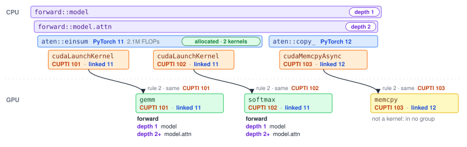

**Nested ops.** On the left `aten::einsum` reports nothing, so the estimate of the
`aten::bmm` inside it is the source. On the right both ops report: the outer one is allocated
and the inner one suppressed, so its 200 FLOPs are not counted a second time.

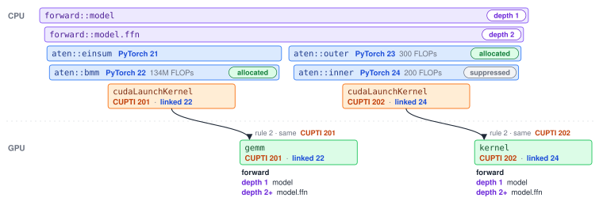

**One estimate over two modules.** `aten::outer` encloses two module stages. At depth 2 its
kernels fall into `model.left` and `model.right`, so it is unallocated; at depth 1 both are
`model` and it is allocated. The estimates inside it are suppressed at every depth.

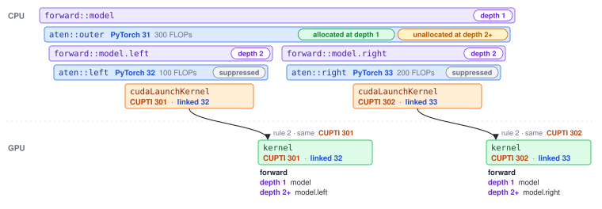

**Backward on autograd's worker thread.** An autograd node is a root: nothing like
`train::backward` encloses it on the worker thread. Inside it `module_scopes` reopened
`backward::model` and `backward::model.ffn`, so the kernel goes to `(backward, model.ffn)`.
`AccumulateGrad` is never claimed by a module, so its kernel is `backward` but
`<unattributed>`.

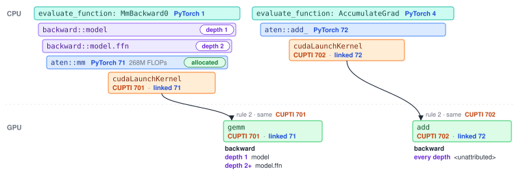

**Work outside every module.** Loss and optimizer work gets its phase from `train::<phase>`
but has no module stage above it.

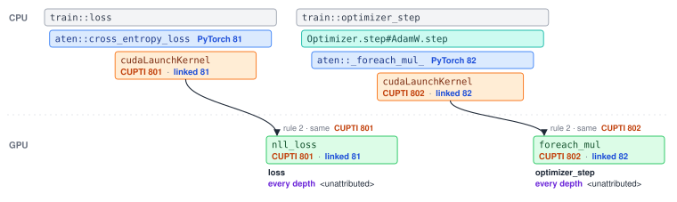

## Reading the results

```python
groups.loc[("forward", "model.tblocks.0")]               # one group
kernels.loc[groups.loc[("forward", "model.tblocks.0"), "kernel_ids"]]   # its kernels
flop_sources[flop_sources.status == "unallocated"]         # estimates no group got
rows.loc[flop_sources.index]                               # the ATen events behind every estimate
launch_chain(rows, unattributed_kernels.index[0])          # why a kernel has no owner
SVG(render(rows, flop_sources.index[0], width=1200))       # one op and what it launched, drawn
```

## Limits

- FLOPs are the profiler's shape-based estimates, not measured instructions. Ops without a
  formula (elementwise ops, softmax, fused attention) report nothing, so group totals
  undercount, and a reported estimate cannot separate an op's CPU work from its GPU work.
- An estimate spanning groups stays unallocated rather than being guessed at; group it at a
  shallower depth to allocate it.
- Missing links stay missing: a kernel whose op the profiler deleted is a root, `unscoped` and
  `<unattributed>`.
- Compiled graphs, Triton kernels and checkpoint recomputation are outside the eager scheme.

## Why

**The outermost estimate wins.** A reported estimate is the op's whole formula, so the ops it
calls are inside it; counting any of them as well counts the same work twice. Keeping one
level per subtree is what makes totals add up, and the outermost one is the op as it was
called.

**A spanning estimate is not split.** Nothing in the events says how an op's FLOPs divide
between the modules below it. Splitting by kernel count or GPU time would invent numbers that
look measured; leaving it unallocated keeps every group's figure true and the total conserved.

**Links are matched, never inferred from time.** Threads and streams overlap, and a link
guessed from timestamps looks as plausible as a right one. An unlinked kernel is visible in
`unattributed_kernels`; a wrongly linked one is not.

## How the steps fit together

The steps of this page as functions, from the profiler's events to the report:

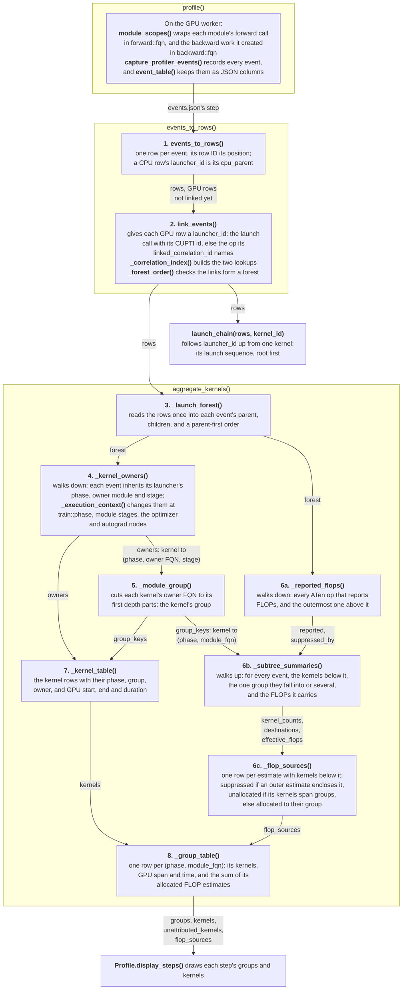

Each box is one function and what it does; each arrow is the value it hands on. Every step is a
pure function of what the steps before it returned: none changes its input, and none recomputes
what another already has.

## Reference

::: profiling.profile_events.events_to_rows
    options:
      show_root_heading: true
      heading_level: 3

::: profiling.profile_events.link_events
    options:
      show_root_heading: true
      heading_level: 3

::: profiling.profile_events.launch_chain
    options:
      show_root_heading: true
      heading_level: 3

::: profiling.profile_events.aggregate_kernels
    options:
      show_root_heading: true
      heading_level: 3

::: profiling.profile_events.module_scopes
    options:
      show_root_heading: true
      heading_level: 3

::: profiling.attribution_diagrams.render
    options:
      show_root_heading: true
      heading_level: 3
