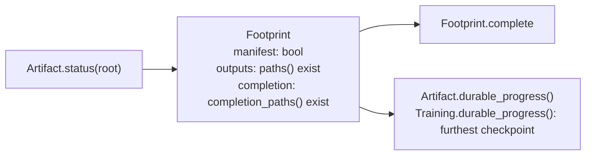

# Artifact Repository

Where everything lives: the volume that holds every artifact, the Modal Dicts
and Queue that hold what is happening now, and the code that reads and writes
them. One store is the source of truth, the volume; every other reader works
from a snapshot of it.

## The volume

`trainvols`, mounted at `/storage` (`config.STORAGE`) in every container that
needs it. One folder per artifact, holding its own `manifest.json`, whatever
files its type declares, and a `logs/` folder with one `{call_id}.jsonl` per
call ever launched for it ([Logging](logging.md)).

```text
sources/odyssey/                  raw text
tokenizers/<uid>/                 trained tokenizer
tokenized/<tokenizer>/<source>/   one source through one tokenizer
datasets/, mappeddatasets/        training data
runs/<run_id>/pretraining/...     training legs, their checkpoints and step logs
logs/launcher.jsonl               the launcher's own log
call_history.json                 every grant ever made, per artifact path
```

- **Shared roots** (`sources/`, `tokenizers/`, `tokenized/`, `datasets/`,
  `mappeddatasets/`) hold artifacts with no `run_id` in their parameters:
  reused across runs rather than rebuilt per run. `tokenized/{tokenizer-uid}/{source-uid}/`
  holds a `TokenizedSource`, one source run through one tokenizer as
  `tokens.bin`, shared by every dataset that names that pair. `DataSet` copies
  those bins into its own `train.bin` and `valid.bin`; `MappedDataSet` owns no
  bytes and reads straight out of the `tokens.bin` files. They are separate
  families and folders, different kinds of artifact rather than variants of
  one.
- **`runs/{run_id}/`** holds that run's own artifacts, today its
  `pretraining/` legs. Everything a run depends on that is not run-scoped (its
  tokenizer, its dataset, the sources behind them) lives under a shared root,
  found by walking the dependency tree embedded in the run's manifest.
- A leg's `train.jsonl` is the worker's own file, one row per step, appended to
  as it trains rather than published like an output: it completes nothing.

Path encodings are a storage contract: changing one requires an explicit
migration ([Migrations](#migrations)).

## Roots

Declaration, loading, status and binding default to one root, where the volume
is mounted in a container:

```python
STORAGE = Path("/storage")  # config.py
```

Every storage-touching call takes `root=None`, meaning `STORAGE`. Any other
store is reached by passing another absolute `Path`: a second volume mounted
elsewhere, a test's `tmp_path`, a folder on a laptop. All are ordinary roots,
and nothing distinguishes them.

**Nothing internal calls `bind()` or `load()` without its root.** A job, a
`_load` hook, or anything else already holding a root passes it on to every
call it makes; a hook that bound a dependency bare would silently read
`STORAGE` while everything around it reads another store. The default is
consumed only at the top: a notebook, the launcher.

**Every root is an absolute `Path`, and every `artifact_path` relative.**
pathlib's `/` silently discards the left side when the right is absolute, so
either mistake would resolve to the wrong file rather than raise.
`storage.root_of` refuses a string or a relative root at the call, so one type
reaches every join, glob and `relative_to`.

The volume is reachable only from Modal. A laptop works against a folder of its
own, and reaches the volume only through `local.py`
([Lab](lab.md#the-notebook-api)), never through a default root that varies
per process.

## Status

`artifact.status(root=None)` returns a `Footprint`: whether the manifest
exists, which owned outputs exist, and which completion files exist. It parses
no manifest, compares no definition, reads no lease, imports no job and loads
no output. Only regular files at final paths count: temporary files, logs and
nested artifact folders do not, and `done` means the files are present, not
that their bytes are right.



`footprint.complete` reads the completion files, never the owned outputs. The
two name the same files for every artifact that owns its bytes and differ
exactly for a virtual artifact, such as `MappedDataSet`, which owns no outputs
and names the files it reads from its dependencies instead. An empty
completion set is satisfied at once, so a type whose completion is borrowed
refuses, in its own validation, a definition that borrows from nothing: it
would read as `done` on an empty volume. What a footprint means for a
declaration (`new`, `declared`, `done`, ...) is [Lab](lab.md#declaration)'s to
say; for the dashboard, [Launcher](launcher.md#the-state-map)'s.

## Dicts and the Queue

What is happening now lives outside the volume, in Modal Dicts and one Queue:

- **`launchpad-leases`**: one entry per artifact path (not per run), naming the
  call currently holding that artifact. Removing the entry is how a call is
  stopped: the call's next lease check finds no grant and raises. A finished
  call's grant stays until the path is granted again or cancelled.
- **`launchpad-beats`**: one entry per call id, the time of its last
  heartbeat, which is how a reader tells a live call from a dead one.
- **`launchpad-call-history`**: one entry per artifact path, the list of every
  grant the launcher ever made for it: which calls belong to an artifact, said
  once, by the thing that made them.
- **`launchpad-call-logs`**: every call's log rows, keyed
  `{call_id}:{livedict|volume}:{worker|launcher|ambient}` ([Logging](logging.md)).
- **Queue `launchpad-refreshes`**: two messages per call,
  `{artifact_path, call_id, event}`: `started`, after its first heartbeat, and
  one naming how it ended (`done`, `failed`, `lease lost`), after its
  `volume.commit()` and its last beat. The worker is the only writer and the
  launcher the only reader. Nothing is computed from a message: it only says
  the volume and the Dicts are worth reading again.

## Where the code lives

- **`artifacts/`**: the artifact families, each a package holding its artifact
  class and, in `jobs.py`, its job; `artifacts/core/` holds the base classes,
  the codec, storage and resolution ([Artifacts](artifacts.md)).
- **`models/`**: one package per architecture ([Models](models.md)).
- **`lab.py`**, **`local.py`**: the notebook API, and the laptop's bridge to the
  volume ([Lab](lab.md)).
- **`main.py`**: the deployment and nothing else: the app, the volume, the
  three images (`web_image`, `worker_image`, `lab_image`) and the five
  functions (`leasebook`, `persist_logs`, `run_job`, `jupyter`, `profile`) with
  the resources each gets. What they run is `launcher/`:
  - `launcher/state.py` reads the volume and the Dicts into the state map, and
    owns `volume`, `mount_lock` and the decoded manifests.
  - `launcher/leasebook.py` is the launcher and its dashboard API:
    `attempt_launch` and `cancel_call`, and the routes that are their only
    callers ([Launcher](launcher.md)).
  - `launcher/gate.py` is the password in front of those routes, and
    `launcher/lab_server.py` JupyterLab's setup ([Dashboard](dashboard.md)).
- **`system/`**: the plumbing under all of that, artifact-agnostic by
  construction: the Dicts and the Queue (`lease_protocol.py`), the log
  channels (`logs.py`), and what a worker does around a job (`runtime.py`,
  [Workers](workers.md)).
- **`web/`**: the dashboard page ([Dashboard](dashboard.md)).
- **`gpus/`**, **`profiling/`**: GPU throughput tables, the training loop's MFU
  monitor, and the profiler ([Profiling](profiling.md)).
- **`migrations/`**: the scripts that change what is on the volume
  ([Migrations](#migrations)).

## Migrations

What is on the volume changes only through a script in `migrations/`, one per
change, run against the volume from a laptop with `modal run local.py::<runner>`.
Each runner is an ephemeral app that builds its image from the checkout and
mounts the volume, so it runs the checkout's code without deploying it. A
script's logic imports only `artifacts` and is tested on a temporary folder;
it plans by default and writes only when asked.

| Runner | Script | What it does |
| --- | --- | --- |
| `scan_volume` | `migrations/scan.py` | Reads every manifest on the volume and reports any that does not load (including one whose decoded path is not its folder) or that would re-encode to different text, naming the first differing line. Writes nothing. Run it before and after any change to the codec. |
| `canonicalize_manifests [--apply]` | `migrations/cpu_floats.py` | Rewrote manifests that stored `allocated_resources.cpu` as an int, written by older code, in the text the code writes today, refusing any other difference. Applied; the scan has reported no problems since. |
