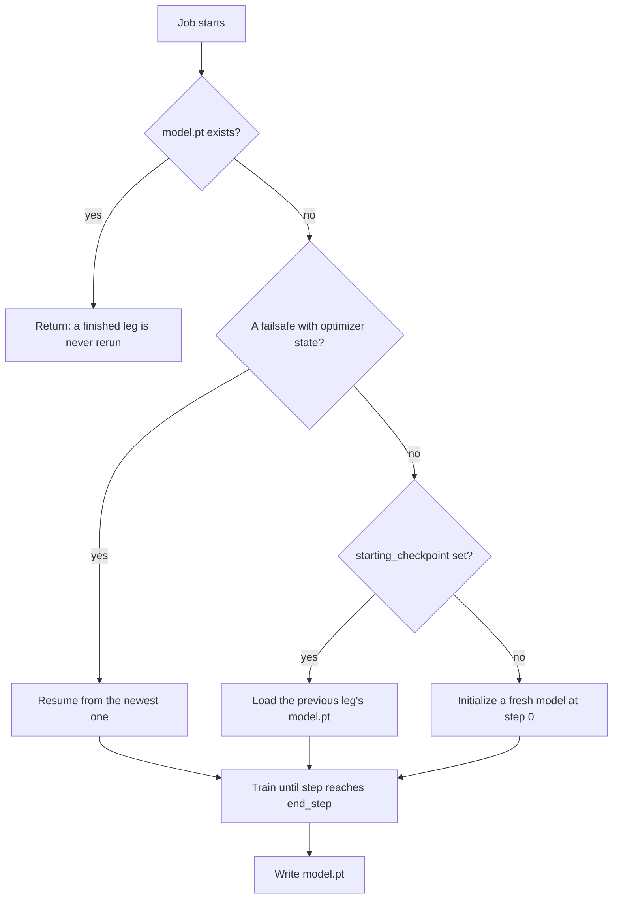
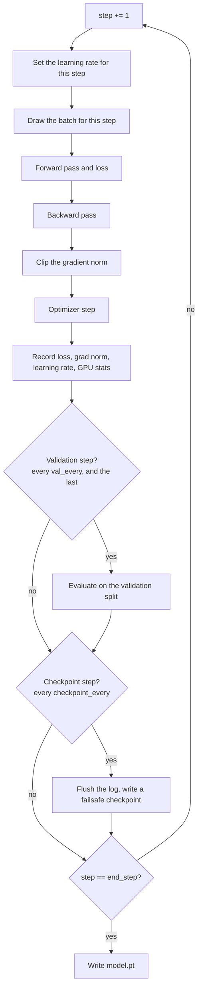
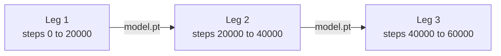

# Training a Model

A model is trained by a **leg**: one `Pretraining` artifact that takes a
dataset and a model description and trains for a fixed number of steps. This
page covers what you declare, what the job does when it runs, how checkpoints
make a run resumable, and how legs chain into a long run.

## Declaring a run

A leg is declared like any other artifact. Everything that decides the result
is a parameter.

```python
from artifacts.core.SGD.training import (
    LoopConfig, LRSchedule, OptimizerParameters, TrainingParameters,
)
from artifacts.stages.pretraining import Pretraining
from models.transformer import Transformer

leg = Pretraining(
    run_id="tinystories",
    dataset=dataset,
    model=Transformer(
        vocab_size=tokenizer.vocab_size, sequence_length=256, num_layers=4,
        d_model=512, d_ff=1344, num_heads=16, rope_theta=10000, device="cuda",
    ),
    training_parameters=TrainingParameters(
        total_steps=20000, batch_size=64, max_norm=1.0,
        lr_schedule=LRSchedule(
            max_learning_rate=1e-3, min_learning_rate=1e-4,
            warmup_iters=200, cosine_cycle_iters=20000,
        ),
        optimizer="torch.optim.AdamW",
        optimizer_parameters=OptimizerParameters(
            lr=1e-3, betas=(0.9, 0.95), weight_decay=0.1, eps=1e-8,
        ),
    ),
    loop_config=LoopConfig(val_every=200, gpu_check_every=100, checkpoint_every=1000),
)
```

| Parameter | What it decides |
| --- | --- |
| `dataset` | The token stream the leg trains on, and through it the tokenizer. |
| `model` | The architecture: an instance of a `Model` class under `models/`. Its `vocab_size` must match the tokenizer's. |
| `training_parameters` | Everything that changes the optimization trajectory: steps, batch size, learning rate schedule, optimizer and the seed. |
| `loop_config` | How the leg is observed and recovered: validation cadence, checkpoint cadence, GPU health checks. |
| `starting_checkpoint` | The leg this one continues, if any. |
| `run_id` | A name that groups the legs of one run. |

Declaring writes the manifest and nothing else. The GPU is requested on the
artifact with `allocated_resources=Resources(gpu_type="A100")`. Resources are
not part of identity, so changing them does not create a new leg.

## What the job does

When the leg is launched, `PretrainJob` runs it. The first decision is where
to start from.



In every case the optimizer settings come from this leg, not from the
checkpoint it loaded. A leg that starts from another leg also checks that the
checkpoint's recorded step matches its own `start_step`, and refuses
otherwise.

## One step

`step` counts completed steps. Each iteration increments it first, so the step
being taken is step number `step`, and its batch and learning rate are both
functions of that number.



The dataset draws the batch. For both `DataSet` and `MappedDataSet`, a step's
batch is random windows of the token stream chosen by a generator seeded with
`(seed, step)`. The batch therefore depends on the seed and the step number
alone, so a resumed run sees exactly the batches the interrupted one would
have, and no random state needs saving. Validation covers the validation split
in order.

## Checkpoints

A leg writes two kinds of checkpoint. They look alike on disk but mean
different things.

| | `model.pt` | `checkpoints/{step}.pt` |
| --- | --- | --- |
| Role | The leg's output | Insurance against interruption |
| Artifact output | Yes, it is the leg's declared file | No |
| When written | Once, at `end_step` | Every `checkpoint_every` steps |
| Who may depend on it | Other legs and artifacts | Nobody |
| Optimizer state | Always | The newest only, by default |

Both hold the model state, the optimizer state and the step the state is the
result of. The recorded step in the file is the authority, not its name.

Files are written to a temporary name and renamed into place, so a checkpoint
exists whole or not at all. The rename is also the last point at which a
cancelled call can be stopped from publishing.

By default only the newest failsafe keeps its optimizer state
(`optimizer_checkpoint_policy="latest"`), because recovery only needs the
newest one. Setting `"all"` keeps it in every failsafe.

## Interrupting and resuming

If a leg is cancelled or dies, launch it again. It resumes from its newest
usable failsafe and redoes at most `checkpoint_every` steps. Because batches
depend only on `(seed, step)`, the redone steps train on the same data.

A leg that has finished is never trained again. Later legs may already have
started from its `model.pt`, and on CUDA a retrain would not reproduce it bit
for bit.

## Long runs: chaining legs

A long run is a chain of legs rather than one job. A leg continues another by
naming it as `starting_checkpoint`.



```python
leg2 = Pretraining(
    run_id="tinystories",
    dataset=dataset,
    starting_checkpoint=leg,
    training_parameters=TrainingParameters(total_steps=20000, ...),
    loop_config=loop_config,
)
```

- A leg's `start_step` is the previous leg's `end_step`, and `total_steps` is
  the number of steps this leg runs.
- The model is inherited from the starting checkpoint, and may not differ.
- The tokenizer may not change across legs, and a leg's `vocab_size` must
  match its tokenizer.
- The learning rate schedule and optimizer parameters belong to each leg, so
  a later leg can change them.
- Because the starting checkpoint is itself a leg, a leg carries its whole
  ancestry, and resolving it resolves the chain behind it.

## Identity

Two legs can cover the same step range and still be different models, so a
leg's name carries a hash of its history:

```text
{run_id}-pretraining-{start_step}-{end_step}-{lineage_hash}
```

The hash covers the starting checkpoint, dataset, tokenizer, model and
training parameters, which is everything that can change the trajectory.
Change any of them and you get a new leg beside the old one.

## What you can watch

Each step appends a row to `train.jsonl` in the leg's folder: loss, gradient
norm and learning rate on every step, validation loss on validation steps, and
GPU memory peaks and MFU where measured. Every attempt appends, so a crash
followed by a resume leaves the redone steps under a new attempt. The
dashboard draws these as loss curves on the leg's page, beside live logs and
step progress.

## Models

Models are not artifacts. Each architecture is a package under `models/`
(`transformer`, `transformerV2`, `mamba`) whose class declares its parameters
and builds the network. The package imports no torch until `build()` runs, so
declaring a leg stays cheap. Adding an architecture means adding a package
there; `Pretraining` needs no change.
