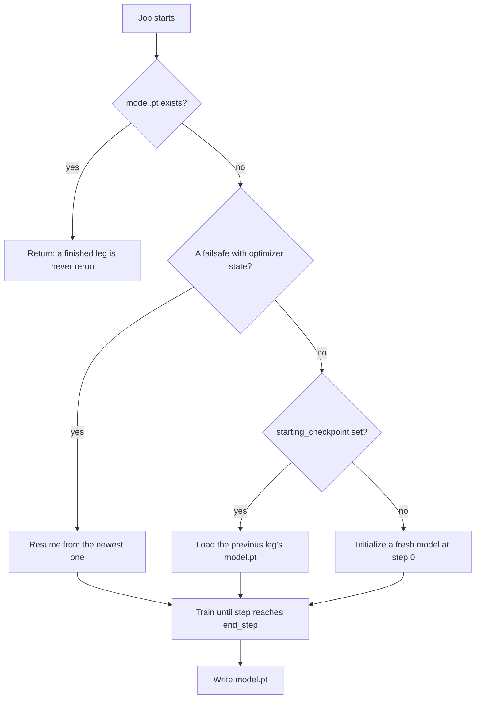
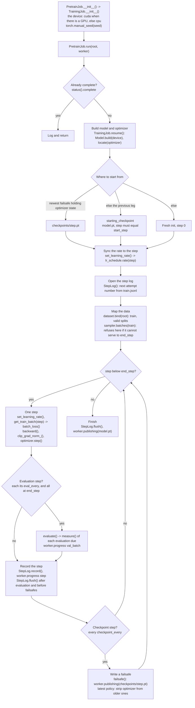
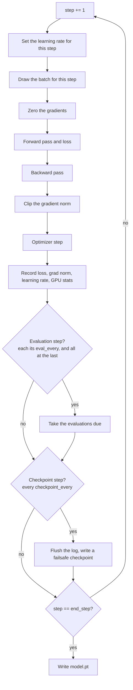
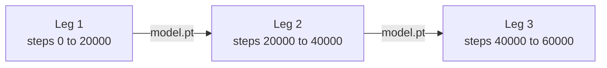

# Training a Model

A model is trained by a **leg**: one `Pretraining` artifact that takes a
dataset and a model description and trains for a fixed number of steps. This
page covers what you declare, what the job does when it runs, how checkpoints
make a run resumable, and how legs chain into a long run.

The work is split in two layers. `Training` (`training/leg.py`)
is what every leg shares: its param configs, `start_step` and `end_step`, and
the model it trains. `TrainingJob` (`training/job.py`) builds the
model and optimizer a leg names, resumes, and writes failsafes. `Pretraining`
(`artifacts/stages/pretraining/`) adds the dataset, reads its tokenizer there,
names its job and decides its `uid`, `artifact_path` and `lineage_hash`;
`PretrainJob` draws the batches and owns the loop.

## Declaring a run

A leg is declared like any other artifact. Everything that decides the result
is a parameter. Here three books from Project Gutenberg train the model and a
fourth validates it:

```python
from training.lr_schedule import WarmupCosine
from training.optimizers import AdamW
from training.leg import LoopConfig, TrainingParameters
from artifacts.mappeddataset import MappedDataSet
from artifacts.sources import SourceURL
from artifacts.stages.pretraining import Pretraining
from artifacts.stages.pretraining.evaluations import TokenLoss
from artifacts.tokenizers.bpe import Tokenizer
from models.transformer import Transformer

# Sources: each downloads one book to sources/<name>/body.txt.
GUTENBERG = "https://www.gutenberg.org/cache/epub"
pride = SourceURL(name="pride-and-prejudice", url=f"{GUTENBERG}/1342/pg1342.txt")
moby = SourceURL(name="moby-dick", url=f"{GUTENBERG}/2701/pg2701.txt")
frankenstein = SourceURL(name="frankenstein", url=f"{GUTENBERG}/84/pg84.txt")
alice = SourceURL(name="alice-in-wonderland", url=f"{GUTENBERG}/11/pg11.txt")

# Tokenizer: BPE merges learned from the training books. <|endoftext|> is the
# separator the dataset puts between books, so no sequence runs from one into
# the next.
tokenizer = Tokenizer(
    vocab_size=4096,
    special_tokens=("<|endoftext|>",),
    sources=(pride, moby, frankenstein),
)

# Dataset: every book tokenized with that tokenizer, the token files read in
# place. DataSet takes the same arguments and concatenates them into its own.
dataset = MappedDataSet.from_sources(
    tokenizer=tokenizer,
    train_sources=(pride, moby, frankenstein),
    valid_sources=(alice,),
)

# The leg: the model and how it is trained.
leg = Pretraining(
    run_id="gutenberg",
    dataset=dataset,
    model=Transformer(
        vocab_size=tokenizer.vocab_size, sequence_length=256, num_layers=4,
        d_model=512, d_ff=1344, num_heads=16, rope_theta=10000,
    ),
    training_parameters=TrainingParameters(
        total_steps=20000, batch_size=64, max_norm=1.0,
        lr_schedule=WarmupCosine(
            max_learning_rate=1e-3, min_learning_rate=1e-4,
            warmup_iters=200, cosine_cycle_iters=20000,
        ),
        optimizer=AdamW(betas=(0.9, 0.95), weight_decay=0.1, eps=1e-8),
    ),
    loop_config=LoopConfig(
        evaluations=(TokenLoss(eval_every=200, batch_size=64),),
        gpu_check_every=100, checkpoint_every=1000,
    ),
)
```

| Parameter | What it decides |
| --- | --- |
| `dataset` | The token stream the leg trains on, and through it the tokenizer. |
| `model` | The architecture: an instance of a `Model` class under `models/`. Its `vocab_size` must match the tokenizer's. |
| `training_parameters` | Everything that changes the optimization trajectory: steps, batch size, learning rate schedule, optimizer and the seed. |
| `loop_config` | How the leg is observed, recovered and run: its evaluations and their cadence, checkpoint cadence, GPU health checks, and the `torch.compile` mode. |
| `starting_checkpoint` | The leg this one continues, if any. |
| `run_id` | A name that groups the legs of one run. |

Declaring writes the manifest and nothing else. The GPU is requested on the
artifact with `allocated_resources=Resources(gpu_type="A100")`. Resources are
not part of identity, so changing them does not create a new leg.

`model`, `training_parameters` and `loop_config` are param configs: each is
validated when it is built, so a value outside its constraint (a zero
`batch_size`, a `d_model` that `num_heads` does not divide) raises a
`ValidationError` naming the field at that line, not when the leg runs. An int
passed where a float is declared (`max_norm=1`) is stored as that float; any
other conversion is refused. The model's fields are on [Models](models.md); the
others are below.

What the leg itself checks when it is built, each a validator on its class:

- **The model.** A leg states its `model`, or omits it and inherits its
  starting checkpoint's, filled in before validation
  (`Training._inherit_model`). A leg with neither is refused: `model` is a
  required field. A leg that states one different from its starting
  checkpoint's is refused (`_model_matches_checkpoint`).
- **One tokenizer for life.** The leg's tokenizer is its dataset's, since a
  dataset holds sources tokenized with exactly one. `Pretraining` refuses a
  model whose `vocab_size` differs from the tokenizer's, and a starting
  checkpoint trained with another tokenizer (`_one_tokenizer_for_life`).

::: training.leg
    options:
      members: [TrainingParameters, LoopConfig, Evaluation]
      heading_level: 3

::: training.lr_schedule
    options:
      heading_level: 3

::: training.optimizers
    options:
      heading_level: 3

## What the job does

When the leg is launched, `PretrainJob` runs it. The first decision is where
to start from.



In every case the optimizer settings come from this leg, not from the
checkpoint it loaded: `load_state_dict` restores the saved leg's, so the job
puts back every option the optimizer was built with after loading, its
declared fields and the ones torch picks alike. On CUDA it is built fused, one
kernel per step for the same update; `fused` is not a field, so it changes no
leg's identity.
If the starting checkpoint saved no optimizer state, the job warns and uses a
fresh optimizer. A leg that starts from another leg also checks that the
checkpoint's recorded step matches its own `start_step`, and refuses
otherwise.

Function by function:



## One step

`step` counts completed steps. Each iteration increments it first, so the step
being taken is step number `step`, and its batch and learning rate are both
functions of that number. After `optimizer.step()` the model is the result of
`step`, which a failsafe written there records.



**The optimizer holds the rate of the current step.** The loop sets it just
before taking the step, and a checkpoint saves it with the model and optimizer,
so a checkpoint at step N carries the rate step N was taken with, whichever
attempt wrote it; `resume` sets it again after loading. The loop runs until
`step` reaches `end_step`, then writes `model.pt` with `"step": end_step`, even
after zero iterations (the last failsafe of an interrupted attempt landed on
`end_step`).

**The leg's sampler decides how batches are drawn.** `run` asks it once for
`sampler.batches(dataset.train, batch_size, sequence_length, seed, end_step)`,
a function from step number to that step's (inputs, targets), and the loop only
passes it the step. The dataset serves tokens; the [sampler](artifact-repository/stages/samplers.md)
is the recipe, and a different recipe (epochs, a curriculum) is a different
`Sampler` class on the leg, part of its `lineage_hash`. A sampler that cannot
serve every step up to `end_step` refuses there, before the first step.

**Evaluations measure the model; they never train it.** Each of
`loop_config.evaluations` names its own period, `eval_every`. At a step that
is a multiple of any of them, and at `end_step` for all of them, `evaluate`
puts the model in eval mode with gradients off and calls `measure` on each
evaluation due, then merges what they return into that step's row, which is
flushed then. A leg with no evaluations records training metrics alone. An `Evaluation` is a param config whose
subclass is the procedure, defined by the stage (pretraining's is
[`TokenLoss`](artifact-repository/stages/evaluations.md)), so the loop knows
none of them. Its metrics are named `val_*`, which is how a reader of
`train.jsonl` tells them from the training metrics, and two evaluations that
name the same metric are refused at the step they clash. The step's gradients
are zeroed before its forward pass rather than after the optimizer step, so an
evaluation can read them, clipped, off the parameters
([`BlockGradNorm`](artifact-repository/stages/evaluations.md) does); its metrics
are of the training batch and are not named `val_*`. `loop_config` is not
in `lineage_hash`, so changing an evaluation changes no leg's identity: it
changes what is measured, never a weight.

**Compiling changes how the model runs, not what it computes.** With
`loop_config.compile` set to a `torch.compile` mode, `run` compiles the model
in place with `model.compile(mode=...)`, after `resume` has loaded it and
before the first step, so training and every evaluation run compiled. In place
keeps the module, its parameters and its `state_dict` keys the ones the
optimizer and the failsafes hold, where `torch.compile(model)` would return a
wrapper whose keys gain an `_orig_mod.` prefix. A compiled kernel can reorder a
reduction, so a compiled leg matches an eager one to rounding, as a leg on
another GPU does; like the GPU, the mode is not identity, so a compiled leg and
an eager one with the same parameters have the same path. Declaring a stored
leg again with another mode is still a conflict in `lab.declare`, as any
change to its `loop_config` is. The first step and each evaluation's first batch pay for the
compile, which the first `gpu_check_every` window's MFU shows. The mode a
[profile](profiling.md) sweep measured fastest is the one to declare.

Every sampler's batch is a function of its fields, the seed and the step number
alone, so a resumed run sees exactly the batches the interrupted one would
have. No random state is checkpointed: the model has no dropout, and batch
selection is the only randomness after initialization.

## Checkpoints

A leg writes two kinds of checkpoint. They look alike on disk but mean
different things.

| | `model.pt` | `checkpoints/{step}.pt` |
| --- | --- | --- |
| Role | The leg's output | Insurance against interruption |
| Artifact output | Yes, it is the leg's declared file | No |
| When written | Once, at `end_step` | Every `checkpoint_every` steps |
| Who may depend on it | Other legs and artifacts | Nobody |
| Optimizer state | Always | The newest only, by default |

Every checkpoint is one `.pt` file holding `{"model": ..., "optimizer": ...,
"step": ...}`: the two `state_dict`s and the step the state is the result of.
Step 0 is the initialized model. The recorded step in the file is the
authority, not its name or the artifact's.

Loading builds the model and optimizer from this leg's parameters, then
`load_state_dict`s into each. The optimizer is built over the live model's
parameters, so the two stay linked; pickling whole objects would give the
optimizer its own copy of the weights, and `step()` would update the wrong
tensors.

Every file goes through `worker.publishing`: written to a temporary name and
renamed into place, so a checkpoint exists whole or not at all. Between the two
it confirms the lease, so the rename is the publication and the last point at
which a cancelled call can be stopped. Nothing calls `volume.commit()` between
failsafes, and nothing needs to: every volume mount runs with background
commits.

Failsafes are not artifacts: not in `files`, nothing waits on them, and no
other artifact may reference them. They also record the trajectory inside the
leg, as a side effect rather than a contract. By default only the newest keeps
its optimizer state (`optimizer_checkpoint_policy="latest"`): after writing a
new failsafe, every earlier one is rewritten without `"optimizer"`, the new
file first, so at every instant at least one failsafe is resumable. Setting
`"all"` keeps it in every failsafe.

## Interrupting and resuming

If a leg is cancelled or dies, launch it again. It resumes from its newest
failsafe that holds optimizer state and redoes at most `checkpoint_every`
steps. Because batches depend only on `(seed, step)`, the redone steps train
on the same data.

A leg that has finished is never trained again: `run` returns as soon as its
`model.pt` exists. Later legs may already have started from it, and on CUDA a
retrain would not reproduce it bit for bit.

## Long runs: chaining legs

A long run is a chain of legs rather than one job. A leg continues another by
naming it as `starting_checkpoint`.



```python
leg2 = Pretraining(
    run_id="gutenberg",
    dataset=dataset,
    starting_checkpoint=leg,          # no model: it is leg's
    training_parameters=TrainingParameters(total_steps=20000, ...),
    loop_config=loop_config,
)
```

- A leg's `start_step` is the previous leg's `end_step`, and `total_steps` is
  the number of steps this leg runs.
- The model is inherited from the starting checkpoint, and may not differ.
- The tokenizer may not change across legs, and a leg's `vocab_size` must
  match its tokenizer.
- The learning rate schedule and optimizer parameters belong to each leg, so
  a later leg can change them.
- Because the starting checkpoint is itself a leg, a leg carries its whole
  ancestry (every earlier leg, dataset, tokenizer, training parameters), and
  resolving it resolves the chain behind it.

## Identity

Two legs can cover the same step range and still be different models, so a
leg's name carries a hash of its history:

```text
{run_id}-pretraining-{start_step}-{end_step}-{lineage_hash}
```

`lineage_hash` digests everything that can change the trajectory: the
starting checkpoint's uid (recursively, the whole chain), the dataset's and
tokenizer's uids, and the model and training parameters exactly as the leg's
manifest writes them. The model's `"class"` key is among them, so moving or
renaming an architecture class moves its legs, and `Transformer` and
`TransformerFA`, which have the same fields, give different legs. `loop_config` and
`run_id` stay out: the first controls observation, not the trajectory, and the
second is already in the path. The device is not a parameter at all: the job
picks it, so a leg has one path whichever device trains it. The
steps are in the name for people to read. Change anything hashed and you get a
new leg beside the old one.

```text
runs/
└── run_001/
    └── pretraining/
        └── 10000-20000-a83f2c/
            ├── manifest.json
            ├── model.pt                declared: the artifact
            ├── train.jsonl             undeclared: one row per step, per attempt
            └── checkpoints/            undeclared: recovery only
                ├── 12000.pt            model only
                ├── 14000.pt            model only
                └── 16000.pt            model + optimizer ("latest" policy)
```

## What you can watch

Each step appends a row to `train.jsonl` in the leg's folder through `StepLog`
(`training/steplog.py`), tagged with the attempt that took it: loss,
gradient norm and learning rate on every step, every evaluation's `val_*`
metrics on evaluation steps (`val_loss` and `val_loss_var` from `TokenLoss`),
and GPU memory peaks and MFU on the steps they
are known. A metric a step did not record is absent from its row, and one that
diverged to NaN or infinity is null, since JSON has neither.

Tensor metrics stay on the device until the loop flushes: after each
evaluation, before each failsafe and once after the loop, the loop's only
CPU/GPU sync points. Flushing before each failsafe means every step up to the
newest failsafe is on file before a crash can land past it, so the attempt
that resumes there leaves no gap. Every attempt appends, so after a crash the
steps redone from the last failsafe appear twice, under different attempts,
which is what lets the file be split back into continuous executions. The
dashboard draws these as loss curves on the leg's page, beside live logs and
step progress.

## Models

The architecture a leg trains, and how to add one, is on [Models](models.md).

## Open recommendations

None applied yet.

- **Weight decay groups.** One param group, so embeddings, RMSNorm gains and
  biases are decayed. The usual recipe decays `p.ndim >= 2` only.
- **`mmap=True` on the volume mount.** Stripping optimizers maps each earlier
  failsafe and renames over it. Whether Modal's FUSE mount supports the map
  and the rename under it needs a check on the real mount. Fallback: plain
  `torch.load` to CPU.
- **Peak memory on resume.** State is loaded with `map_location` set to the
  job's device while the fresh model and optimizer already sit there, so
  resume briefly holds two copies of both. `map_location="cpu"` removes the
  transient at the cost of a slower copy.
- **`torch.compile(model)`** is usually a free 1.3 to 2x on this shape on CUDA.
- **Sweeping stale `.tmp` files.** `worker.publishing` deletes its temporary
  file whenever it does not publish, so an ordinary failure and a lost lease
  both clean up after themselves. A hard kill (OOM, preemption, timeout) runs
  no Python and leaves `{step}.pt.{call_id}.tmp` beside the failsafes, and
  because the name carries a call id that never recurs, no later attempt
  overwrites it: this litter accumulates, one checkpoint-sized file per killed
  attempt. The `*.pt` glob ignores it, so it costs space and nothing else. A
  sweep needs one decision first: a superseded call that is still alive may be
  writing one of those files, so whoever sweeps must either hold the lease and
  accept breaking that call's rename, or skip files younger than some age.
