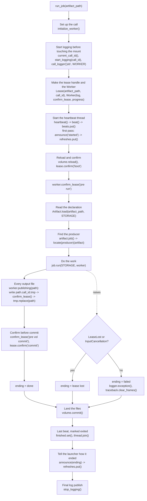
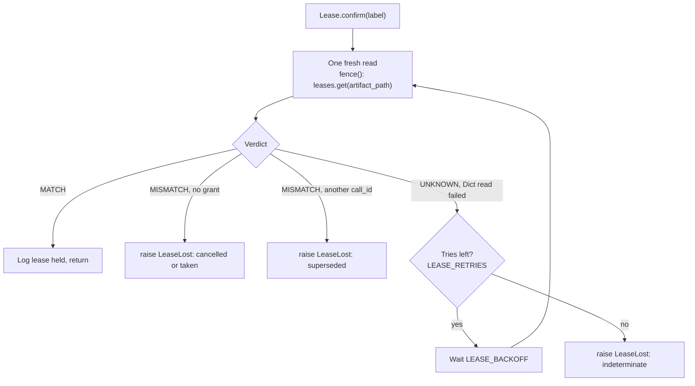

# Workers

A worker is a `run_job` call: its own Modal container, with its own mount of
the volume, running one job under the lease the launcher granted it.
`system/runtime.py`'s `initialize_worker` sets up everything around the job:
logging, the heartbeat, the lease checks, the commit, and the message that says
how it ended.

## Running a job



Logging and the heartbeat start before the worker touches the mount, so a
failure in its own reload is still the call's first logged row rather than
silence. The worker reads the manifest at its own path, the only one that
records the artifact's declaring commit and resources, runs the job, commits its writes whatever
the outcome, and reports one of three endings: `done`, `failed` or
`lease lost`. A cancel arrives as a lost lease, which is what it is: the
launcher took the artifact away.

## One job, traced

One job, spawned, run to completion and exited, against the Dicts, the Queue
and the volume it reads and writes. Alongside it, the launcher recomputing its
picture through its own mount when the job's messages tell it to, and
`persist_logs` filing the Dicts' rows on its schedule.

```mermaid
sequenceDiagram
    participant L as Launcher (leasebook)
    participant Le as Leases (Dict)
    participant B as Beats + call_logs + call_history (Dicts)
    participant Q as Refreshes (Queue)
    participant V as Volume (source of truth)
    participant J as Job container (run_job)

    L->>Le: GET lease -- already active?
    L->>V: reload(); read manifest.json + dependencies' files -- ready?
    L->>Le: DELETE stale grant (if any)
    L->>J: spawn(artifact_path)
    L->>Le: PUT new grant
    L->>B: APPEND grant to call_history[artifact_path]; APPEND "granted" to {call_id}:launcher
    L->>V: reload(); recompute the state map (the new grant is on it)

    activate J
    J->>V: reload()
    J->>Le: confirm ("boot")
    J->>B: PUT first heartbeat
    J->>Q: PUT {artifact_path, call_id, event: started}
    J->>Le: confirm ("pre run")
    J->>J: run() -- write each file through worker.publishing (open tmp, confirm, rename); every log record lands in the buffer
    J-->>B: PUT heartbeat (daemon thread); PUT {call_id}:livedict:{worker,ambient} (its own thread, all rows so far)
    J->>Le: confirm ("pre vol commit")
    J->>Le: confirm ("commit")
    J->>V: commit()
    J-->>B: PUT last heartbeat, marked exited
    J->>Q: PUT {artifact_path, call_id, event: done | failed | lease lost}
    deactivate J

    Note over Q,L: on each message, the listener thread's blocking read returns
    L->>V: reload(); recompute the state map (the beat, then the files, are on it)

    Note over L,J: meanwhile, independently
    loop persist_logs, every PERSIST_LOGS_EVERY
        Note over B,V: reload(); append every source's new rows to logs/{call_id}.jsonl, write call_history.json, commit()
    end
```

## Lease confirms

Four confirms around the job, and one inside it per file published.
`initialize_worker` brackets the whole call with `"boot"` (before anything
runs) and `"commit"` (just before `volume.commit()`); `run_job` adds
`"pre run"` and `"pre vol commit"`; and `worker.publishing` confirms once more
before each rename, which for a training leg is every failsafe as well as
`model.pt`. Each is a fresh read of the grant, so whichever of two racing
launches lost discovers it at its next check rather than only at the end.



A read that succeeded and found no grant is an answer, not silence: no one
holds the artifact, and this call is no one. That is what makes dropping the
lease a usable stop signal.

## What reaches the volume, and when

A job's writes are not private until `commit()`: every mount runs with
background commits, so what a job has written can reach the volume before its
call ends, and the `commit()` on the way out makes that moment definite rather
than making it happen at all. What a job controls is which files exist to be
committed: every completion file goes through `worker.publishing`, so a
temporary file satisfies no completion and only the lease holder renames.
Ownership therefore prevents two workers from *publishing* to one path, not
from running: a cancel drops the lease before asking Modal to stop the call,
so a second call can be granted the path while the first still writes, and the
confirm inside `publishing` decides which one renames. A lease dropped between
the confirm and the rename still lets that rename through; that window is
accepted.

A job's log never touches the volume directly: it reaches the Dict, and the
volume through `persist_logs`. Each message trails what it announces, the
start message after the call's first beat and the ending one after the commit
and the final beat, so a launcher that reloaded any earlier would find exactly
what it already had.

## Reference

::: system.runtime
