# Workflows

Every workflow in the repo as a flowchart. Each box names an abstract step on
its first line and the functions that carry it out below. Python and JS only;
tests and notebooks are left out.

1. [System map](#1-system-map)
2. [Artifact lifecycle](#2-artifact-lifecycle)
3. [Constructing an artifact](#3-constructing-an-artifact)
4. [Declaring](#4-declaring)
5. [Manifest codec, load and bind](#5-manifest-codec-load-and-bind)
6. [Launching](#6-launching)
7. [Cancelling](#7-cancelling)
8. [Running a job](#8-running-a-job)
9. [Lease confirm](#9-lease-confirm)
10. [State recompute and the read routes](#10-state-recompute-and-the-read-routes)
11. [Logging](#11-logging)
12. [Artifact families](#12-artifact-families)
13. [Training a leg](#13-training-a-leg)
14. [Dashboard front end](#14-dashboard-front-end)
15. [Auth gate and the lab](#15-auth-gate-and-the-lab)
16. [One-off scripts](#16-one-off-scripts)

## 1. System map

Who talks to what. Containers are the four Modal functions in `main.py`.

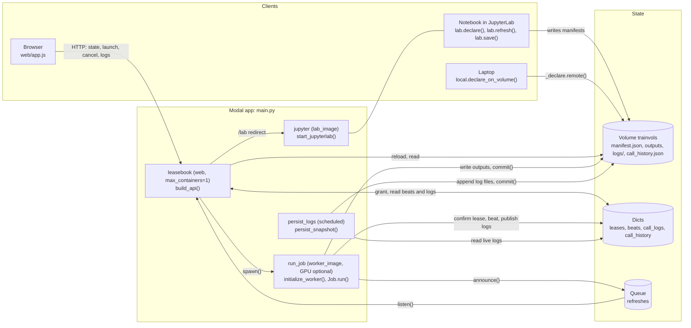

## 2. Artifact lifecycle

Moved to [docs/artifacts.md](../docs/artifacts.md#lifecycle).

## 3. Constructing an artifact

Moved to [docs/artifacts.md](../docs/artifacts.md#construction).

## 4. Declaring

`lab.declare` in a notebook, or `local.declare_on_volume` from a laptop, which
runs the same function in a container that mounts the volume.

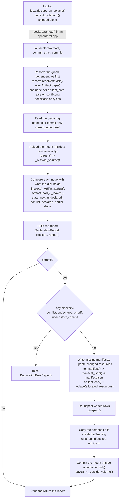

## 5. Manifest codec, load and bind

The codec, load and bind moved to [docs/manifests.md](../docs/manifests.md).
Status stays here until the repository page takes it. It is a pure filesystem
read, used by declaring, launching and the state map:

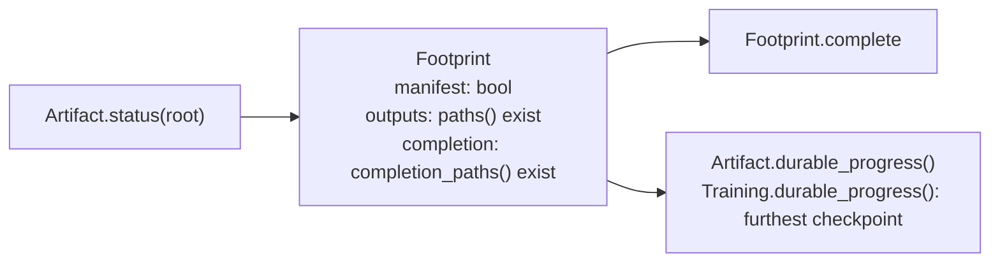

## 6. Launching

The dashboard's run button, through to a spawned `run_job` call
(`launcher/leasebook.py`, `launcher/state.py`).

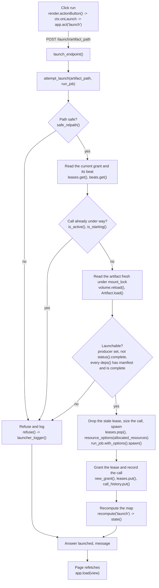

## 7. Cancelling

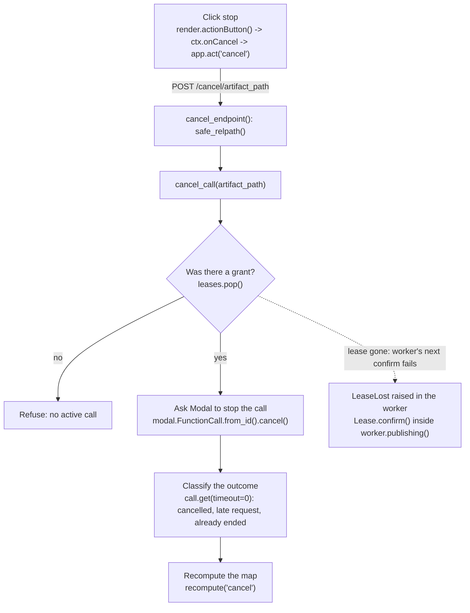

## 8. Running a job

Inside the `run_job` container (`main.py`, `system/runtime.py`).

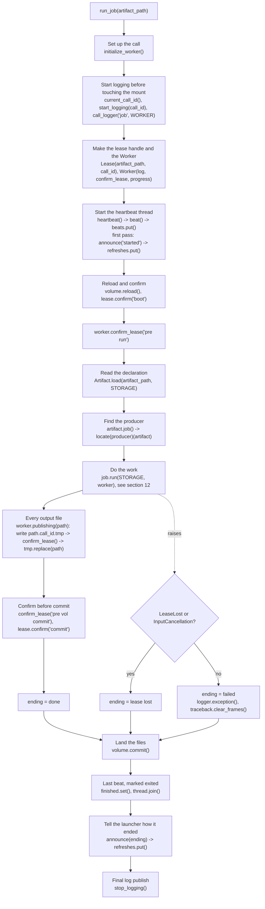

## 9. Lease confirm

Every fence a worker takes (`system/lease_protocol.py`).

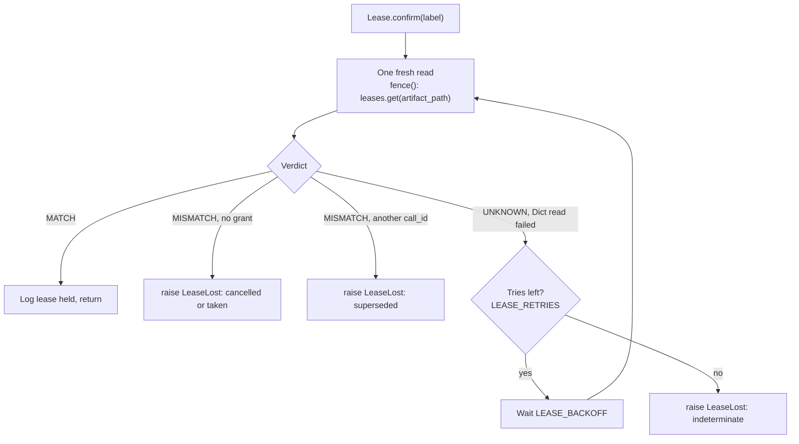

## 10. State recompute and the read routes

The leasebook's in-memory map and the routes that read it
(`launcher/leasebook.py`, `launcher/state.py`).

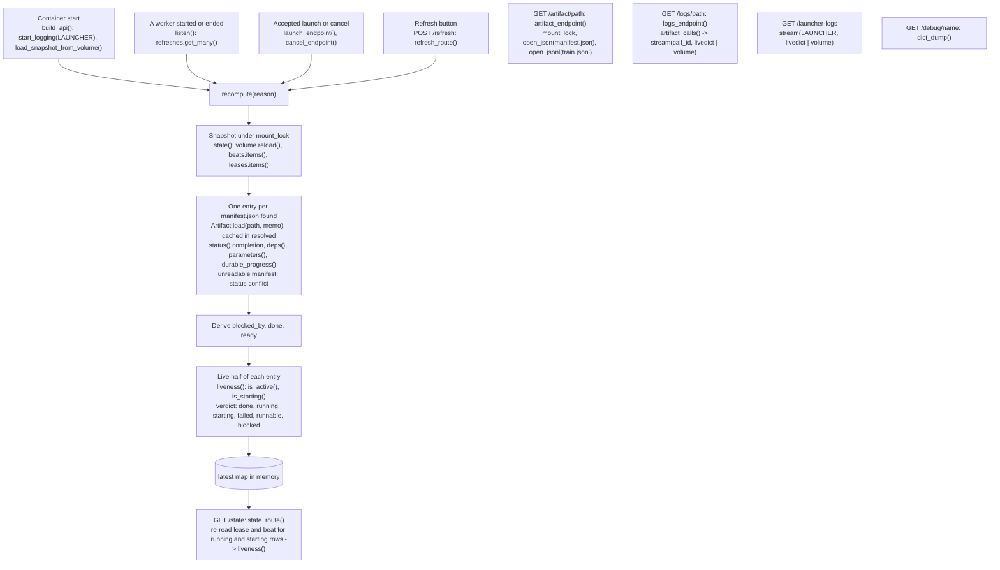

## 11. Logging

From a log call to a row on the page (`system/logs.py`).

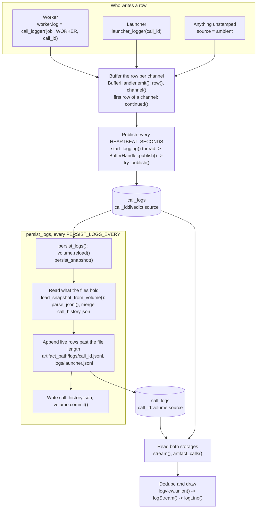

## 12. Artifact families

Moved to [docs/artifacts.md](../docs/artifacts.md#families).

## 13. Training a leg

Moved to [docs/training.md](../docs/training.md#what-the-job-does).

## 14. Dashboard front end

`web/`: `app.js` owns state and the network; `render.js`, `artifactview.js`,
`logview.js` and `filter.js` build DOM through `el.js`.

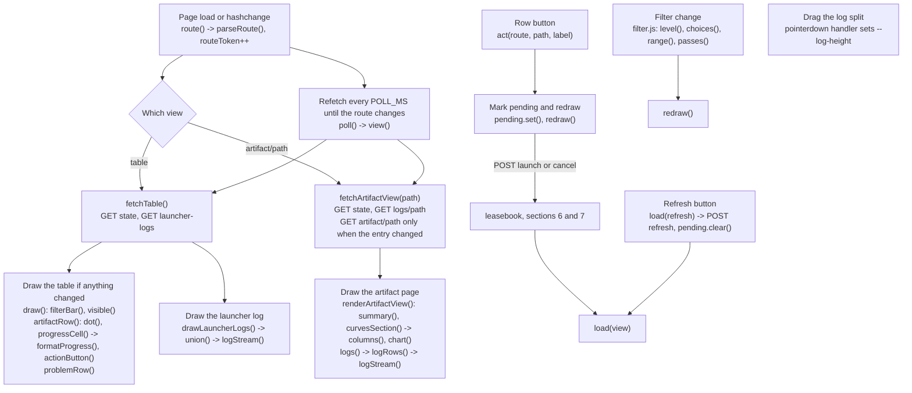

## 15. Auth gate and the lab

Every leasebook request passes the gate first (`launcher/gate.py`,
`launcher/lab_server.py`, `lab.py`).

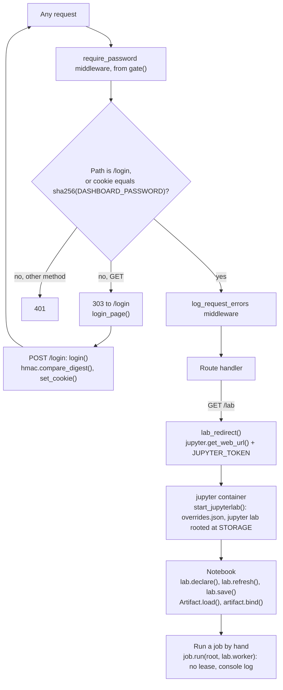

## 16. One-off scripts

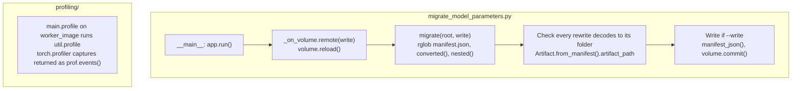
